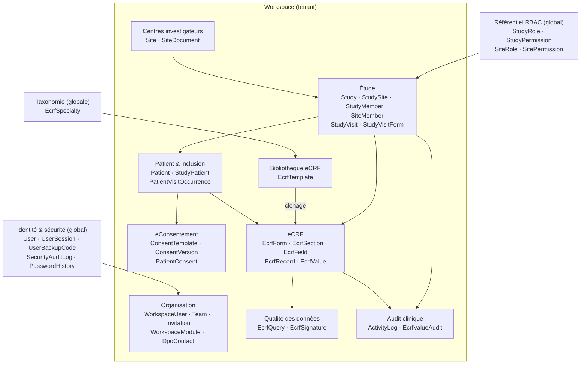
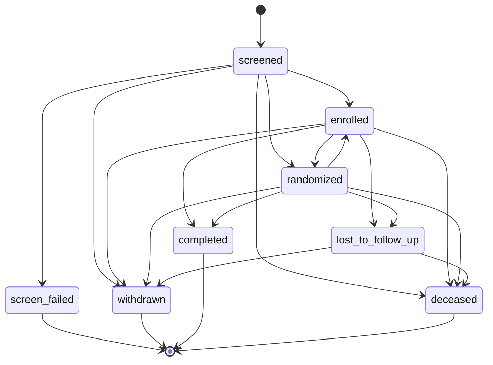
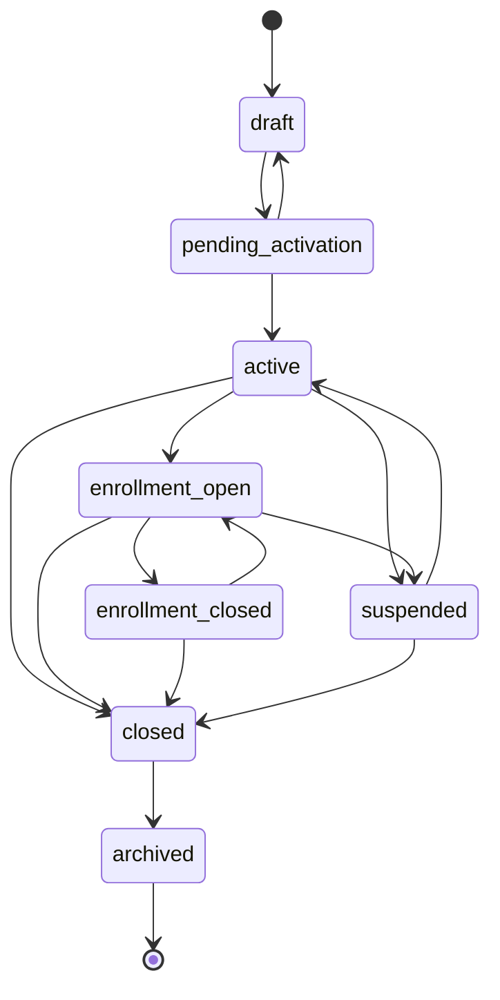

> 🌐 Version française · [English version](/en/3.0/architecture/domain-model/)

Cette page décrit le domaine **d'un point de vue conceptuel** : quels sont les grands
contextes métier, quels objets forment un agrégat cohérent, et quelles règles (invariants)
le code garantit. Elle complète, sans la dupliquer, la page technique
[Modèle de données](/3.0/database/data-model/), qui liste les entités Doctrine, leurs colonnes
et les migrations.

Voir aussi : [Architecture — vue d'ensemble](/3.0/architecture/overview/) ·
[Permissions & contrôle d'accès](/3.0/security/permissions/).

***

## Table des matières

1. [Vocabulaire](#1-vocabulaire)
2. [Carte des contextes](#2-carte-des-contextes)
3. [Agrégats](#3-agrégats)
4. [Invariants clés](#4-invariants-clés)
5. [Cycles de vie](#5-cycles-de-vie)
6. [Référence des enums](#6-référence-des-enums)

***

## 1. Vocabulaire

| Terme métier | Classe | Description |
|--------------|--------|-------------|
| Workspace / Organisation | `Workspace` | Tenant : environnement applicatif totalement isolé |
| Série / Étude | `Study` | Étude clinique sur une maladie ou une indication |
| Centre investigateur | `Site` | Hôpital, clinique ou cabinet participant ; lié à une étude via `StudySite` |
| Patient | `Patient` | Personne suivie ; IPP = `externalId` (chiffré) |
| Inclusion / Sujet | `StudyPatient` | Participation d'un patient à une étude, avec son statut et son `subjectId` |
| Visite | `StudyVisit` / `PatientVisitOccurrence` | Visite prévue au protocole / visite réelle d'un sujet |
| eCRF | `EcrfForm` | Formulaire électronique de recueil de données d'une étude |
| Saisie | `EcrfRecord` | Instance d'un eCRF rempli pour un sujet (et éventuellement une visite) |
| Query / Discordance | `EcrfQuery` | Demande de clarification sur une saisie |
| Signature électronique | `EcrfSignature` | Signature 21 CFR Part 11 d'une saisie |
| Membre | `WorkspaceUser`, `StudyMember`, `SiteMember` | Appartenance d'un utilisateur à un workspace, une étude ou un centre |

:::note[Ancien vocabulaire]
Les noms `StudyField`, `StudyFieldGroup` et l'enum `StudyMemberRole` apparaissent encore
dans d'anciens documents. Ils n'existent plus dans `src/` : les champs de données sont
portés par le module eCRF (`EcrfField`, `EcrfSection`) et les rôles d'étude par l'entité
`StudyRole`.
:::

***

## 2. Carte des contextes

Le domaine se découpe en contextes, tous bornés par le **workspace** :

| Contexte | Rôle | Racine d'agrégat |
|----------|------|------------------|
| **Organisation** | Membres, équipes, invitations, modules activés, DPO | `Workspace` |
| **Identité & sécurité** | Comptes, 2FA, sessions, audit sécurité — **hors workspace** (un utilisateur peut appartenir à plusieurs workspaces) | `User` |
| **RBAC** | Rôles et permissions d'étude et de site, stockés en base | `StudyRole`, `SiteRole` |
| **Centres** | Centres investigateurs du workspace | `Site` |
| **Étude** | Protocole, équipe, centres ouverts, calendrier de visites | `Study` |
| **Patient & inclusion** | Identité patient (PII chiffrées), inclusions, visites réelles | `Patient`, `StudyPatient` |
| **eConsentement** | Modèles versionnés et consentements recueillis (module optionnel) | `ConsentTemplate` |
| **eCRF** | Structure des formulaires et données saisies | `EcrfForm`, `EcrfRecord` |
| **Bibliothèque eCRF** | Modèles réutilisables, classés par spécialité | `EcrfTemplate` |
| **Qualité des données** | Discordances et signatures électroniques | `EcrfQuery`, `EcrfSignature` |
| **Audit clinique** | Piste d'audit GCP chaînée par HMAC | `ActivityLog` |

***

## 3. Agrégats

### Workspace

Le `Workspace` est le **tenant racine**. Il porte ses membres (`WorkspaceUser`, avec un
`WorkspaceRole`), ses équipes (`Team` → `TeamMember`), ses invitations en attente
(`Invitation`), ses modules (`WorkspaceModule`) et son mode DPO (`WorkspaceDpoMode`,
`DpoContact`).

* Une `Invitation` est valable **7 jours** ; elle pré-affecte un rôle, une équipe, des
  sites et des études, et peut imposer la MFA (`enforceMfa`).
* Un membre `guest` reçoit une date d'expiration (`WorkspaceUser.expiresAt`, 90 jours
  par défaut).
* Les modules optionnels (aujourd'hui uniquement `electronic_patient_consent`) sont
  activés par workspace ; `ConsentVoter` refuse l'accès si le module n'est pas `enabled`.

### Étude et centres

`Study` est la racine de l'agrégat étude. Elle regroupe :

* l'**équipe** : `StudyMember` (utilisateur + `StudyRole`, avec expiration possible) ;
* les **centres ouverts** : `StudySite` (lien `Study` ↔ `Site` avec son propre statut
  `StudySiteStatus` et un objectif d'inclusions) et `SiteMember` (utilisateur + `SiteRole`
  sur un centre, pour une étude donnée) ;
* le **calendrier de visites** : `StudyVisit` (jour cible, fenêtre avant/après) et
  `StudyVisitForm` (eCRF attendus à chaque visite) ;
* les **formulaires eCRF** (`EcrfForm`) et la **piste d'audit** (`ActivityLog`).

`Site` est un agrégat distinct : un même centre du workspace peut être ouvert dans
plusieurs études.

### Patient et inclusion

`Patient` porte l'identité (nom, date de naissance, IPP) **chiffrée au repos**, avec des
index aveugles HMAC (`externalIdHash`, `dateOfBirthHash`) pour la recherche exacte. Il
porte aussi les marqueurs RGPD : effacement (`erasedAt`, `PatientErasureLog`) et
limitation du traitement (`processingRestricted`).

`StudyPatient` (l'**inclusion**) relie un patient à une étude et, en multicentrique, à un
`StudySite`. Il porte le `subjectId` (format `{CODE_SITE}-{NNN}`, généré par
`SubjectIdService`, unique par couple étude/centre) et le statut `StudyPatientStatus`.
Les visites réelles sont des `PatientVisitOccurrence` rattachées à l'inclusion.

### eCRF

Architecture **modèle → instance** :

| Niveau | Entités | Remarques |
|--------|---------|-----------|
| Spécialité | `EcrfSpecialty` | Taxonomie globale (nom, icône, couleur) |
| Modèle | `EcrfTemplate` → `EcrfTemplateSection` → `EcrfTemplateField` | Par workspace, versionné, mapping CDISC SDTM (`SdtmClass`) |
| Formulaire | `EcrfForm` → `EcrfSection` → `EcrfField` | Rattaché à une étude ; garde `sourceTemplate` + `sourceTemplateVersion` |
| Saisie | `EcrfRecord` → `EcrfValue` | Une saisie par sujet (et par visite) ; `repeatIndex` pour les sections répétables |
| Intégrité | `EcrfFieldSnapshot`, `EcrfValueAudit` | Définition des champs figée à la saisie ; historique des valeurs |
| Annexes | `EcrfAttachment` | Fichier stocké hors webroot, référencé par un token opaque |

* `EcrfTemplateCloner::cloneIntoStudy()` n'accepte qu'un modèle **publié**.
* Les sections sont **arborescentes** (`parent` / `children`) et peuvent être répétables
  (`minInstances` / `maxInstances`).
* `EcrfField.type` prend l'une des 22 valeurs de `EcrfFieldType` (voir [§6](#6-référence-des-enums)).
* `EcrfRecord` porte un `workspace_id` propre (protégé par RLS) et mémorise la
  `formVersion` utilisée.

### Queries (discordances)

`EcrfQuery` cible une saisie et, optionnellement, un champ. Elle porte une catégorie, un
fil de messages (`EcrfQueryMessage`), l'auteur et le clôtureur. Les transitions passent
par `EcrfQueryService` : `answer()` exige une query `open`, `close()` et `cancel()` exigent
une query encore ouverte (`open` ou `answered`).

### Signatures électroniques

`EcrfSignature` est **immuable** : signataire, nom imprimé, signification
(`SignatureMeaning`), horodatage, IP, User-Agent et `contentHash` des valeurs au moment
de la signature. `EcrfSignatureService::sign()` exige une **ré-authentification par mot
de passe** ; une signature `investigator_review` sur une saisie `completed` la
**verrouille**. `verifyIntegrity()` recalcule le hash pour détecter toute altération.

### Audit

| Piste | Portée | Garanties |
|-------|--------|-----------|
| `ActivityLog` | Actions métier (étude, patient, eCRF…), **workspace non nullable** | Append-only, chaînage HMAC (`integrityHash`), ancienne/nouvelle valeur, motif, rôle, IP |
| `EcrfValueAudit` | Chaque modification de valeur eCRF | Append-only, chaînage (`integrityHash`), `reasonForChange` |
| `SecurityAuditLog` | Connexions, verrouillages, accès refusés | Hors workspace, sans secret ni PII en clair |

Vérification des chaînes : voir la [référence des commandes](/3.0/commands/readme/)
(`app:verify-audit-chain`, `app:audit:verify-chain`).

### Utilisateurs, équipes, RBAC

L'autorisation s'exerce sur **trois niveaux**, tous bornés par le workspace actif :

| Niveau | Support | Nature |
|--------|---------|--------|
| Workspace | `WorkspaceUser.role` (enum `WorkspaceRole`) | Rôle unique par workspace |
| Étude | `StudyMember.studyRole` (entité `StudyRole`) | Hiérarchique (`hierarchyLevel` 0 = viewer, 1 = manager, 2 = admin) |
| Centre | `SiteMember.siteRole` (entité `SiteRole`) | Par capacités (non hiérarchique) |

Les rôles `isSystem = true` sont créés par migration et ne doivent pas être supprimés.
Les voters exposent `STUDY_VIEW` / `STUDY_MANAGE` / `STUDY_ADMIN` (`StudyVoter`) et
`SITE_VIEW` / `SITE_ENTER_DATA` / `SITE_MANAGE_QUERIES` (`SiteVoter`). Le détail des
rôles et des matrices de droits est sur la page [Permissions](/3.0/security/permissions/).

`User` porte aussi une catégorie professionnelle (`UserCategory`) et l'état de sécurité du
compte (2FA, verrouillage, expiration du mot de passe, soft-delete).

***

## 4. Invariants clés

### Isolation par workspace

* Toute racine d'agrégat métier porte un `workspace_id` non nullable ; les entités
  enfants (sections, champs, valeurs, membres d'étude…) héritent de la portée de leur
  racine.
* **Jamais de chargement par ID seul** : les repositories filtrent par workspace, les
  voters vérifient `resource.workspace === workspace actif` (`StudyVoter` refuse tout
  accès si aucun workspace n'est actif).
* En base, PostgreSQL Row-Level Security filtre `study`, `patient` et `ecrf_record` via
  la variable `app.workspace_id` positionnée par `WorkspaceRlsSubscriber`.
* Détails : [architecture §5](/3.0/architecture/overview/#5-multi-tenance--isolation).

### Soft delete

`User`, `Study` et `Patient` ne sont jamais supprimés physiquement : `softDelete()`
renseigne `deletedAt`, `restore()` l'annule. Les requêtes de liste excluent
`deletedAt IS NOT NULL`, et `UserChecker` bloque la connexion d'un compte supprimé.
L'effacement RGPD d'un patient est un processus distinct (`ErasePatientService`,
`PatientErasureLog`).

### Cycle de vie de l'étude

Une étude est créée en `draft`. L'action d'archivage (réservée à `STUDY_ADMIN`) la passe
en `archived`. Aucune machine à états n'est imposée dans l'entité : le statut reste
modifiable depuis le formulaire d'édition. La politique de rétention
(`app:retention:check-studies`) ne considère que les études `completed` ou `archived`.

### Gel de l'étude (study freeze)

Indépendant du statut : `Study::freeze()` renseigne `frozenAt` / `frozenBy`. Une étude
gelée **refuse toute nouvelle saisie eCRF**. Gel et dégel sont réservés à
`STUDY_ADMIN` et tracés (`study.frozen`, `study.unfrozen`).

### Cycle de vie du sujet

Les transitions de `StudyPatient` sont **gardées** : `setStatus()` lève une
`LogicException` si la transition n'est pas autorisée (`forceStatus()` contourne la garde,
réservé aux seeders et à l'administration). Seuls les statuts `screened`, `randomized` et
`enrolled` autorisent la saisie (`allowsDataEntry()`). Voir le diagramme [§5](#5-cycles-de-vie).

### Motif de modification (reason for change)

Conformément aux BPC / 21 CFR Part 11, toute modification d'une valeur **déjà
enregistrée** exige un motif (`reason_for_change`) ; la saisie initiale n'en demande pas.
Le motif est stocké dans `EcrfValueAudit.reasonForChange` et inclus dans le hash chaîné.

### Verrouillage des saisies

Une saisie n'est éditable qu'en `draft` ou `in_progress`. Le verrouillage (`lock()`,
`lockedAt` / `lockedBy`) intervient par signature investigateur ou par action d'un
`STUDY_ADMIN`, qui est aussi le seul à pouvoir déverrouiller (action tracée
`ecrf.record.unlocked`). Une revue data-manager (`dmReviewedAt`) peut être posée et
révoquée indépendamment.

***

## 5. Cycles de vie

### Inclusion (`StudyPatientStatus`)

Transitions telles que codées dans `StudyPatientStatus::allowedTransitions()` :

`withdrawn` et `screen_failed` sont masqués de la liste des patients de l'étude
(`isVisibleInList()`).

### Centre dans une étude (`StudySiteStatus`)

Seul `enrollment_open` accepte de nouvelles inclusions ; la saisie est permise en
`active`, `enrollment_open` et `enrollment_closed`.

### Formulaire eCRF (`EcrfFormStatus`)

| Depuis | Vers | Effet |
|--------|------|-------|
| `draft` | `active` | `activate()` incrémente `version` ; la structure n'est modifiable qu'en `draft` |
| `active` | `closed`, `archived` | Plus de nouvelle saisie hors `active` |
| `closed` | `active` (`reopen()`), `archived` | — |
| `archived` | — | Terminal |

Le cycle de vie d'une **saisie** (`EcrfRecordStatus`) et la boucle de résolution des
**queries** sont illustrés dans [Architecture §6](/3.0/architecture/overview/#6-module-ecrf).

***

## 6. Référence des enums

Valeurs issues de `src/Enum` (valeur stockée en base entre backticks).

| Enum | Valeurs |
|------|---------|
| `StudyStatus` | `draft`, `active`, `completed`, `archived` |
| `StudySiteStatus` | `draft`, `pending_activation`, `active`, `enrollment_open`, `enrollment_closed`, `suspended`, `closed`, `archived` |
| `StudyPatientStatus` | `screened`, `randomized`, `enrolled`, `screen_failed`, `withdrawn`, `completed`, `lost_to_follow_up`, `deceased` |
| `PatientVisitStatus` | `planned`, `done`, `missed`, `rescheduled` |
| `GenderType` | `male`, `female`, `other`, `unknown` |
| `EcrfFormStatus` | `draft`, `active`, `closed`, `archived` |
| `EcrfRecordStatus` | `draft`, `in_progress`, `completed`, `locked` |
| `EcrfTemplateStatus` | `draft`, `published`, `archived` |
| `EcrfQueryStatus` | `open`, `answered`, `closed`, `cancelled` |
| `EcrfFieldType` | `text`, `textarea`, `number`, `date`, `boolean`, `color`, `select`, `radio`, `checkbox_group`, `email`, `phone`, `image`, `gallery`, `scale`, `file_pdf`, `matrix`, `static_note`, `static_instructions`, `static_image`, `static_separator`, `signature`, `calculated` |
| `SdtmClass` | `findings`, `events`, `interventions`, `special_purpose`, `relationship` |
| `SignatureMeaning` | `investigator_review`, `data_manager_review`, `sponsor_review` |
| `ConsentKind` | `participation`, `data_processing`, `communication`, `secondary_data_reuse` |
| `ConsentMode` | `simple`, `signed` |
| `ConsentVersionStatus` | `draft`, `published`, `archived` |
| `WorkspaceRole` | `owner`, `admin`, `member`, `guest` |
| `WorkspaceModuleStatus` | `enabled`, `subscribed_disabled`, `unavailable` |
| `ModuleCode` | `electronic_patient_consent` |
| `WorkspaceDpoMode` | `none`, `internal`, `external` |
| `DpoContactType` | `internal`, `external` |
| `UserCategory` | `medecin`, `arc`, `chercheur`, `admin`, `synapse_team`, `service_account`, `internal` |
| `InstitutionType` | `hopital`, `clinique`, `cabinet`, `centre_investigateur`, `autre` |
| `AdminNotificationType` | `profile_update`, `password_reset` |
| `SiteColor` | 10 couleurs hexadécimales (`#3b82f6` bleu … `#6b7280` gris) |
| `TeamAccentColor` | 8 couleurs hexadécimales (`#6d4aff` violet … `#ec4899` rose) |

:::tip[Libellés]
La plupart des enums exposent `label()` (libellé français affiché) et `badgeClass()`
(classe CSS du badge). Les enums à cycle de vie (`StudyPatientStatus`, `StudySiteStatus`,
`EcrfFormStatus`) exposent aussi `allowedTransitions()` / `canTransitionTo()` : ce sont
eux la source de vérité des transitions.
:::
