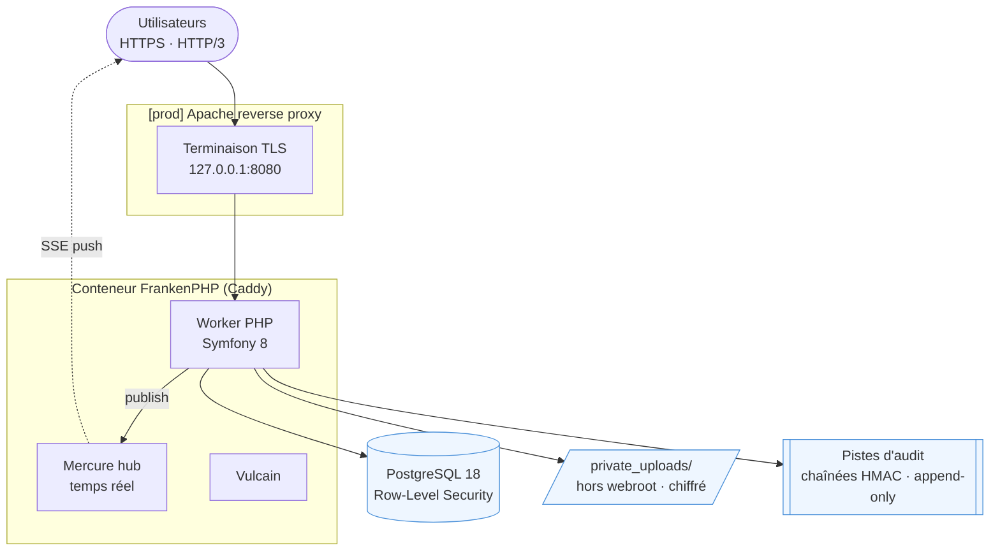
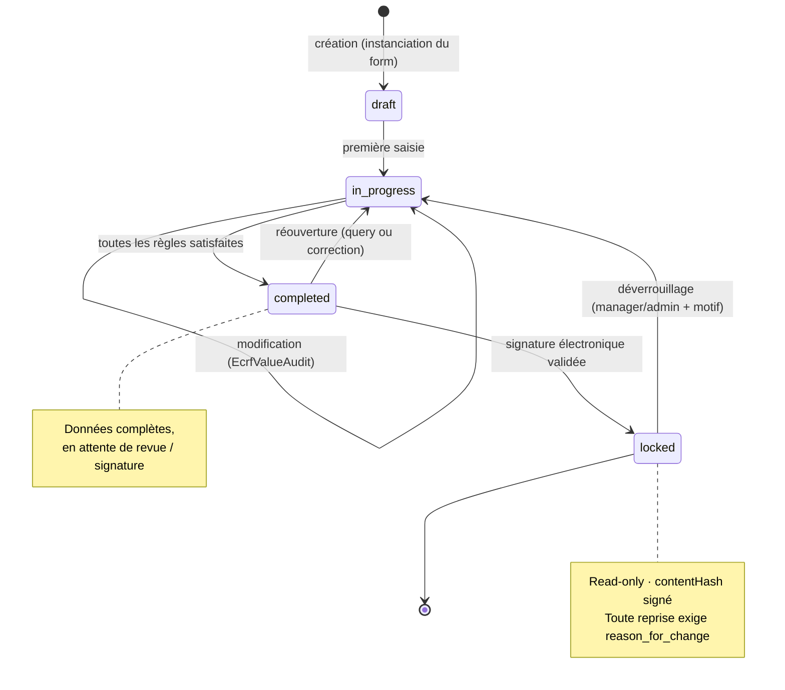
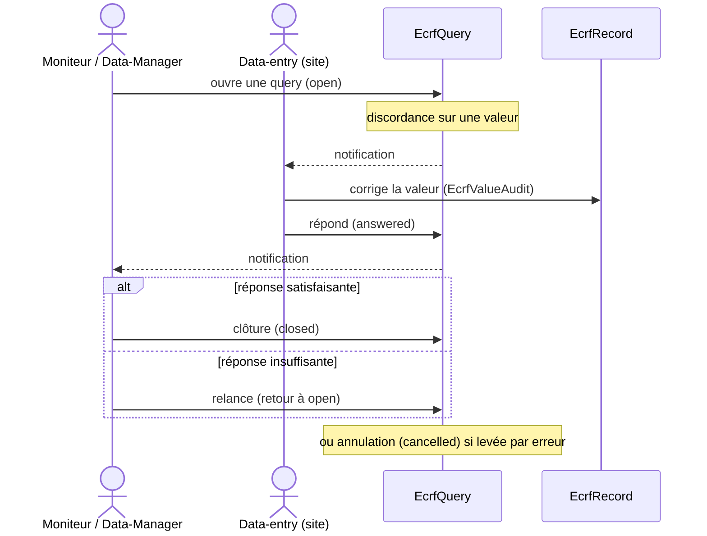

> 🌐 Version française · [English version](/3.0/en/architecture/overview/)

Document de référence sur l'architecture de la plateforme. Pour le détail du code, voir
[Structure du code backend](/3.0/backend/symfony-structure/) ; pour les données, le
[Modèle de données](/3.0/database/data-model/) ; pour la sécurité, la [section dédiée](/3.0/en/security/readme/).

***

## Table des matières

1. [Stack technique](#1-stack-technique)
2. [Vue macroscopique](#2-vue-macroscopique)
3. [Couche applicative](#3-couche-applicative)
4. [Mode worker FrankenPHP](#4-mode-worker-frankenphp)
5. [Multi-tenance & isolation](#5-multi-tenance--isolation)
6. [Module eCRF](#6-module-ecrf)
7. [Flux d'une requête](#7-flux-dune-requête)
8. [Infrastructure & déploiement](#8-infrastructure--déploiement)
9. [Choix d'architecture (ADR)](#9-choix-darchitecture-adr)

***

## 1. Stack technique

| Couche | Technologie | Version |
|--------|-------------|---------|
| Langage | PHP | 8.5 |
| Framework | Symfony | 8.1 |
| Serveur applicatif | FrankenPHP (Caddy) | 1.x — **mode worker** |
| ORM | Doctrine ORM | 3.6 |
| Base de données | PostgreSQL | 16 |
| Temps réel | Mercure | (hub Caddy) |
| Front-end | AssetMapper + importmap + Stimulus | — (sans build Node) |
| Conteneurisation | Docker multi-stage | — |
| 2FA | OTPHP (TOTP) | 11.x |
| Chiffrement | libsodium (`crypto_secretbox`) | natif |

***

## 2. Vue macroscopique



Application **monolithique** : un seul conteneur applicatif embarque le serveur web, le worker PHP, le hub temps réel et le support Vulcain. La base et les sauvegardes sont des services séparés.

***

## 3. Couche applicative

Architecture Symfony en couches, namespace racine `App\` (PSR-4, `src/`).

```
Controller ──▶ Service ──▶ Repository ──▶ Doctrine ──▶ PostgreSQL
    │              │
    │              └─▶ EventListener (chiffrement transparent)
    │
    └─▶ Voter (autorisation) ─▶ AccessService (rôle effectif)

EventSubscriber : transverse (2FA, RLS, sessions, headers, login/logout)
```

| Couche | Responsabilité | Détail |
|--------|----------------|--------|
| Controller (~42) | Point d'entrée HTTP, orchestration | [structure backend](/3.0/backend/symfony-structure/#contrôleurs) |
| Service (~32) | Logique métier | eCRF, chiffrement, accès, GDPR, audit |
| Voter (9) + AccessService | Autorisation fine + isolation workspace | [sécurité](/3.0/security/permissions/) |
| Repository (~47) | Accès données, **toujours filtré workspace** | [modèle de données](/3.0/database/data-model/) |
| EventSubscriber (12) / EventListener (4) | Transverse | [structure backend](/3.0/backend/symfony-structure/#événements) |

***

## 4. Mode worker FrankenPHP

Le process PHP **reste vivant entre les requêtes** (pas de bootstrap à chaque appel) → gain de performance majeur. Conséquence directe pour le code :

> **Tout service portant un état lié à la requête DOIT implémenter `Symfony\Contracts\Service\ResetInterface`** et remettre son état à zéro dans `reset()`.

Patterns appliqués dans le code :

* `ActiveWorkspaceContext`, `StudyAccessService` : cache request-scoped vidé via `ResetInterface`.
* `WorkspaceRlsSubscriber` : variable de session PostgreSQL positionnée à `kernel.request`, **purgée à `kernel.terminate`** (anti-fuite entre requêtes).
* Globals Twig injectées via un subscriber (`kernel.controller`), pas via un état statique.
* Cookies positionnés sur la réponse, pas en variable persistante.

En dev, le worker tourne avec `--watch` (hot reload) ; en prod, `opcache.validate_timestamps=0` + preloading.

***

## 5. Multi-tenance & isolation

Le **Workspace** est la frontière de tenance. Isolation en **défense en profondeur, deux couches** :

1. **Applicatif** — `ActiveWorkspaceContext` (workspace actif en session, ré-validé à chaque accès) ; les **Voters** re-vérifient `resource.workspace === workspace actif`.
2. **Base de données** — **PostgreSQL Row-Level Security** (`FORCE ROW LEVEL SECURITY`) sur `study`, `patient`, `ecrf_record` ; `WorkspaceRlsSubscriber` positionne `app.workspace_id`.

Règle d'or, sans exception :

```php
// ❌ INTERDIT
$study = $repo->find($id);

// ✅ OBLIGATOIRE
$study = $repo->findOneBy(['id' => $id, 'workspace' => $activeWorkspace]);
// ou via un Voter qui vérifie study.workspace === activeWorkspace
```

Détails : [modèle de données](/3.0/database/data-model/) · [sécurité](/3.0/en/security/readme/).

***

## 6. Module eCRF

Le cœur métier (recueil de données) repose sur une architecture **template → instance** :

```
EcrfTemplate ── EcrfTemplateSection ── EcrfTemplateField     (modèles réutilisables, par workspace)
      │  (instanciation + snapshot)
      ▼
EcrfForm ── EcrfSection ── EcrfField                          (formulaire vivant, rattaché à une étude)
      │
      ▼
EcrfRecord ── EcrfValue ── EcrfValueAudit                     (données saisies + historique)
      ├── EcrfSignature   (signature électronique 21 CFR Part 11)
      ├── EcrfAttachment  (fichier, token opaque)
      └── EcrfQuery       (discordances / clarifications)
```

Moteurs serveur associés : `EcrfRuleEngine` (règles conditionnelles), `EcrfFormulaEngine` (champs calculés), `EcrfAuditWriter` (audit chaîné), `EcrfSignatureService` (signatures).

### Workflow de validation d'un eCRF

Cycle de vie d'un `EcrfRecord` (enum `EcrfRecordStatus`). Un record n'est éditable
qu'aux statuts `draft` et `in_progress` (`EcrfRecordStatus::isEditable()`) ; il est
figé en `locked` après signature électronique (21 CFR Part 11).



En parallèle, le **monitoring** lève des discordances (`EcrfQuery`, enum
`EcrfQueryStatus`) ; la boucle de résolution implique le data-entry (site) et le
moniteur/data-manager :



***

## 7. Flux d'une requête

Ordre des subscribers sur une requête authentifiée (priorités indicatives) :

```
kernel.request
  ├─ (auth firewall, 2FA)         TwoFactorSubscriber
  ├─ ForcePasswordChangeSubscriber (-5)
  ├─ SessionInactivitySubscriber  (+5)
  └─ WorkspaceRlsSubscriber       (-128, après auth → SET app.workspace_id)
kernel.controller
  └─ WorkspaceContextSubscriber   (globals Twig workspace)
[ Controller → Service → Repository (RLS actif) → DB ]
kernel.response
  └─ SecurityHeadersSubscriber    (CSP nonce, HSTS, X-Frame-Options…)
kernel.terminate
  └─ WorkspaceRlsSubscriber       (RESET app.workspace_id)
```

***

## 8. Infrastructure & déploiement

Dockerfile **multi-stage** (`dunglas/frankenphp:1.13.1-php8.5.11`) :

| Cible | Base | Usage |
|-------|------|-------|
| `frankenphp_base` | frankenphp | Extensions PHP + Composer |
| `frankenphp_dev` | base + Xdebug | Hot-reload, user non-root |
| `frankenphp_prod_builder` | base | `composer install --no-dev`, compile assets, `dump-env prod` |
| `frankenphp_prod` | `debian:13.7-slim` | Image finale (~150 Mo), `www-data`, OPcache preload |

Compose en couches : `compose.yaml` (base) · `compose.override.yaml` (dev : Mailpit, watch, HTTP/3) · `compose.prod.yaml` (prod : Apache devant, secrets `${VAR:?}`, service `backup`).

Détails : [deployment/](/3.0/deployment/readme/) · [production](/3.0/deployment/production/).

***

## 9. Choix d'architecture (ADR)

Les décisions structurantes sont tracées dans des **Architecture Decision Records** :

* [ADR 0001 — Security foundations](/3.0/en/architecture/adr/0003-security-foundations/)
* [ADR 0001 — Use Symfony Security](/3.0/en/architecture/adr/0001-use-symfony-security/)
* [ADR 0002 — Session timeout server-side](/3.0/en/architecture/adr/0002-session-timeout-server-side/)

> Tout nouveau choix structurant (techno, pattern transverse, compromis de sécurité) doit faire l'objet d'un nouvel ADR — voir [adr/README.md](/3.0/en/architecture/adr/readme/).
