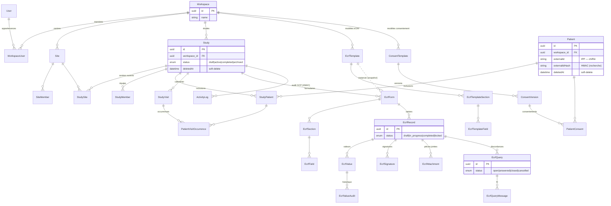

> 🌐 Version française · [English version](/en/database/data-model/)

Entités Doctrine, relations et conventions transverses.
Voir aussi : [Structure du code backend](/backend/symfony-structure/) · [Architecture](/architecture/overview/).

---

## Table des matières

1. [Chiffres clés](#1-chiffres-clés)
2. [Conventions transverses](#2-conventions-transverses)
3. [Schéma global](#3-schéma-global)
4. [Workspace & multi-tenance](#4-workspace--multi-tenance)
5. [Identité & sécurité](#5-identité--sécurité)
6. [Étude & domaine clinique](#6-étude--domaine-clinique)
7. [Patients & consentement](#7-patients--consentement)
8. [eCRF](#8-ecrf)
9. [Audit & traçabilité](#9-audit--traçabilité)
10. [Migrations](#10-migrations)

---

## 1. Chiffres clés

- **~50 entités**, **~25 enums**, **~47 repositories**.
- **2 fonctions DQL custom** (PostgreSQL JSON/text).
- **35 migrations actives** (+ 85 archivées).
- SGBD : **PostgreSQL 18** (avec Row-Level Security sur les tables sensibles).

---

## 2. Conventions transverses

| Convention | Détail |
|------------|--------|
| **`workspace_id`** | Colonne non-nullable, FK vers `workspace`, sur ~16 entités métier. Filtrage obligatoire dans **toutes** les requêtes. |
| **Soft-delete** (`deletedAt`) | Sur les entités à forte valeur réglementaire : `User`, `Study`, `Patient`. |
| **Timestamps** | `createdAt`/`updatedAt` sur les agrégats ; entités d'audit **append-only** (créées, jamais modifiées). |
| **Chiffrement au repos** | PII patient et secret TOTP chiffrés transparemment (listeners Doctrine) + index aveugle HMAC pour la recherche. |
| **Row-Level Security** | `FORCE ROW LEVEL SECURITY` sur `study`, `patient`, `ecrf_record`. |
| **Rôles & permissions** | Modélisés en base (`StudyRole`/`StudyPermission`, `SiteRole`/`SitePermission`), pas seulement en code. |

> **Règle d'or** : ne jamais charger une ressource par son ID seul — toujours vérifier `workspace_id` (repository filtré ou Voter). Voir [architecture/overview.md §5](/architecture/overview/#5-multi-tenance--isolation).

---

## 3. Schéma global

`Workspace` est le **tenant racine** : toutes les entités métier en dépendent (FK `workspace_id`).
Le diagramme ci-dessous montre les agrégats principaux et leurs cardinalités ; les
entités de sécurité hors workspace (`SecurityAuditLog`, `UserSession`, `PasswordHistory`…)
ne sont pas représentées.



---

## 4. Workspace & multi-tenance

| Entité | Rôle | Relations clés |
|--------|------|----------------|
| `Workspace` | Racine de tenance | → `DpoContact`, owner `User`, `WorkspaceUser[]` |
| `WorkspaceUser` | Appartenance User↔Workspace | `role: WorkspaceRole` |
| `WorkspaceModule` | Activation de module | `moduleCode: ModuleCode`, `status` |
| `DpoContact` | Délégué à la protection des données | `type: DpoContactType` |
| `Invitation` | Invitation en attente | rôle, sites/études assignés, `enforceMfa`, `locale` (`fr` ou `en` : langue de l'e-mail et de la page d'acceptation) |
| `Team` / `TeamMember` | Regroupement intra-workspace | — |
| `TherapeuticArea` | Domaine thérapeutique du workspace (28 par défaut, personnalisables) | `workspace_id`, clé stable (`area_key`), libellés FR et EN, `enabled`, `position` ; RLS fermée comme `study` |
| `UserTherapeuticArea` | Sélection par défaut d'un utilisateur dans un workspace | `user_id`, `area_id`, `workspace_id` ; RLS fermée |

Contraintes d'intégrité notables : `WorkspaceUserRepository` garantit **≥ 1 Owner** par workspace ; `UserRepository.findOneByWorkspace` empêche l'assignation cross-workspace.

---

## 5. Identité & sécurité

| Entité | Rôle |
|--------|------|
| `User` | Compte (UserInterface) — soft-delete, MFA, expiration MDP, catégorie |
| `UserSession` | Suivi des sessions (multi-appareils, révocation) |
| `UserBackupCode` | Codes de secours 2FA (hashés) |
| `PasswordHistory` | Anti-réutilisation de mot de passe |
| `PasswordResetToken` | Réinitialisation |
| `AppSetting` | Réglages globaux clé/valeur |
| `AdminNotification` | Notifications admin |

Détails fonctionnels : [security/README.md](/en/security/readme/).

---

## 6. Étude & domaine clinique

| Entité | Rôle |
|--------|------|
| `Study` | Étude clinique (« série ») — soft-delete, `status: StudyStatus` |
| `StudyMember` / `StudyRole` / `StudyPermission` | Membres et droits |
| `StudySite` | Lien étude ↔ centre investigateur |
| `StudyVisit` / `StudyVisitForm` | Calendrier de visites du protocole |
| `StudyFavorite` | Marque-page utilisateur |

`Site`, `SiteMember`, `SiteRole`, `SitePermission`, `SiteDocument` modélisent les centres investigateurs.

**Domaine thérapeutique.** `Study.therapeuticArea` stocke la clé d'un `TherapeuticArea` du workspace (`oncology`, `ophthalmology`, `custom_…`) et `Study.therapeuticAreaOther` le texte libre qui accompagne « Autre » (`other`). Chaque workspace démarre
avec le catalogue par défaut (`App\TherapeuticArea\DefaultAreas`, 28 domaines, libellés FR et EN), amorcé à la première lecture et par la migration pour les workspaces existants. Le propriétaire et les administrateurs du workspace
(`TherapeuticAreaVoter`) activent, désactivent, renomment, réordonnent et ajoutent des domaines depuis le menu « Domaines thérapeutiques » (`/therapeutic-areas`) ; chaque changement est tracé dans le journal d'activité (`therapeutic_area.*`). Un
domaine désactivé n'est plus proposé mais reste affiché sur les études qui l'utilisent ; un domaine par défaut ne se supprime pas, un domaine ajouté se supprime tant qu'aucune étude ne l'utilise. Chaque utilisateur choisit ses domaines par défaut
(page de profil ou lien « Gérer mes domaines » de l'assistant) : ils sont proposés en premier, les autres restent accessibles par la recherche ou « Afficher tous » ; sans sélection, tous les domaines activés sont proposés. Une source unique
(`App\TherapeuticArea\TherapeuticAreas`, `Form\Type\TherapeuticAreaType`) alimente l'assistant, le formulaire d'édition, les récapitulatifs et la fiche imprimable.

**Latéralité (ophtalmologie).** Les études du domaine `ophthalmology` portent des réglages de latéralité (`Study.laterality_unit`, `laterality_eyes`, `laterality_rule`) ; `StudyPatient.studyEyes` (`OD`, `OS`, `OU`) enregistre l'œil de l'étude à l'inclusion. Détail : [Ophtalmologie](/backend/ophtalmologie/).

---

## 7. Patients & consentement

| Entité | Rôle |
|--------|------|
| `Patient` | Patient — **PII chiffrées**, soft-delete, IPP = `externalId` |
| `StudyPatient` | Inclusion patient ↔ étude (`status: StudyPatientStatus`) |
| `PatientVisitOccurrence` | Instance réelle de visite |
| `PatientErasureLog` | Journal d'effacement RGPD (Art. 17) |
| `ConsentTemplate` / `ConsentVersion` / `PatientConsent` | eConsent (RGPD) |

Les colonnes `externalIdHash` / `dateOfBirthHash` (HMAC déterministe) permettent la recherche exacte sur données chiffrées.

---

## 8. eCRF

Architecture **template (réutilisable) → form (instancié par étude)** avec snapshot de définition.

| Niveau | Entités |
|--------|---------|
| Modèles | `EcrfTemplate` ── `EcrfTemplateSection` ── `EcrfTemplateField` |
| Formulaires vivants | `EcrfForm` ── `EcrfSection` ── `EcrfField` |
| Données saisies | `EcrfRecord` ── `EcrfValue` (repeatIndex pour groupes répétables) |
| Audit & intégrité | `EcrfValueAudit`, `EcrfFieldSnapshot` |
| Annexes | `EcrfAttachment` (token opaque), `EcrfSignature` (contentHash), `EcrfQuery` ── `EcrfQueryMessage` |
| Taxonomie | `EcrfSpecialty`, mapping CDISC SDTM (`SdtmClass`) |

Un champ peut être saisi **par œil** (`EcrfField.perEye`) : `EcrfValue.laterality` (`OD`, `OS`, vide sinon), `EcrfValueAudit.laterality` et `EcrfQuery.laterality` portent alors l'œil ; l'index unique des valeurs l'inclut.

`EcrfValueAudit.recordId` est une simple colonne indexée, pas une clé étrangère vers `ecrf_record` : la piste d'audit est immuable (déclencheur de base de données), elle ne suit donc pas la suppression de son enregistrement et ne la bloque pas.
À la purge des données de test d'une étude lors de la mise en production, les enregistrements, valeurs, requêtes, signatures et fichiers des patients de test sont supprimés et leurs entrées d'audit restent telles quelles. Les écrans et les exports atteignent les entrées par leur enregistrement vivant : ces entrées n'y figurent pas.

`EcrfFieldType` couvre ~23 types (texte, date, nombre, signature, matrice, champ calculé, galerie…). Les sections sont **auto-référentielles** (arbre parent/enfants).

Repositories d'intégrité : `EcrfFieldRepository.findOneByIdAndForm`, `EcrfAttachmentRepository` scopent l'accès au record/form parent.

---

## 9. Audit & traçabilité

Deux pistes distinctes, **inviolables par chaînage HMAC-SHA256** :

| Entité | Service | Portée |
|--------|---------|--------|
| `ActivityLog` | `ActivityLogService` + `ActivityLogIntegrityService` | Audit clinique/GCP (21 CFR Part 11 §11.10(e)) — workspace-scopé |
| `SecurityAuditLog` | `SecurityAuditLogger` | Audit sécurité (login, lockout, accès refusé…) — sans secret/PII en clair |

Vérification : `verifyChain()` retourne le point de rupture. Commandes : `app:verify-audit-chain`, `app:audit:verify-chain`.

---

## 10. Migrations

- Répertoire `migrations/` — **35 migrations actives** (fenêtre de consolidation 2026-04-25 → 2026-04-30) + **85 archivées** dans `migrations/_archive/`.
- Les policies RLS sont créées par migration (`Version20260429200000`, `Version20260429500000`).

```bash
make sf c="make:migration"                 # générer
make sf c="doctrine:migrations:migrate"    # appliquer
make sf c="doctrine:schema:validate"       # valider la cohérence ORM ↔ schéma
```

> Toute évolution du schéma passe par une migration versionnée (jamais de modification manuelle de la base).
