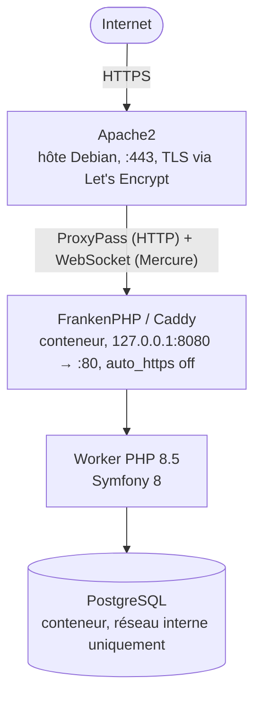

> Architecture cible : Apache2 sur l'hôte Debian gère SSL/TLS et fait office de reverse proxy
> vers FrankenPHP/Caddy qui tourne dans un conteneur Docker en HTTP simple.



---

## 1. Prérequis serveur

### 1.1 Système

```bash
# Debian 12 (Bookworm) recommandé
lsb_release -a

# Mettre à jour
apt update && apt upgrade -y

# Outils de base
apt install -y curl git unzip ufw fail2ban
```

### 1.2 Docker Engine

```bash
# Installation officielle Docker (ne pas utiliser le paquet Debian apt)
curl -fsSL https://get.docker.com | sh

# Vérifier la version (Docker Compose 2.24+ requis pour le tag !reset dans compose.prod.yaml)
docker compose version
# → Docker Compose version v2.24.0 ou supérieur

# Démarrer et activer Docker
systemctl enable --now docker
```

### 1.3 Apache2

```bash
apt install -y apache2

# Modules nécessaires
a2enmod proxy
a2enmod proxy_http
a2enmod proxy_wstunnel   # WebSocket pour Mercure
a2enmod ssl
a2enmod rewrite
a2enmod headers

systemctl restart apache2
```

### 1.4 Certbot (Let's Encrypt)

```bash
apt install -y certbot python3-certbot-apache
```

---

## 2. Configuration Apache2

### 2.1 VirtualHost HTTP → HTTPS (redirect)

Créer `/etc/apache2/sites-available/synapse.conf` :

```apache
# /etc/apache2/sites-available/synapse.conf

# ── Redirect HTTP → HTTPS ─────────────────────────────────────────────────────
<VirtualHost *:80>
    ServerName votre-domaine.fr
    ServerAlias www.votre-domaine.fr

    # Certbot a besoin de servir le challenge ACME avant que HTTPS soit prêt
    RewriteEngine On
    RewriteCond %{REQUEST_URI} !^/\.well-known/acme-challenge/
    RewriteRule ^ https://%{SERVER_NAME}%{REQUEST_URI} [R=301,L]
</VirtualHost>

# ── HTTPS + Reverse proxy vers FrankenPHP ─────────────────────────────────────
<VirtualHost *:443>
    ServerName votre-domaine.fr
    ServerAlias www.votre-domaine.fr

    # ── SSL (rempli automatiquement par Certbot) ──────────────────────────────
    SSLEngine on
    SSLCertificateFile      /etc/letsencrypt/live/votre-domaine.fr/fullchain.pem
    SSLCertificateKeyFile   /etc/letsencrypt/live/votre-domaine.fr/privkey.pem
    Include                 /etc/letsencrypt/options-ssl-apache.conf

    # ── En-têtes de sécurité ──────────────────────────────────────────────────
    Header always set Strict-Transport-Security "max-age=63072000; includeSubDomains; preload"
    Header always set X-Content-Type-Options "nosniff"
    Header always set X-Frame-Options "SAMEORIGIN"
    Header always set Referrer-Policy "strict-origin-when-cross-origin"

    # ── Proxy vers FrankenPHP/Caddy ───────────────────────────────────────────
    # HTTP_PORT = 8080 par défaut (défini dans .env.local)
    ProxyPreserveHost On

    # WebSocket pour Mercure (doit être AVANT le ProxyPass général)
    RewriteEngine On
    RewriteCond %{HTTP:Upgrade} =websocket [NC]
    RewriteRule /.well-known/mercure(.*)  ws://127.0.0.1:8080/.well-known/mercure$1 [P,L]

    ProxyPass        / http://127.0.0.1:8080/
    ProxyPassReverse / http://127.0.0.1:8080/

    # ── Transmettre IP réelle à Symfony ──────────────────────────────────────
    # TRUSTED_PROXIES dans .env.local doit inclure la gateway Docker
    RequestHeader set X-Forwarded-Proto "https"
    RequestHeader set X-Forwarded-Port  "443"

    # ── Logs ─────────────────────────────────────────────────────────────────
    ErrorLog  ${APACHE_LOG_DIR}/synapse-error.log
    CustomLog ${APACHE_LOG_DIR}/synapse-access.log combined
</VirtualHost>
```

### 2.2 Activer le site et obtenir le certificat

```bash
# Activer le site (HTTP d'abord, sans SSL, pour le challenge ACME)
a2ensite synapse.conf
a2dissite 000-default.conf   # désactiver le vhost par défaut
systemctl reload apache2

# Obtenir le certificat (remplacer les domaines)
certbot --apache \
    -d votre-domaine.fr \
    -d www.votre-domaine.fr \
    --non-interactive \
    --agree-tos \
    --email admin@votre-domaine.fr \
    --redirect

# Vérifier le renouvellement automatique
systemctl status certbot.timer
certbot renew --dry-run
```

### 2.3 Vérifier Apache

```bash
apache2ctl configtest   # → Syntax OK
systemctl status apache2
curl -I http://votre-domaine.fr   # doit rediriger 301 → https
curl -I https://votre-domaine.fr  # doit retourner 502 (FrankenPHP pas encore lancé)
```

---

## 3. Découverte de la gateway Docker

Apache proxy vers `127.0.0.1:8080` (hôte). Côté Symfony, le `REMOTE_ADDR` qui arrive
est la gateway Docker du conteneur vers l'hôte — il faut la déclarer dans `TRUSTED_PROXIES`.

```bash
# Après un premier `docker compose up` :
docker network inspect symfony-docker_default | grep Gateway
# → "Gateway": "172.20.0.1"

# La valeur CIDR 172.16.0.0/12 couvre tous les sous-réseaux Docker par défaut.
# Mettre à jour TRUSTED_PROXIES dans .env.local si la gateway est hors de ce range.
```

> La valeur par défaut de `compose.prod.yaml` est `127.0.0.1,172.16.0.0/12`.
> Elle couvre `172.16.x.x` → `172.31.x.x`, ce qui inclut tous les réseaux Docker bridge classiques.

---

## 4. Préparer les secrets

```bash
# Sur le serveur, dans le répertoire du projet
cp .env.local.example .env.local
chmod 600 .env.local
```

Éditer `.env.local` et remplir toutes les valeurs :

```bash
# Générer les clés
openssl rand -hex 32           # → APP_SECRET
openssl rand -hex 32           # → CADDY_MERCURE_JWT_SECRET
openssl rand -base64 24        # → POSTGRES_PASSWORD
php -r "echo base64_encode(random_bytes(32));"  # → APP_TOTP_ENCRYPTION_KEY
php -r "echo base64_encode(random_bytes(32));"  # → APP_PATIENT_ENCRYPTION_KEY
php -r "echo base64_encode(random_bytes(32));"  # → APP_PATIENT_SEARCH_HMAC_KEY
php -r "echo base64_encode(random_bytes(32));"  # → APP_FILE_ENCRYPTION_KEY
```

> **Ne jamais committer `.env.local`.** Il est dans `.gitignore` par défaut.

---

## 5. Procédure de déploiement complète

### 5.1 Premier déploiement

```bash
# ── 1. Cloner le dépôt ───────────────────────────────────────────────────────
cd /opt
git clone git@github.com:votre-org/synapse-app.git synapse
cd synapse

# ── 2. Créer .env.local ──────────────────────────────────────────────────────
cp .env.local.example .env.local
chmod 600 .env.local
# Éditer avec vos valeurs réelles
nano .env.local

# ── 3. Vérifier la gateway Docker (voir §3) ──────────────────────────────────
# Adapter TRUSTED_PROXIES dans .env.local si besoin

# ── 4. Construire l'image de production ─────────────────────────────────────
docker compose -f compose.yaml -f compose.prod.yaml build --pull --no-cache

# ── 5. Démarrer les services ─────────────────────────────────────────────────
docker compose -f compose.yaml -f compose.prod.yaml up -d

# ── 6. Vérifier que tout est sain ────────────────────────────────────────────
docker compose -f compose.yaml -f compose.prod.yaml ps
# Tous les services doivent être "healthy" ou "running"

# ── 7. Vérifier les logs au démarrage ────────────────────────────────────────
docker compose -f compose.yaml -f compose.prod.yaml logs -f php
# Attendre : "PHP app ready!"

# ── 8. Tester le site ────────────────────────────────────────────────────────
curl -I https://votre-domaine.fr
# → HTTP/2 200

# ── 9. Packs réglementaires et premier administrateur ────────────────────────
docker compose -f compose.yaml -f compose.prod.yaml exec php php bin/console app:regulatory-packs:seed
docker compose -f compose.yaml -f compose.prod.yaml exec php php bin/console app:admin:create --email=prenom.nom@exemple.fr
# Mot de passe demandé (masqué) ; changement de mot de passe + 2FA au premier login.
# app:seed est refusé en prod (APP_ALLOW_FAKE_DATA=1 : serveurs de développement uniquement, jamais en production).
```

### 5.2 Déploiement de mise à jour

```bash
cd /opt/synapse

# ── 1. Récupérer les nouveaux commits ────────────────────────────────────────
git pull origin main

# ── 2. Rebuild de l'image (inclut composer install + asset-map:compile) ──────
docker compose -f compose.yaml -f compose.prod.yaml build --pull

# ── 3. Redémarrage avec zero-downtime ────────────────────────────────────────
docker compose -f compose.yaml -f compose.prod.yaml up -d --wait

# Les migrations Doctrine sont appliquées automatiquement au démarrage
# via docker-entrypoint.sh → doctrine:migrations:migrate --no-interaction

# ── 4. Vérifier les logs post-migration ──────────────────────────────────────
docker compose -f compose.yaml -f compose.prod.yaml logs --tail=50 php
```

---

## 6. Alias pratiques (optionnel)

Ajouter dans `/root/.bashrc` ou `/root/.profile` :

```bash
# Raccourcis Docker Compose prod
alias dc='docker compose -f /opt/synapse/compose.yaml -f /opt/synapse/compose.prod.yaml'
alias sf='docker compose -f /opt/synapse/compose.yaml -f /opt/synapse/compose.prod.yaml exec php php bin/console'
alias sflog='docker compose -f /opt/synapse/compose.yaml -f /opt/synapse/compose.prod.yaml logs -f php'

# Exemples d'usage :
# dc ps                          → état des services
# dc logs -f php                 → logs applicatifs
# sf cache:clear                 → vider le cache Symfony
# sf doctrine:migrations:status  → statut des migrations
```

---

## 7. Permissions et répertoires

FrankenPHP en production tourne en tant que `www-data`. Le répertoire `var/` est
géré **à l'intérieur du conteneur** — pas de volume bind-mount sur `var/` en prod.

```bash
# Vérifier depuis l'intérieur du conteneur
docker compose -f compose.yaml -f compose.prod.yaml exec php ls -la var/
# → writable by www-data ✓

# Si un problème de permission survient :
docker compose -f compose.yaml -f compose.prod.yaml exec php \
    chown -R www-data:www-data var/
```

Les fichiers uploadés (`private_uploads/`) sont dans le volume nommé `private_uploads` de `compose.prod.yaml`
(partagé par `php` et `worker`) : voir [Fichiers déposés](/deployment/production/#fichiers-déposés-private_uploads).

---

## 8. Logs

```bash
# Logs applicatifs Symfony (stderr → Docker → ici)
docker compose -f compose.yaml -f compose.prod.yaml logs -f php

# Logs Apache
tail -f /var/log/apache2/synapse-error.log
tail -f /var/log/apache2/synapse-access.log

# Logs PostgreSQL
docker compose -f compose.yaml -f compose.prod.yaml logs -f database

# Logs backup
docker compose -f compose.yaml -f compose.prod.yaml logs -f backup
```

En production, Monolog utilise `fingers_crossed` (voir `config/packages/monolog.yaml`) :
les logs INFO/DEBUG ne sont écrits que si un ERROR survient dans la même requête.
Format JSON pour faciliter l'ingestion dans un SIEM (Wazuh, Graylog…).

---

## 9. Firewall (ufw)

```bash
ufw default deny incoming
ufw default allow outgoing

# SSH (adapter le port si non-standard)
ufw allow 22/tcp

# HTTP et HTTPS (Apache)
ufw allow 80/tcp
ufw allow 443/tcp

# Bloquer l'accès direct à FrankenPHP depuis l'extérieur
# (le port 8080 est déjà lié sur 127.0.0.1 uniquement, pas besoin de règle explicite)

ufw enable
ufw status
```

> Le port 8080 est lié sur `127.0.0.1` uniquement grâce à `ports: ["127.0.0.1:8080:80"]`
> dans `compose.prod.yaml` — le conteneur n'est pas accessible depuis Internet directement.

---

## 10. Redémarrage automatique

Docker restart policy `unless-stopped` est déjà configuré pour tous les services
dans `compose.prod.yaml`. En cas de reboot serveur, Docker Engine redémarre automatiquement
avec `systemctl enable docker` (fait lors de l'installation).

Vérifier :
```bash
systemctl is-enabled docker   # → enabled
docker compose -f compose.yaml -f compose.prod.yaml ps
# → tous "Up" après reboot
```

---

## 11. Migrations Doctrine

Les migrations sont appliquées **automatiquement** au démarrage du conteneur
via `docker-entrypoint.sh` :

```sh
if [ "$(find ./migrations -iname '*.php' -print -quit)" ]; then
    php bin/console doctrine:migrations:migrate --no-interaction --all-or-nothing
fi
```

Pour exécuter manuellement ou vérifier l'état :

```bash
# Statut des migrations
docker compose -f compose.yaml -f compose.prod.yaml exec php \
    php bin/console doctrine:migrations:status

# Forcer une migration en cas de besoin (hors démarrage auto)
docker compose -f compose.yaml -f compose.prod.yaml exec php \
    php bin/console doctrine:migrations:migrate --no-interaction

# Revenir en arrière (avec caution)
docker compose -f compose.yaml -f compose.prod.yaml exec php \
    php bin/console doctrine:migrations:execute --down 'App\Migrations\Version20260424092105'
```

---

## 12. Healthcheck

```bash
# État de tous les services
docker compose -f compose.yaml -f compose.prod.yaml ps

# Test HTTP de bout en bout
curl -f https://votre-domaine.fr/health || echo "ALERTE"

# Test direct vers FrankenPHP (bypass Apache)
curl -f http://127.0.0.1:8080/ -H "Host: votre-domaine.fr"

# PostgreSQL
docker compose -f compose.yaml -f compose.prod.yaml exec database \
    pg_isready -U app -d app
```

Intégration monitoring (Nagios/Zabbix/Uptime Kuma) :

```bash
# Endpoint de santé simple à créer dans Symfony si besoin
# GET /health → 200 OK {"status":"ok"}
```

---

## 13. Checklist de déploiement

### Avant le premier déploiement

- [ ] Debian 12 à jour (`apt upgrade`)
- [ ] Docker Engine ≥ 27 et Docker Compose ≥ 2.24 installés
- [ ] Apache2 installé avec les modules : `proxy`, `proxy_http`, `proxy_wstunnel`, `ssl`, `rewrite`, `headers`
- [ ] Certbot installé
- [ ] DNS `A` et `AAAA` configurés pour le domaine
- [ ] `.env.local` créé avec **toutes** les valeurs (`APP_SECRET`, `POSTGRES_PASSWORD`, les 3 clés de chiffrement, `CADDY_MERCURE_JWT_SECRET`, `DOMAIN`)
- [ ] `TRUSTED_PROXIES` adapté à la gateway Docker réelle
- [ ] `HTTP_PORT=8080` dans `.env.local`
- [ ] `SERVER_NAME=":80, php:80"` dans `.env.local`
- [ ] `CADDY_GLOBAL_OPTIONS=auto_https off` dans `.env.local`
- [ ] VirtualHost Apache2 configuré et certificat SSL obtenu
- [ ] Firewall ufw activé (22, 80, 443 ouverts)
- [ ] `docker compose ... build --pull --no-cache` réussi
- [ ] `docker compose ... up -d --wait` → tous les services "healthy"
- [ ] `curl -I https://votre-domaine.fr` → HTTP/2 200

### À chaque mise à jour

- [ ] `git pull origin main`
- [ ] `docker compose ... build --pull`
- [ ] `docker compose ... up -d --wait`
- [ ] Vérifier les logs : `dc logs --tail=50 php`
- [ ] Vérifier l'état des migrations : `sf doctrine:migrations:status`
- [ ] Test fonctionnel manuel sur le site

---

## 14. Dépannage courant

### 502 Bad Gateway depuis Apache

```bash
# FrankenPHP démarré ?
docker compose -f compose.yaml -f compose.prod.yaml ps php
# → si "Exited" : docker compose ... logs php

# Port bien lié ?
ss -tlnp | grep 8080
# → 127.0.0.1:8080 doit apparaître

# Test direct
curl -v http://127.0.0.1:8080/ -H "Host: votre-domaine.fr"
```

### "The database is not up or not reachable"

```bash
# État du service base de données
docker compose -f compose.yaml -f compose.prod.yaml ps database
docker compose -f compose.yaml -f compose.prod.yaml logs database

# Vérifier DATABASE_URL dans compose.prod.yaml
docker compose -f compose.yaml -f compose.prod.yaml exec php \
    php bin/console dbal:run-sql "SELECT 1"
```

### IP cliente toujours 172.x.x.x dans les logs Symfony

`TRUSTED_PROXIES` n'inclut pas la gateway Docker. Vérifier :

```bash
docker network inspect symfony-docker_default | grep Gateway
# Mettre à jour TRUSTED_PROXIES dans .env.local
# Redémarrer : docker compose ... up -d
```

### Migrations échouent au démarrage

```bash
# Voir l'erreur exacte
docker compose -f compose.yaml -f compose.prod.yaml logs php | grep -A5 "migration"

# Exécuter manuellement pour voir l'erreur complète
docker compose -f compose.yaml -f compose.prod.yaml exec php \
    php bin/console doctrine:migrations:migrate -vvv
```

### Certificat SSL expiré

```bash
certbot renew
systemctl reload apache2
```
