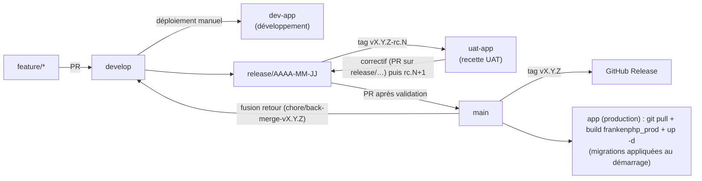

> 🌐 Version française · [English version](/en/deployment/release-process/)

Cette page décrit le chemin complet d'une modification, de la branche de
fonctionnalité jusqu'à la mise en production. La politique de numérotation et
de publication (SemVer, tag, GitHub Release) est définie dans
**[Versions & processus de release](/changelog/releases/)** ; elle n'est pas
répétée ici.

:::note[Processus manuel]
À ce jour, **rien n'est automatisé** côté release : pas de workflow de tag, pas
de génération automatique de GitHub Release, pas de déploiement continu. La CI
(`.github/workflows/ci.yaml`) valide le build et le lint, mais le tag, la
release et le déploiement sont réalisés à la main en suivant cette page.
:::

## Vue d'ensemble



| Environnement | Hôte | Code déployé |
|---------------|------|--------------|
| Développement | `dev-app.synapse-medical.fr` | `develop` |
| Recette (UAT) | `uat-app.synapse-medical.fr` | candidate de release `vX.Y.Z-rc.N` |
| Production | `app.synapse-medical.fr` | `vX.Y.Z` sur `main` |

Les déploiements des trois environnements sont manuels.

| Élément | Emplacement | Rôle |
|---------|-------------|------|
| Journal des modifications | `CHANGELOG.md` (racine) | Format [Keep a Changelog 1.1.0](https://keepachangelog.com/fr/1.1.0/), section `[Unreleased]` |
| Version applicative | Le tag git `vX.Y.Z` (aucun fichier ne la copie) ; `bin/app-version` la calcule au build | Passée en `APP_VERSION` à l'image (`Dockerfile`, `compose.prod.yaml`), affichée par `app_version` (pied de page, page de connexion) |
| Version de la doc | Dépôt `synapse-docs` : `astro.config.mjs` → `src/version.ts` | Dérivée du dernier tag `v*` (voir le dépôt `synapse-docs`) |
| CI | `.github/workflows/ci.yaml` | Build Docker, smoke-tests HTTP/Mercure, migrations + PHPUnit, `composer audit`, lint |
| Image de production | `Dockerfile`, cible `frankenphp_prod` + `compose.prod.yaml` | Image slim `debian:13.7-slim`, utilisateur `www-data` |
| Migrations | `frankenphp/docker-entrypoint.sh` | `doctrine:migrations:migrate --all-or-nothing` au démarrage du conteneur |

## 1. Branches

Le dépôt suit un flux à trois niveaux :

| Branche | Contenu | Alimentée par |
|---------|---------|---------------|
| `feature/*` (ou `feat/*`), `fix/*`, `refactor/*`, `docs/*`, `ci/*`, `chore/*` | Une modification isolée | Création depuis `develop` |
| `develop` | Prochaine version en cours d'intégration | Pull Requests des branches de travail |
| `release/AAAA-MM-JJ` | Promotion de `develop` vers `main`, candidates `vX.Y.Z-rc.N` déployées sur l'UAT | Création depuis `origin/develop` à la demande ; correctifs de recette uniquement |
| `main` | Dernière version publiée | Pull Request `release/…` → `main` |

- Les branches de travail partent **toujours** de `develop` et leur Pull Request
  cible `develop`. On ne commite jamais directement sur `main`.
- Chaque Pull Request doit passer la CI avant fusion (voir [§ 3](#3-ce-que-la-ci-vérifie)).
- Les messages de commit suivent [Conventional Commits](https://www.conventionalcommits.org/),
  en anglais : `type(scope): résumé (#issue)` (voir le [guide de contribution](/contribute/)).
- Il n'existe pas de branche de hotfix depuis `main` : un correctif urgent passe
  aussi par `develop` (branche `fix/*`), puis par une release. Seule exception : un
  défaut trouvé en recette UAT est corrigé sur `release/AAAA-MM-JJ` (voir [§ 5](#5-publier-la-version)).
- `Closes #x` ne ferme automatiquement une issue que lors d'une fusion dans la
  branche par défaut `main`. Après la fusion d'une PR dans `develop`, **fermer
  l'issue à la main**.

## 2. Tenir le changelog au fil de l'eau

Chaque PR qui change un comportement visible ajoute une ligne dans la section
`[Unreleased]` de `CHANGELOG.md`, sous la rubrique adaptée :

| Rubrique | Usage |
|----------|-------|
| `Added` | Nouvelle fonctionnalité |
| `Changed` | Modification d'un comportement existant |
| `Deprecated` | Fonctionnalité appelée à disparaître |
| `Removed` | Fonctionnalité supprimée |
| `Fixed` | Correction de bug |
| `Security` | Correction de vulnérabilité |

Un changement incompatible (qui impose un incrément **MAJOR**) doit aussi être
documenté dans [Changements incompatibles](/changelog/breaking-changes/).

## 3. Ce que la CI vérifie

Le workflow `CI` se déclenche sur chaque **Pull Request**, sur chaque **push sur
`main`** et manuellement (`workflow_dispatch`). Il ne se déclenche **pas** sur un
push direct sur `develop` ni sur un tag.

| Job | Étapes réellement exécutées |
|-----|-----------------------------|
| **Tests** | Ignoré sur une Pull Request qui ne touche que `docs/**` ou des fichiers `*.md`. Build des images (`compose.yaml` + `compose.override.yaml`, donc la cible **dev**), `docker compose up --wait`, `curl` sur `http://localhost`, vérification du hub Mercure (`/.well-known/mercure`), création de la base de test, migrations, **PHPUnit**, `doctrine:schema:validate` |
| **Security** | Sur une Pull Request, uniquement si `composer.json` ou `composer.lock` changent. `composer install` puis `composer audit` (PHP 8.5 via `setup-php`) |
| **Lint** | `super-linter/slim` (YAML, Markdown, Shell, GitHub Actions…), toujours exécuté |

Un job ignoré compte comme réussi pour les vérifications requises. Les failles publiées entre deux changements de dépendances sont détectées par le workflow hebdomadaire `.github/workflows/dependency-audit.yaml` (lundi 05:00 UTC, ou manuellement) : `composer audit` et `importmap:audit` sur `main` et `develop`. En cas de faille, il ouvre (ou met à jour) une issue `security` et échoue.

:::caution[Ce que la CI ne couvre pas]
La CI ne construit pas l'image `frankenphp_prod`. Ce contrôle doit donc être
exécuté **localement** avant chaque release (voir la checklist ci-dessous).
La validation du mapping Doctrine (`doctrine:schema:validate`) est, elle,
exécutée par le job **Tests**.
:::

## 4. Checklist de pré-release

À dérouler sur `develop`, dans l'environnement Docker de développement
(`make up`), avant d'ouvrir la PR de release :

- [ ] **Tests** : `make test` passe sans échec, sans dépréciation ni avertissement
      (PHPUnit est configuré avec `failOnDeprecation`, `failOnNotice`, `failOnWarning`).
- [ ] **Mapping Doctrine** : `make sf c="doctrine:schema:validate"` → mapping et base synchronisés.
- [ ] **Migrations sur base vierge** : les migrations s'appliquent sur une base
      vide, du début à la fin (voir ci-dessous).
- [ ] **Aucune migration manquante** : `make migration` ne génère pas de nouveau
      fichier (supprimer le fichier vide éventuellement créé).
- [ ] **Recette manuelle** : dérouler la [checklist QA de release](/qa/readme/#checklist-de-recette-manuelle).
- [ ] **Build de production** : l'image `frankenphp_prod` se construit sans erreur
      (voir [§ 6](#6-build-de-production)).
- [ ] **Changelog** : section `[Unreleased]` renommée en `[X.Y.Z] - AAAA-MM-JJ`,
      nouvelle section `[Unreleased]` vide ajoutée, liens de comparaison en bas de fichier mis à jour.
- [ ] **Version** : rien à modifier (ni `.env`, ni `.env.local.example`) : elle vient du tag posé à l'étape 3.
- [ ] **Changements incompatibles** documentés si la version est MAJOR.

### Vérifier les migrations sur une base vierge

```bash
# Base de test isolée (suffixe _test, cf. config/packages/doctrine.yaml)
make sf c="-e test doctrine:database:drop --force --if-exists"
make sf c="-e test doctrine:database:create --connection=migrations"  # propriétaire : le rôle applicatif ne crée pas de base
make sf c="-e test doctrine:migrations:migrate --no-interaction --all-or-nothing"
make sf c="-e test doctrine:schema:validate"
```

L'option `--all-or-nothing` est celle utilisée par l'entrypoint en production :
toutes les migrations en attente sont appliquées dans une seule transaction, ou
aucune.

:::caution[Migrations et données chiffrées]
Une migration qui touche des colonnes chiffrées (PII patient, secrets TOTP) doit
être testée sur une copie de base réaliste, pas seulement sur une base vide. Voir
[Déploiement en production](/deployment/production/#3-étapes-post-déploiement)
pour les commandes de backfill associées.
:::

## 5. Publier la version

0. **Archiver la documentation** de la version précédente (nouvelle version mineure ou
   majeure uniquement), dans le dépôt `synapse-docs`, **avant** le commit de release : ce
   commit déclenche la synchronisation du contenu vers le site de développement, qui
   remplacerait les pages actuelles.
   ```bash
   make archive VERSION=2.0   # garde la doc 2.0 en ligne sous /2.0/
   ```
   Commiter le résultat sur `develop` (voir le README de `synapse-docs`).
1. **Commit de release** sur `develop` : changelog daté (aucune version à modifier dans le dépôt), par exemple
   `chore(release): 2.1.0`.
2. **Branche de release**, uniquement sur demande explicite : créer `release/AAAA-MM-JJ`
   depuis `origin/develop` et la pousser. Ne jamais ouvrir une PR dont la branche source est
   `develop` : avec la suppression automatique des branches fusionnées, `develop` serait supprimée.
3. **Candidate de release** : tag annoté `vX.Y.Z-rc.1` sur la pointe de `release/AAAA-MM-JJ`, poussé,
   puis **déploiement manuel de ce tag sur l'UAT** (même procédure qu'au [§ 7](#7-déployer-sur-le-serveur),
   sur la pile UAT). L'application affiche `vX.Y.Z-rc.1`.
   ```bash
   git switch release/2026-11-03 && git pull
   git tag -a v2.1.0-rc.1 -m "Synapse Medical 2.1.0-rc.1"
   git push origin v2.1.0-rc.1
   ```
   Chaque candidate est publiée comme pré-release GitHub (elle indique quel tag est sur l'UAT) ; elle ne devient
   jamais la « dernière » release :
   ```bash
   gh release create v2.1.0-rc.1 --verify-tag --prerelease --title "Synapse Medical 2.1.0-rc.1" \
     --notes "Candidate de release déployée sur l'UAT, voir la section [2.1.0] du CHANGELOG.md"
   ```
4. **Recette** sur l'UAT. Un défaut est corrigé par une PR **vers `release/AAAA-MM-JJ`** (exception à la
   règle « tout passe par `develop` » : seuls des correctifs y entrent, aucune fonctionnalité), puis nouveau tag
   `vX.Y.Z-rc.2` (puis `rc.3`…) et nouveau déploiement UAT. Un correctif déjà fusionné dans `develop` s'y
   reporte par `git cherry-pick -x`. Les correctifs reviennent dans `develop` par la fusion retour (étape 8).
5. **Validation de la recette** par le valideur, puis PR `release/AAAA-MM-JJ` → `main` (titre `Release X.Y.Z`),
   sur le code de la dernière candidate validée. La CI complète s'exécute sur cette PR (la seule, avec le push
   sur `main`) ; fusionner une fois verte, avec un commit de merge.
6. **Tag annoté final** `vX.Y.Z` sur le commit de merge de `main` :
   ```bash
   git switch main && git pull
   git tag -a v2.1.0 -m "Synapse Medical 2.1.0"
   git push origin v2.1.0
   ```
7. **GitHub Release** créée à la main depuis le tag ; les notes reprennent mot pour mot la
   section du `CHANGELOG.md` (voir [Versions & processus de release](/changelog/releases/)).
8. **Fusion retour de `main` dans `develop`** (obligatoire, après chaque release) : sans elle, les tags de
   release ne sont pas atteignables depuis `develop` (`git describe` échoue) et les correctifs faits sur la
   branche de release n'y reviennent pas. Jamais de PR dont la tête est `main` ou `develop` : passer par
   une branche dédiée.
   ```bash
   git fetch origin
   git switch -c chore/back-merge-v2.1.0 origin/develop
   git merge --no-ff origin/main     # conflits de CHANGELOG.md : garder les deux entrées
   git push -u origin chore/back-merge-v2.1.0
   ```
   PR vers `develop`, **fusionnée avec un commit de merge** (jamais en squash ni en rebase, sinon les
   commits taggués restent hors de `develop`). Vérifier ensuite que `git describe --tags origin/develop`
   donne `vX.Y.Z-N-gsha`.
9. **Fermer à la main** les issues des PR fusionnées dans `develop` : `Closes #x` ne
   les ferme automatiquement que pour une fusion dans `main`.
10. **Publier la documentation** : le site de développement (dev-docs.synapse-medical.fr)
    est mis à jour à la demande (workflow manuel) ou à chaque fusion dans `develop` touchant `docs/` ou
    `.env` lorsque la synchronisation automatique est active. Le contenu atteint `main` via la PR de release de `synapse-docs`, et la
    production (docs.synapse-medical.fr) n'est déployée **qu'à la main** (lancement du
    workflow sur `main` dans `synapse-docs`).

:::tip[La version vient du tag, au build]
Le tag `vX.Y.Z` est la **seule source** de la version. `bin/app-version` la calcule au build
(`3.2.0` sur le tag, `3.2.0-3-gdd49366` trois commits plus loin) ; elle est passée en argument de build
(`APP_VERSION`, `APP_REVISION`), figée dans l'image (`ENV APP_VERSION` et labels OCI
`org.opencontainers.image.version` / `revision`) et l'emporte sur la valeur `dev` compilée dans
`.env.local.php`. Il faut donc **exporter `APP_VERSION` avant chaque `build`** (`make build` le fait ;
voir [§ 6](#6-build-de-production)), et ne pas la définir dans `.env.local`. L'application ne lit jamais git à l'exécution.

Les tags sont posés sur le commit de merge de `main`, que `develop` ne contient pas tant que `main` n'y est
pas refusionnée après le tag : cette fusion de `main` dans `develop` (étape 8 du § 5) est nécessaire pour que
`git describe` fonctionne sur `develop` et que celle-ci affiche `vX.Y.Z-N-gsha`. En attendant, `bin/app-version`
retombe sur le dernier tag et le point commun avec `HEAD`, et, sans aucun tag (clone sans tags), sur le SHA court
(affiché `dev-<sha>`). Le site de documentation lit le dernier tag `v*` (PR séparée dans `synapse-docs`).
:::

## 6. Build de production

L'image de production est construite depuis la cible `frankenphp_prod` du
`Dockerfile`, via `compose.prod.yaml` :

| Étape (Dockerfile) | Effet |
|--------------------|-------|
| `frankenphp_prod_builder` | `APP_ENV=prod`, `APP_DEBUG=0`, `DATABASE_URL` factice pour le warmup |
| `composer install --no-dev` | Dépendances de production uniquement |
| `composer dump-autoload --classmap-authoritative` | Autoloader optimisé |
| `composer dump-env prod` | Compile `.env` en `.env.local.php` (`APP_VERSION=dev` y est écrasé par la variable d'environnement de l'image) |
| `frankenphp_prod` (`ARG APP_VERSION`, `APP_REVISION`) | `ENV APP_VERSION` et labels OCI de version et de révision |
| `asset-map:compile` | Compilation des assets AssetMapper |
| `frankenphp_prod` | Image finale `debian:13.7-slim`, bits setuid retirés, exécution en `www-data` |

Le `.dockerignore` exclut `tests/`, `docs/`, `.env.local`, `.env.test` et les
fichiers `compose.*` : l'image ne contient ni les tests ni les secrets. Ceux-ci
sont injectés à l'exécution par `compose.prod.yaml` depuis `.env.local` sur le
serveur (voir [Secrets](/deployment/production/#1-secrets)).

```bash
docker compose -f compose.yaml -f compose.prod.yaml build --pull --no-cache
```

## 7. Déployer sur le serveur

```bash
# 0. Sauvegarde manuelle juste avant la mise à jour (en plus du service backup)
docker compose -f compose.yaml -f compose.prod.yaml exec database \
  pg_dump -U "$POSTGRES_USER" "$POSTGRES_DB" | gzip > pre-v2.1.0_$(date +%Y%m%d%H%M).sql.gz

# 1. Récupérer la version taguée
git fetch --tags && git checkout v2.1.0

# 2. Reconstruire l'image (sans cache)
docker compose -f compose.yaml -f compose.prod.yaml build --pull --no-cache

# 3. Redémarrer ; l'entrypoint attend la base puis applique les migrations
docker compose -f compose.yaml -f compose.prod.yaml up -d
docker compose -f compose.yaml -f compose.prod.yaml logs -f php   # attendre « PHP app ready! »
```

Au démarrage, `frankenphp/docker-entrypoint.sh` :

1. lance `composer install` si `vendor/` est vide ;
2. attend la base de données (60 tentatives, 1 s d'intervalle) ;
3. exécute `doctrine:migrations:migrate --no-interaction --all-or-nothing` si
   `migrations/` contient des fichiers PHP ;
4. affiche `PHP app ready!` puis démarre FrankenPHP.

Si une migration échoue, la transaction est annulée et le conteneur s'arrête
(`set -e`) : consulter `logs php` avant toute autre action.

Enchaîner ensuite les [étapes post-déploiement](/deployment/production/#3-étapes-post-déploiement)
propres à la version et un smoke-test :

- [ ] `curl -I https://<domaine>` → `200`.
- [ ] Connexion avec 2FA, ouverture d'une étude ; la nouvelle version (`vX.Y.Z`) s'affiche sur la page de connexion et dans le pied de page.
- [ ] Hub Mercure joignable (`/.well-known/mercure`).
- [ ] Tous les conteneurs `healthy` / `running`.
- [ ] Le service `worker` a été recréé avec la nouvelle image (`ps` : `healthy`) ; `logs worker` sans erreur répétée. Les messages en échec se consultent avec `messenger:failed:show` (voir [Worker Messenger](/deployment/production/#worker-messenger-imports-en-arrière-plan)).

:::caution[Persistance de `private_uploads/`]
Les fichiers uploadés (avatars, pièces jointes, documents cliniques eCRF, imports archivés) sont dans le volume
nommé `private_uploads` (`compose.prod.yaml`, partagé par `php` et `worker`). Au **premier** déploiement qui
introduit ce volume, copier d'abord les fichiers hors du conteneur (voir
[Fichiers déposés](/deployment/production/#fichiers-déposés-private_uploads)), sous peine de les perdre.
:::

## 8. Rollback

Il n'existe pas de commande de rollback automatisée. La stratégie dépend de la
présence de migrations dans la version :

| Situation | Procédure |
|-----------|-----------|
| **Aucune migration** dans la version | `git checkout v<précédente>`, rebuild, `up -d` |
| **Migration échouée** au démarrage | Rien n'a été appliqué (`--all-or-nothing`) : revenir au tag précédent, rebuild, `up -d` |
| **Migrations appliquées**, schéma à annuler | Restaurer le `pg_dump` pris à l'étape 0 (ou la sauvegarde du service `backup`), puis redéployer le tag précédent |

`doctrine:migrations:migrate prev` est possible si les méthodes `down()` sont
fiables, mais la restauration d'une sauvegarde reste la méthode de référence
pour des données cliniques. Voir [Politique de sauvegarde](/deployment/backup/)
pour la procédure de restauration.

## Voir aussi

- [Versions & processus de release](/changelog/releases/) · [Journal des modifications](/changelog/readme/) · [Changements incompatibles](/changelog/breaking-changes/)
- [Déploiement en production](/deployment/production/) · [Déploiement Debian + Apache + Docker](/deployment/debian-apache-docker/)
- [QA & stratégie de test](/qa/readme/)
