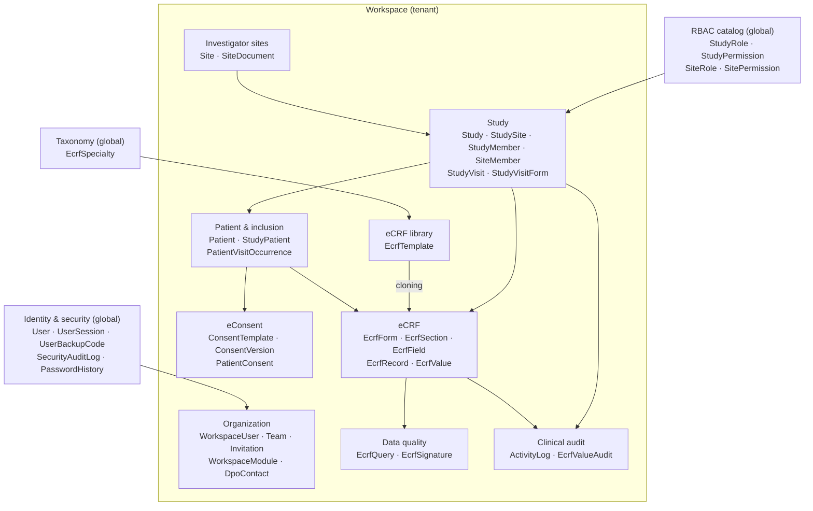
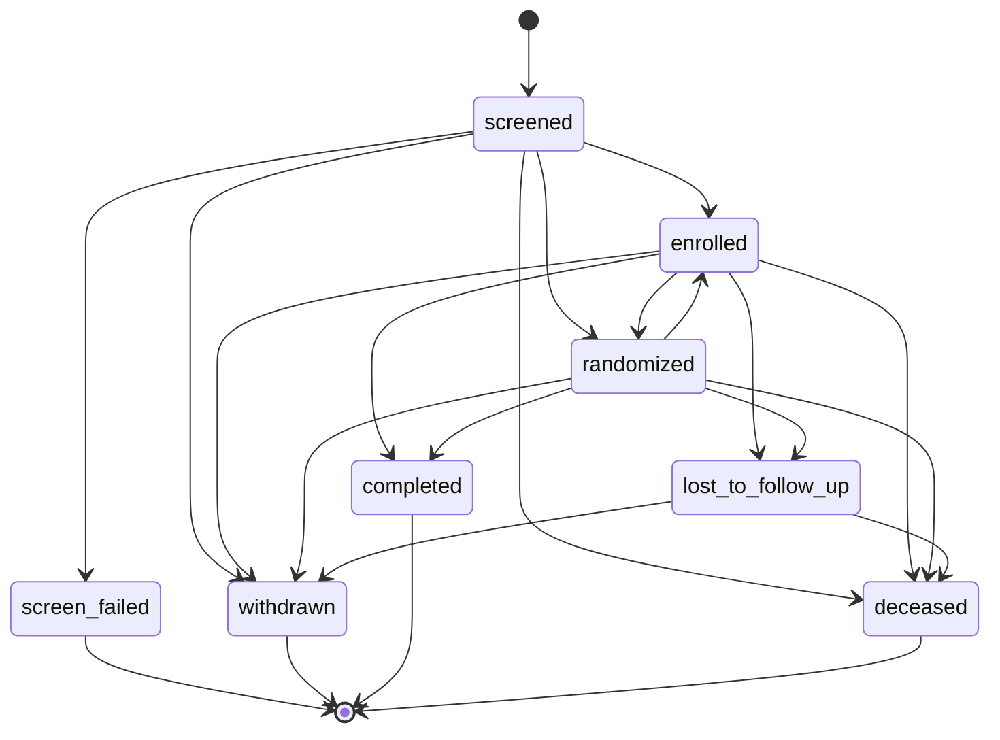
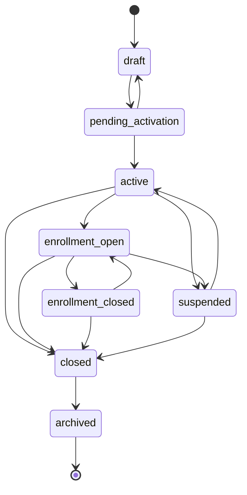

> 🌐 English version · [Version française](/3.1/architecture/domain-model/)

This page describes the domain **conceptually**: which business contexts exist, which
objects form a consistent aggregate, and which rules (invariants) the code enforces. It
complements, without duplicating, the technical [Data model](/en/3.1/database/data-model/)
page, which lists the Doctrine entities, their columns and the migrations.

See also: [Architecture overview](/en/3.1/architecture/overview/) ·
[Permissions & access control](/en/3.1/security/permissions/).

***

## Table of contents

1. [Vocabulary](#1-vocabulary)
2. [Context map](#2-context-map)
3. [Aggregates](#3-aggregates)
4. [Key invariants](#4-key-invariants)
5. [Lifecycles](#5-lifecycles)
6. [Enum reference](#6-enum-reference)

***

## 1. Vocabulary

| Business term | Class | Description |
|---------------|-------|-------------|
| Workspace / Organization | `Workspace` | Tenant: a fully isolated application environment |
| Series / Study | `Study` | Clinical study on a disease or indication ("série" in the French UI) |
| Investigator site | `Site` | Hospital, clinic or practice taking part; linked to a study through `StudySite` |
| Patient | `Patient` | Person being followed; IPP (permanent patient ID) = `externalId` (encrypted) |
| Inclusion / Subject | `StudyPatient` | A patient's participation in a study, with its status and `subjectId` |
| Visit | `StudyVisit` / `PatientVisitOccurrence` | Visit planned by the protocol / actual visit of a subject |
| eCRF | `EcrfForm` | Electronic case report form of a study |
| Record | `EcrfRecord` | One filled-in eCRF for a subject (and optionally a visit) |
| Query / Discrepancy | `EcrfQuery` | Clarification request on a record |
| Electronic signature | `EcrfSignature` | 21 CFR Part 11 signature of a record |
| Member | `WorkspaceUser`, `StudyMember`, `SiteMember` | A user's membership of a workspace, a study or a site |

:::note[Legacy vocabulary]
The names `StudyField`, `StudyFieldGroup` and the `StudyMemberRole` enum still appear in
some older documents. They no longer exist in `src/`: data fields are carried by the eCRF
module (`EcrfField`, `EcrfSection`) and study roles by the `StudyRole` entity.
:::

***

## 2. Context map

The domain is split into contexts, all bounded by the **workspace**:

| Context | Responsibility | Aggregate root |
|---------|----------------|----------------|
| **Organization** | Members, teams, invitations, enabled modules, DPO | `Workspace` |
| **Identity & security** | Accounts, 2FA, sessions, security audit — **outside the workspace** (a user can belong to several workspaces) | `User` |
| **RBAC** | Study and site roles and permissions, stored in the database | `StudyRole`, `SiteRole` |
| **Sites** | The workspace's investigator sites | `Site` |
| **Study** | Protocol, team, opened sites, visit schedule | `Study` |
| **Patient & inclusion** | Patient identity (encrypted PII), inclusions, actual visits | `Patient`, `StudyPatient` |
| **eConsent** | Versioned templates and collected consents (optional module) | `ConsentTemplate` |
| **eCRF** | Form structure and captured data | `EcrfForm`, `EcrfRecord` |
| **eCRF library** | Reusable templates, grouped by specialty | `EcrfTemplate` |
| **Data quality** | Discrepancies and electronic signatures | `EcrfQuery`, `EcrfSignature` |
| **Clinical audit** | HMAC-chained GCP audit trail | `ActivityLog` |

***

## 3. Aggregates

### Workspace

`Workspace` is the **root tenant**. It owns its members (`WorkspaceUser`, with a
`WorkspaceRole`), its teams (`Team` → `TeamMember`), its pending invitations
(`Invitation`), its modules (`WorkspaceModule`) and its DPO mode (`WorkspaceDpoMode`,
`DpoContact`).

* An `Invitation` is valid for **7 days**; it pre-assigns a role, a team, sites and
  studies, and can enforce MFA (`enforceMfa`).
* A `guest` member gets an expiry date (`WorkspaceUser.expiresAt`, 90 days by default).
* Optional modules (currently only `electronic_patient_consent`) are enabled per
  workspace; `ConsentVoter` denies access when the module is not `enabled`.

### Study and sites

`Study` is the root of the study aggregate. It groups:

* the **team**: `StudyMember` (user + `StudyRole`, with an optional expiry);
* the **opened sites**: `StudySite` (`Study` ↔ `Site` link with its own
  `StudySiteStatus` and an enrollment target) and `SiteMember` (user + `SiteRole` on a
  site, for a given study);
* the **visit schedule**: `StudyVisit` (target day, before/after window) and
  `StudyVisitForm` (eCRFs expected at each visit);
* the **eCRF forms** (`EcrfForm`) and the **audit trail** (`ActivityLog`).

`Site` is a separate aggregate: the same workspace site can be opened in several studies.

### Patient and inclusion

`Patient` holds the identity (name, date of birth, IPP) **encrypted at rest**, with HMAC
blind indexes (`externalIdHash`, `dateOfBirthHash`) for exact-match search. It also holds
the GDPR markers: erasure (`erasedAt`, `PatientErasureLog`) and restriction of processing
(`processingRestricted`).

`StudyPatient` (the **inclusion**) links a patient to a study and, in multicentre studies,
to a `StudySite`. It holds the `subjectId` (format `{SITE_CODE}-{NNN}`, generated by
`SubjectIdService`, unique per study/site pair) and the `StudyPatientStatus`. Actual visits
are `PatientVisitOccurrence` rows attached to the inclusion.

### eCRF

**Template → instance** architecture:

| Level | Entities | Notes |
|-------|----------|-------|
| Specialty | `EcrfSpecialty` | Global taxonomy (name, icon, color) |
| Template | `EcrfTemplate` → `EcrfTemplateSection` → `EcrfTemplateField` | Per workspace, versioned, CDISC SDTM mapping (`SdtmClass`) |
| Form | `EcrfForm` → `EcrfSection` → `EcrfField` | Attached to a study; keeps `sourceTemplate` + `sourceTemplateVersion` |
| Record | `EcrfRecord` → `EcrfValue` | One record per subject (and per visit); `repeatIndex` for repeatable sections |
| Integrity | `EcrfFieldSnapshot`, `EcrfValueAudit` | Field definition frozen at capture time; value history |
| Attachments | `EcrfAttachment` | File stored outside the webroot, referenced by an opaque token |

* `EcrfTemplateCloner::cloneIntoStudy()` only accepts a **published** template.
* Sections form a **tree** (`parent` / `children`) and can be repeatable
  (`minInstances` / `maxInstances`).
* `EcrfField.type` takes one of the 22 `EcrfFieldType` values (see [§6](#6-enum-reference)).
* `EcrfRecord` has its own `workspace_id` (protected by RLS) and remembers the
  `formVersion` it was captured with.

### Queries (discrepancies)

`EcrfQuery` targets a record and, optionally, a field. It holds a category, a message
thread (`EcrfQueryMessage`), the author and the user who closed it. Transitions go through
`EcrfQueryService`: `answer()` requires an `open` query; `close()` and `cancel()` require a
query that is still open (`open` or `answered`).

### Electronic signatures

`EcrfSignature` is **immutable**: signer, printed name, meaning (`SignatureMeaning`),
timestamp, IP, User-Agent and a `contentHash` of the values at signing time.
`EcrfSignatureService::sign()` requires **password re-authentication**; an
`investigator_review` signature on a `completed` record **locks** it.
`verifyIntegrity()` recomputes the hash to detect tampering.

### Audit

| Trail | Scope | Guarantees |
|-------|-------|------------|
| `ActivityLog` | Business actions (study, patient, eCRF…), **non-nullable workspace** | Append-only, HMAC chaining (`integrityHash`), old/new value, reason, role, IP |
| `EcrfValueAudit` | Every eCRF value change | Append-only, chained (`integrityHash`), `reasonForChange` |
| `SecurityAuditLog` | Logins, lockouts, denied access | Outside the workspace, no secrets or clear-text PII |

Chain verification: see the [command reference](/en/3.1/commands/readme/)
(`app:verify-audit-chain`, `app:audit:verify-chain`).

### Users, teams, RBAC

Authorization works on **three levels**, all bounded by the active workspace:

| Level | Carried by | Nature |
|-------|------------|--------|
| Workspace | `WorkspaceUser.role` (`WorkspaceRole` enum) | One role per workspace |
| Study | `StudyMember.studyRole` (`StudyRole` entity) | Hierarchical (`hierarchyLevel` 0 = viewer, 1 = manager, 2 = admin) |
| Site | `SiteMember.siteRole` (`SiteRole` entity) | Capability-based (not hierarchical) |

Roles with `isSystem = true` are created by migration and must not be deleted. Voters
expose `STUDY_VIEW` / `STUDY_MANAGE` / `STUDY_ADMIN` (`StudyVoter`) and `SITE_VIEW` /
`SITE_ENTER_DATA` / `SITE_MANAGE_QUERIES` (`SiteVoter`). Roles and permission matrices are
detailed on the [Permissions](/en/3.1/security/permissions/) page.

`User` also holds a professional category (`UserCategory`) and the account security state
(2FA, lockout, password expiry, soft delete).

***

## 4. Key invariants

### Workspace isolation

* Every business aggregate root has a non-nullable `workspace_id`; child entities
  (sections, fields, values, study members…) inherit the scope of their root.
* **Never load by ID alone**: repositories filter by workspace, and voters check
  `resource.workspace === active workspace` (`StudyVoter` denies everything when no
  workspace is active).
* In the database, PostgreSQL Row-Level Security filters `study`, `patient` and
  `ecrf_record` through the `app.workspace_id` variable set by `WorkspaceRlsSubscriber`.
* Details: [architecture §5](/en/3.1/architecture/overview/#5-multi-tenancy--isolation).

### Soft delete

`User`, `Study` and `Patient` are never physically deleted: `softDelete()` sets
`deletedAt`, `restore()` clears it. List queries exclude `deletedAt IS NOT NULL`, and
`UserChecker` blocks login for a deleted account. GDPR erasure of a patient is a separate
process (`ErasePatientService`, `PatientErasureLog`).

### Study lifecycle

A study is created as `draft`. The archive action (restricted to `STUDY_ADMIN`) moves it
to `archived`. No state machine is enforced in the entity: the status can still be changed
from the edit form. The retention policy (`app:retention:check-studies`) only considers
`completed` or `archived` studies.

### Study freeze

Independent of the status: `Study::freeze()` sets `frozenAt` / `frozenBy`. A frozen study
**rejects any new eCRF data entry**. Freezing and unfreezing are restricted to
`STUDY_ADMIN` and logged (`study.frozen`, `study.unfrozen`).

### Subject lifecycle

`StudyPatient` transitions are **guarded**: `setStatus()` throws a `LogicException` when
the transition is not allowed (`forceStatus()` bypasses the guard and is meant for seeders
and administration only). Only `screened`, `randomized` and `enrolled` allow data entry
(`allowsDataEntry()`). See the diagram in [§5](#5-lifecycles).

### Reason for change

Following GCP / 21 CFR Part 11, any change to an **already stored** value requires a
reason (`reason_for_change`); initial entry does not. The reason is stored in
`EcrfValueAudit.reasonForChange` and included in the chained hash.

### Record locking

A record is only editable in `draft` or `in_progress`. Locking (`lock()`, `lockedAt` /
`lockedBy`) happens through an investigator signature or an action by a `STUDY_ADMIN`, who
is also the only one allowed to unlock (logged as `ecrf.record.unlocked`). A data-manager
review (`dmReviewedAt`) can be set and revoked independently.

***

## 5. Lifecycles

### Inclusion (`StudyPatientStatus`)

Transitions as coded in `StudyPatientStatus::allowedTransitions()`:

`withdrawn` and `screen_failed` are hidden from the study's patient list
(`isVisibleInList()`).

### Site within a study (`StudySiteStatus`)

Only `enrollment_open` accepts new inclusions; data entry is allowed in `active`,
`enrollment_open` and `enrollment_closed`.

### eCRF form (`EcrfFormStatus`)

| From | To | Effect |
|------|----|--------|
| `draft` | `active` | `activate()` increments `version`; the structure can only be edited in `draft` |
| `active` | `closed`, `archived` | No new data entry outside `active` |
| `closed` | `active` (`reopen()`), `archived` | — |
| `archived` | — | Terminal |

The **record** lifecycle (`EcrfRecordStatus`) and the **query** resolution loop are
illustrated in [Architecture §6](/en/3.1/architecture/overview/#6-ecrf-module).

***

## 6. Enum reference

Values taken from `src/Enum` (the stored database value is in backticks).

| Enum | Values |
|------|--------|
| `StudyStatus` | `draft`, `active`, `completed`, `archived` |
| `StudySiteStatus` | `draft`, `pending_activation`, `active`, `enrollment_open`, `enrollment_closed`, `suspended`, `closed`, `archived` |
| `StudyPatientStatus` | `screened`, `randomized`, `enrolled`, `screen_failed`, `withdrawn`, `completed`, `lost_to_follow_up`, `deceased` |
| `PatientVisitStatus` | `planned`, `done`, `missed`, `rescheduled` |
| `GenderType` | `male`, `female`, `other`, `unknown` |
| `EcrfFormStatus` | `draft`, `active`, `closed`, `archived` |
| `EcrfRecordStatus` | `draft`, `in_progress`, `completed`, `locked` |
| `EcrfTemplateStatus` | `draft`, `published`, `archived` |
| `EcrfQueryStatus` | `open`, `answered`, `closed`, `cancelled` |
| `EcrfFieldType` | `text`, `textarea`, `number`, `date`, `boolean`, `color`, `select`, `radio`, `checkbox_group`, `email`, `phone`, `image`, `gallery`, `scale`, `file_pdf`, `matrix`, `static_note`, `static_instructions`, `static_image`, `static_separator`, `signature`, `calculated` |
| `SdtmClass` | `findings`, `events`, `interventions`, `special_purpose`, `relationship` |
| `SignatureMeaning` | `investigator_review`, `data_manager_review`, `sponsor_review` |
| `ConsentKind` | `participation`, `data_processing`, `communication`, `secondary_data_reuse` |
| `ConsentMode` | `simple`, `signed` |
| `ConsentVersionStatus` | `draft`, `published`, `archived` |
| `WorkspaceRole` | `owner`, `admin`, `member`, `guest` |
| `WorkspaceModuleStatus` | `enabled`, `subscribed_disabled`, `unavailable` |
| `ModuleCode` | `electronic_patient_consent` |
| `WorkspaceDpoMode` | `none`, `internal`, `external` |
| `DpoContactType` | `internal`, `external` |
| `UserCategory` | `medecin`, `arc`, `chercheur`, `admin`, `synapse_team`, `service_account`, `internal` |
| `InstitutionType` | `hopital`, `clinique`, `cabinet`, `centre_investigateur`, `autre` |
| `AdminNotificationType` | `profile_update`, `password_reset` |
| `SiteColor` | 10 hex colors (`#3b82f6` blue … `#6b7280` gray) |
| `TeamAccentColor` | 8 hex colors (`#6d4aff` violet … `#ec4899` pink) |

:::tip[Labels]
Most enums expose `label()` (French display label) and `badgeClass()` (badge CSS class).
Lifecycle enums (`StudyPatientStatus`, `StudySiteStatus`, `EcrfFormStatus`) also expose
`allowedTransitions()` / `canTransitionTo()`: they are the source of truth for transitions.
:::
