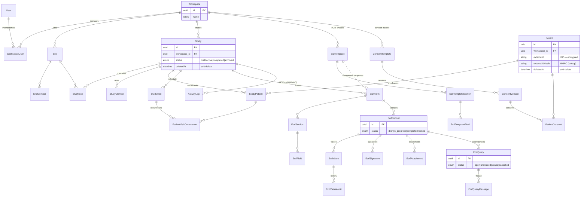

> 🌐 English version · [Version française](/3.2/database/data-model/)

Doctrine entities, relationships and cross-cutting conventions.
See also: [Backend code structure](/en/3.2/backend/symfony-structure/) · [Architecture](/en/3.2/architecture/overview/).

***

## Table of contents

1. [Key figures](#1-key-figures)
2. [Cross-cutting conventions](#2-cross-cutting-conventions)
3. [Global schema](#3-global-schema)
4. [Workspace & multi-tenancy](#4-workspace--multi-tenancy)
5. [Identity & security](#5-identity--security)
6. [Study & clinical domain](#6-study--clinical-domain)
7. [Patients & consent](#7-patients--consent)
8. [eCRF](#8-ecrf)
9. [Audit & traceability](#9-audit--traceability)
10. [Migrations](#10-migrations)

***

## 1. Key figures

* **~50 entities**, **~25 enums**, **~47 repositories**.
* **2 custom DQL functions** (PostgreSQL JSON/text).
* **35 active migrations** (+ 85 archived).
* DBMS: **PostgreSQL 18** (with Row-Level Security on sensitive tables).

***

## 2. Cross-cutting conventions

| Convention | Detail |
|------------|--------|
| **`workspace_id`** | Non-nullable column, FK to `workspace`, on ~16 business entities. Filtering mandatory in **every** query. |
| **Soft-delete** (`deletedAt`) | On high regulatory-value entities: `User`, `Study`, `Patient`. |
| **Timestamps** | `createdAt`/`updatedAt` on aggregates; audit entities are **append-only** (created, never modified). |
| **Encryption at rest** | Patient PII and TOTP secret transparently encrypted (Doctrine listeners) + HMAC blind index for search. |
| **Row-Level Security** | `FORCE ROW LEVEL SECURITY` on `study`, `patient`, `ecrf_record`. |
| **Roles & permissions** | Modeled in the database (`StudyRole`/`StudyPermission`, `SiteRole`/`SitePermission`), not only in code. |

> **Golden rule**: never load a resource by its ID alone — always check `workspace_id` (filtered repository or Voter). See [architecture/overview.md §5](/en/3.2/architecture/overview/#5-multi-tenancy--isolation).

***

## 3. Global schema

`Workspace` is the **tenancy root**: every business entity depends on it (FK `workspace_id`).
The diagram below shows the main aggregates and their cardinalities; out-of-workspace
security entities (`SecurityAuditLog`, `UserSession`, `PasswordHistory`…) are not shown.



***

## 4. Workspace & multi-tenancy

| Entity | Role | Key relationships |
|--------|------|-------------------|
| `Workspace` | Tenancy root | → `DpoContact`, owner `User`, `WorkspaceUser[]` |
| `WorkspaceUser` | User↔Workspace membership | `role: WorkspaceRole` |
| `WorkspaceModule` | Module activation | `moduleCode: ModuleCode`, `status` |
| `DpoContact` | Data Protection Officer | `type: DpoContactType` |
| `Invitation` | Pending invitation | role, assigned sites/studies, `enforceMfa` |
| `Team` / `TeamMember` | Intra-workspace grouping | — |

Notable integrity constraints: `WorkspaceUserRepository` guarantees **≥ 1 Owner** per workspace; `UserRepository.findOneByWorkspace` prevents cross-workspace assignment.

***

## 5. Identity & security

| Entity | Role |
|--------|------|
| `User` | Account (UserInterface) — soft-delete, MFA, password expiry, category |
| `UserSession` | Session tracking (multi-device, revocation) |
| `UserBackupCode` | 2FA backup codes (hashed) |
| `PasswordHistory` | Password reuse prevention |
| `PasswordResetToken` | Reset |
| `AppSetting` | Global key/value settings |
| `AdminNotification` | Admin notifications |

Functional details: [security/README.md](/en/3.2/security/readme/).

***

## 6. Study & clinical domain

| Entity | Role |
|--------|------|
| `Study` | Clinical study ("series") — soft-delete, `status: StudyStatus` |
| `StudyMember` / `StudyRole` / `StudyPermission` | Members and rights |
| `StudySite` | Study ↔ investigation site link |
| `StudyVisit` / `StudyVisitForm` | Protocol visit schedule |
| `StudyFavorite` | User bookmark |

`Site`, `SiteMember`, `SiteRole`, `SitePermission`, `SiteDocument` model the investigation sites.

***

## 7. Patients & consent

| Entity | Role |
|--------|------|
| `Patient` | Patient — **encrypted PII**, soft-delete, IPP = `externalId` |
| `StudyPatient` | Patient ↔ study enrollment (`status: StudyPatientStatus`) |
| `PatientVisitOccurrence` | Actual visit instance |
| `PatientErasureLog` | GDPR erasure log (Art. 17) |
| `ConsentTemplate` / `ConsentVersion` / `PatientConsent` | eConsent (GDPR) |

The `externalIdHash` / `dateOfBirthHash` columns (deterministic HMAC) enable exact-match search over encrypted data.

***

## 8. eCRF

**template (reusable) → form (instantiated per study)** architecture, with a definition snapshot.

| Level | Entities |
|-------|----------|
| Models | `EcrfTemplate` ── `EcrfTemplateSection` ── `EcrfTemplateField` |
| Live forms | `EcrfForm` ── `EcrfSection` ── `EcrfField` |
| Captured data | `EcrfRecord` ── `EcrfValue` (repeatIndex for repeating groups) |
| Audit & integrity | `EcrfValueAudit`, `EcrfFieldSnapshot` |
| Attachments | `EcrfAttachment` (opaque token), `EcrfSignature` (contentHash), `EcrfQuery` ── `EcrfQueryMessage` |
| Taxonomy | `EcrfSpecialty`, CDISC SDTM mapping (`SdtmClass`) |

`EcrfFieldType` covers ~23 types (text, date, number, signature, matrix, calculated field, gallery…). Sections are **self-referencing** (parent/children tree).

Integrity repositories: `EcrfFieldRepository.findOneByIdAndForm`, `EcrfAttachmentRepository` scope access to the parent record/form.

***

## 9. Audit & traceability

Two separate trails, **tamper-evident via HMAC-SHA256 chaining**:

| Entity | Service | Scope |
|--------|---------|-------|
| `ActivityLog` | `ActivityLogService` + `ActivityLogIntegrityService` | Clinical/GCP audit (21 CFR Part 11 §11.10(e)) — workspace-scoped |
| `SecurityAuditLog` | `SecurityAuditLogger` | Security audit (login, lockout, access denied…) — no secret/PII in clear |

Verification: `verifyChain()` returns the break point. Commands: `app:verify-audit-chain`, `app:audit:verify-chain`.

***

## 10. Migrations

* `migrations/` directory — **35 active migrations** (consolidation window 2026-04-25 → 2026-04-30) + **85 archived** in `migrations/_archive/`.
* RLS policies are created by migration (`Version20260429200000`, `Version20260429500000`).

```bash
make sf c="make:migration"                 # generate
make sf c="doctrine:migrations:migrate"    # apply
make sf c="doctrine:schema:validate"       # validate ORM ↔ schema consistency
```

> Any schema change goes through a versioned migration (never a manual database edit).
