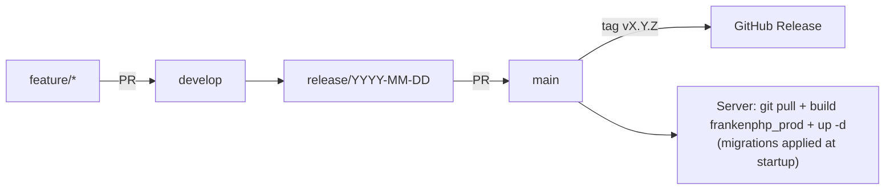

> 🌐 [Version française](/3.2/deployment/release-process/) · English version

This page describes the full path of a change, from the feature branch to
production. The numbering and publishing policy (SemVer, tag, GitHub Release) is
defined in **[Releases & release process](/en/3.2/changelog/releases/)** and is not
repeated here.

:::note[Manual process]
At this time **nothing is automated** on the release side: no tagging workflow,
no automatic GitHub Release, no continuous deployment. CI
(`.github/workflows/ci.yaml`) validates the build and lint, but tagging,
releasing and deploying are done by hand following this page.
:::

## Overview



| Item | Location | Role |
|------|----------|------|
| Changelog | `CHANGELOG.md` (root) | [Keep a Changelog 1.1.0](https://keepachangelog.com/en/1.1.0/) format, `[Unreleased]` section |
| Application version | The git tag `vX.Y.Z` (no file copies it); `bin/app-version` computes it at build time | Passed as `APP_VERSION` to the image (`Dockerfile`, `compose.prod.yaml`), shown through `app_version` (footer, login page) |
| Docs version | `synapse-docs` repository: `astro.config.mjs` → `src/version.ts` | Derived from the latest `v*` tag (see the `synapse-docs` repository) |
| CI | `.github/workflows/ci.yaml` | Docker build, HTTP/Mercure smoke tests, migrations + PHPUnit, `composer audit`, lint |
| Production image | `Dockerfile`, target `frankenphp_prod` + `compose.prod.yaml` | Slim `debian:13.7-slim` image, runs as `www-data` |
| Migrations | `frankenphp/docker-entrypoint.sh` | `doctrine:migrations:migrate --all-or-nothing` on container startup |

## 1. Branches

The repository follows a three-level flow:

| Branch | Content | Fed by |
|--------|---------|--------|
| `feature/*` (or `feat/*`), `fix/*`, `refactor/*`, `docs/*`, `ci/*`, `chore/*` | One isolated change | Created from `develop` |
| `develop` | Next version being integrated | Pull Requests from work branches |
| `release/YYYY-MM-DD` | Promotion of `develop` to `main` | Created from `origin/develop` on request |
| `main` | Latest published version | Pull Request `release/…` → `main` |

* Work branches **always** start from `develop` and their Pull Request targets
  `develop`. Never commit directly to `main`.
* Every Pull Request must pass CI before merging (see [§ 3](#3-what-ci-checks)).
* Commit messages follow [Conventional Commits](https://www.conventionalcommits.org/),
  in English: `type(scope): summary (#issue)` (see the [contribution guide](/en/3.2/contribute/)).
* There is no hotfix branch from `main`: an urgent fix also goes through `develop`
  (`fix/*` branch), then a release.
* `Closes #x` only auto-closes an issue on a merge into the default branch `main`.
  After merging a PR into `develop`, **close the issue by hand**.

## 2. Keep the changelog up to date

Every PR that changes visible behaviour adds a line to the `[Unreleased]`
section of `CHANGELOG.md`, under the matching heading:

| Heading | Use |
|---------|-----|
| `Added` | New feature |
| `Changed` | Change to existing behaviour |
| `Deprecated` | Feature scheduled for removal |
| `Removed` | Feature removed |
| `Fixed` | Bug fix |
| `Security` | Vulnerability fix |

An incompatible change (which requires a **MAJOR** bump) must also be documented
in [Breaking changes](/en/3.2/changelog/breaking-changes/).

## 3. What CI checks

The `CI` workflow runs on every **Pull Request**, on every **push to `main`**, and
manually (`workflow_dispatch`). It does **not** run on a direct push to `develop`
or on a tag.

| Job | Steps actually executed |
|-----|-------------------------|
| **Tests** | Skipped on a Pull Request that only touches `docs/**` or `*.md` files. Builds the images (`compose.yaml` + `compose.override.yaml`, i.e. the **dev** target), `docker compose up --wait`, `curl` on `http://localhost`, Mercure hub check (`/.well-known/mercure`), test database creation, migrations, **PHPUnit**, `doctrine:schema:validate` |
| **Security** | On a Pull Request, only when `composer.json` or `composer.lock` change. `composer install` then `composer audit` (PHP 8.5 via `setup-php`) |
| **Lint** | `super-linter/slim` (YAML, Markdown, Shell, GitHub Actions…), always runs |

A skipped job counts as passed for required checks. Advisories published between two dependency changes are caught by the weekly `.github/workflows/dependency-audit.yaml` workflow (Monday 05:00 UTC, or manually): `composer audit` and `importmap:audit` on `main` and `develop`. On advisories it opens (or updates) a `security` issue and fails.

:::caution[What CI does not cover]
CI does not build the `frankenphp_prod` image. This check must therefore be run
**locally** before every release (see the checklist below). The Doctrine mapping
validation (`doctrine:schema:validate`) is run by the **Tests** job.
:::

## 4. Pre-release checklist

Run on `develop`, in the Docker development environment (`make up`), before
opening the release PR:

* \[ ] **Tests**: `make test` passes with no failure, deprecation or warning
  (PHPUnit is configured with `failOnDeprecation`, `failOnNotice`, `failOnWarning`).
* \[ ] **Doctrine mapping**: `make sf c="doctrine:schema:validate"` → mapping and database in sync.
* \[ ] **Migrations on a fresh database**: migrations apply on an empty database,
  start to finish (see below).
* \[ ] **No missing migration**: `make migration` generates no new file (delete the
  empty file if one was created).
* \[ ] **Manual QA**: run the [release QA checklist](/en/3.2/qa/readme/#manual-qa-checklist).
* \[ ] **Production build**: the `frankenphp_prod` image builds without error
  (see [§ 6](#6-production-build)).
* \[ ] **Changelog**: `[Unreleased]` renamed to `[X.Y.Z] - YYYY-MM-DD`, a new empty
  `[Unreleased]` section added, comparison links at the bottom updated.
* \[ ] **Version**: nothing to edit (neither `.env` nor `.env.local.example`): it comes from the tag created in step 3.
* \[ ] **Breaking changes** documented if the version is MAJOR.

### Check migrations on a fresh database

```bash
# Isolated test database (_test suffix, see config/packages/doctrine.yaml)
make sf c="-e test doctrine:database:drop --force --if-exists"
make sf c="-e test doctrine:database:create --connection=migrations"  # owner: the application role cannot create a database
make sf c="-e test doctrine:migrations:migrate --no-interaction --all-or-nothing"
make sf c="-e test doctrine:schema:validate"
```

`--all-or-nothing` is the option used by the entrypoint in production: all
pending migrations are applied in a single transaction, or none are.

:::caution[Migrations and encrypted data]
A migration touching encrypted columns (patient PII, TOTP secrets) must be
tested on a realistic database copy, not only on an empty database. See
[Production deployment](/en/3.2/deployment/production/) for the related backfill
commands.
:::

## 5. Publish the version

0. **Archive the documentation** of the previous version (new minor or major version
   only), in the `synapse-docs` repository, **before** the release commit: that commit
   triggers the content sync to the development site, which would replace the current pages.
   ```bash
   make archive VERSION=2.0   # keeps the 2.0 docs online under /2.0/
   ```
   Commit the result on `develop` (see the `synapse-docs` README).
1. **Release commit** on `develop`: dated changelog (no version to edit in the repository), e.g.
   `chore(release): 2.1.0`.
2. **Release branch and PR**, only on explicit request: create `release/YYYY-MM-DD`
   from `origin/develop`, push it, then open the PR `release/YYYY-MM-DD` → `main`.
   Never open a PR whose head is `develop`: with auto-delete of merged branches,
   `develop` would be deleted. CI runs on the PR; merge once green.
3. **Annotated tag** on the `main` commit:
   ```bash
   git switch main && git pull
   git tag -a v2.1.0 -m "Release 2.1.0"
   git push origin v2.1.0
   ```
4. **GitHub Release** created by hand from the tag; the notes reuse the
   `CHANGELOG.md` section word for word (see [Releases & release process](/en/3.2/changelog/releases/)).
5. **Close by hand** the issues of the PRs merged into `develop`: `Closes #x` only
   closes them automatically on a merge into `main`.
6. **Publish the documentation**: the development site (dev-docs.synapse-medical.fr)
   is updated automatically on every merge into `develop` that touches `docs/` or
   `.env`. The content reaches `main` through the `synapse-docs` release PR, and
   production (docs.synapse-medical.fr) is deployed **only by hand** (workflow run
   on `main` in `synapse-docs`).

:::tip[The version comes from the tag, at build time]
The `vX.Y.Z` tag is the **single source** of the version. `bin/app-version` computes it at build time
(`3.2.0` on the tag, `3.2.0-3-gdd49366` three commits later); it is passed as a build argument
(`APP_VERSION`, `APP_REVISION`), baked into the image (`ENV APP_VERSION` and the OCI labels
`org.opencontainers.image.version` / `revision`) and overrides the `dev` value compiled into
`.env.local.php`. **Export `APP_VERSION` before every `build`** (`make build` does it; see
[§ 6](#6-production-build)) and do not define it in `.env.local`. The application never reads git at runtime.

Tags sit on the merge commit of `main`, which `develop` does not contain until `main` is merged back after the
tag: that merge of `main` into `develop` (#251) is required for `git describe` to work on `develop` and for it to
show `vX.Y.Z-N-gsha`. Meanwhile `bin/app-version` falls back to the latest tag and the common point with `HEAD`,
and, with no tag at all (clone without tags), to the short SHA (shown as `dev-<sha>`). The documentation site reads
the latest `v*` tag (separate PR in `synapse-docs`).
:::

## 6. Production build

The production image is built from the `frankenphp_prod` target of the
`Dockerfile`, via `compose.prod.yaml`:

| Stage (Dockerfile) | Effect |
|--------------------|--------|
| `frankenphp_prod_builder` | `APP_ENV=prod`, `APP_DEBUG=0`, dummy `DATABASE_URL` for cache warmup |
| `composer install --no-dev` | Production dependencies only |
| `composer dump-autoload --classmap-authoritative` | Optimised autoloader |
| `composer dump-env prod` | Compiles `.env` into `.env.local.php` (`APP_VERSION=dev` there is overridden by the image environment variable) |
| `frankenphp_prod` (`ARG APP_VERSION`, `APP_REVISION`) | `ENV APP_VERSION` and the OCI version and revision labels |
| `asset-map:compile` | AssetMapper asset compilation |
| `frankenphp_prod` | Final `debian:13.7-slim` image, setuid bits stripped, runs as `www-data` |

`.dockerignore` excludes `tests/`, `docs/`, `.env.local`, `.env.test` and the
`compose.*` files: the image contains neither tests nor secrets. Secrets are
injected at runtime by `compose.prod.yaml` from `.env.local` on the server (see
[Secrets](/en/3.2/deployment/production/)).

```bash
docker compose -f compose.yaml -f compose.prod.yaml build --pull --no-cache
```

## 7. Deploy to the server

```bash
# 0. Manual backup right before the update (on top of the backup service)
docker compose -f compose.yaml -f compose.prod.yaml exec database \
  pg_dump -U "$POSTGRES_USER" "$POSTGRES_DB" | gzip > pre-v2.1.0_$(date +%Y%m%d%H%M).sql.gz

# 1. Fetch the tagged version
git fetch --tags && git checkout v2.1.0

# 2. Rebuild the image (no cache)
docker compose -f compose.yaml -f compose.prod.yaml build --pull --no-cache

# 3. Restart; the entrypoint waits for the database then applies migrations
docker compose -f compose.yaml -f compose.prod.yaml up -d
docker compose -f compose.yaml -f compose.prod.yaml logs -f php   # wait for "PHP app ready!"
```

On startup, `frankenphp/docker-entrypoint.sh`:

1. runs `composer install` if `vendor/` is empty;
2. waits for the database (60 attempts, 1 s apart);
3. runs `doctrine:migrations:migrate --no-interaction --all-or-nothing` if
   `migrations/` contains PHP files;
4. prints `PHP app ready!` and starts FrankenPHP.

If a migration fails, the transaction is rolled back and the container stops
(`set -e`): check `logs php` before doing anything else.

Then run the version-specific
[post-deployment steps](/en/3.2/deployment/production/) and a smoke test:

* \[ ] `curl -I https://<domain>` → `200`.
* \[ ] Log in with 2FA, open a study; the new version (`vX.Y.Z`) shows on the login page and in the footer.
* \[ ] Mercure hub reachable (`/.well-known/mercure`).
* \[ ] All containers `healthy` / `running`.
* \[ ] The `worker` service was recreated with the new image (`ps`: `healthy`); `logs worker` shows no repeated error. Failed messages are listed with `messenger:failed:show` (see [Messenger worker](/en/3.2/deployment/production/#messenger-worker-background-imports)).

:::caution[Persisting `private_uploads/`]
Uploaded files (avatars, attachments, clinical eCRF documents, archived imports) are in the `private_uploads`
named volume (`compose.prod.yaml`, shared by `php` and `worker`). On the **first** deployment that introduces
this volume, copy the files out of the container first (see
[Uploaded files](/en/3.2/deployment/production/#uploaded-files-private_uploads)), or they will be lost.
:::

## 8. Rollback

There is no automated rollback command. The strategy depends on whether the
version contains migrations:

| Situation | Procedure |
|-----------|-----------|
| **No migration** in the version | `git checkout v<previous>`, rebuild, `up -d` |
| **Migration failed** at startup | Nothing was applied (`--all-or-nothing`): go back to the previous tag, rebuild, `up -d` |
| **Migrations applied**, schema must be reverted | Restore the `pg_dump` taken in step 0 (or the `backup` service dump), then redeploy the previous tag |

`doctrine:migrations:migrate prev` is possible if the `down()` methods are
reliable, but restoring a backup remains the reference method for clinical
data. See the [Backup policy](/3.2/deployment/backup/) (French) for the restore
procedure.

## See also

* [Releases & release process](/en/3.2/changelog/releases/) · [Changelog](/en/3.2/changelog/readme/) · [Breaking changes](/en/3.2/changelog/breaking-changes/)
* [Production deployment](/en/3.2/deployment/production/) · [Debian + Apache + Docker deployment](/3.2/deployment/debian-apache-docker/) (French)
* [QA & test strategy](/en/3.2/qa/readme/)
