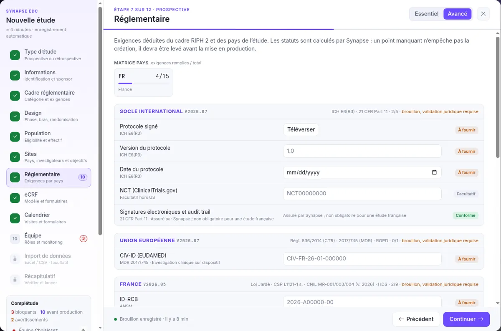

## 7. Regulatory

The requirements derived from the framework and the countries, grouped by pack: international baseline, European Union, France.

| Field | Example | What it is for |
|-------|---------|----------------|
| **Consent form** | Upload a PDF | The document signed by the patient. Uploading it allows identifying data to be kept at import. |
| **ID-RCB** | `2026-A01234-56` | ANSM registration number. An incorrect format is flagged. |
| **CPP opinion** | `Pending` | Opinion of the ethics committee (CPP, Comité de protection des personnes), mandatory before the first enrolment. |
| **Other requirements** | — | If left empty, they become "before production" items and do not block creation. |

## 8. eCRF

The data entry forms (electronic case report form).

| Field | Example | What it is for |
|-------|---------|----------------|
| **eCRF template** | `Start from scratch` | Or a template from the library. The original template is never modified. |
| **Study-specific forms** | `Baseline assessment ↵` | Creates empty forms, to be built after creation. |

:::note[Importing a file?]
Choose "Start from scratch": the fields will be created in the Import step from the columns of the file.
:::

## 9. Visit schedule

The study visits and the forms completed at each one. D0 = enrolment day.

| Field | Example | What it is for |
|-------|---------|----------------|
| **Visit schedule template** | `Interventional` | Pre-fills typical visits; "Blank" to start from scratch. |
| **Visit** | `V1 · Enrolment · D0` | Unique code, name and day relative to enrolment, with a tolerance window. |
| **Visits × forms matrix** | — | Tick the forms to complete at each visit. A visit without a form is blocking. |

## 10. Team

The leads, the monitoring strategy and the members.

| Field | Example | What it is for |
|-------|---------|----------------|
| **Coordinating investigator** \* | `Dr A. Payet` | Coordinates the study across all sites; manager of the whole study at launch. |
| **Sponsor lead** \* | `Mr Durand` | Contact at the sponsor; not necessarily a Synapse user. |
| **Monitoring strategy** \* | `Risk-based (RBQM)` | 100% SDV, targeted according to risk, or centralised monitoring. |
| **Members and permissions** | — | Investigators are included by default. "GCP missing" flags an absent GCP certificate: warning only. |

:::note[Invitations]
Invitation emails are only sent when the study is launched, never before.
:::
