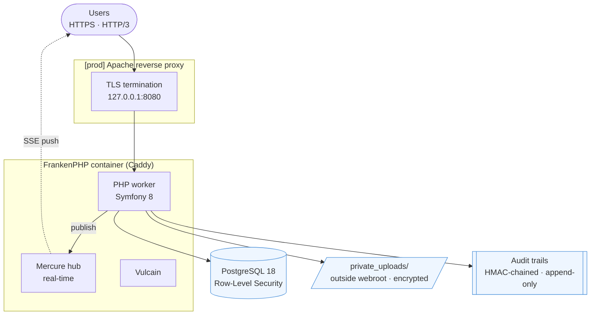
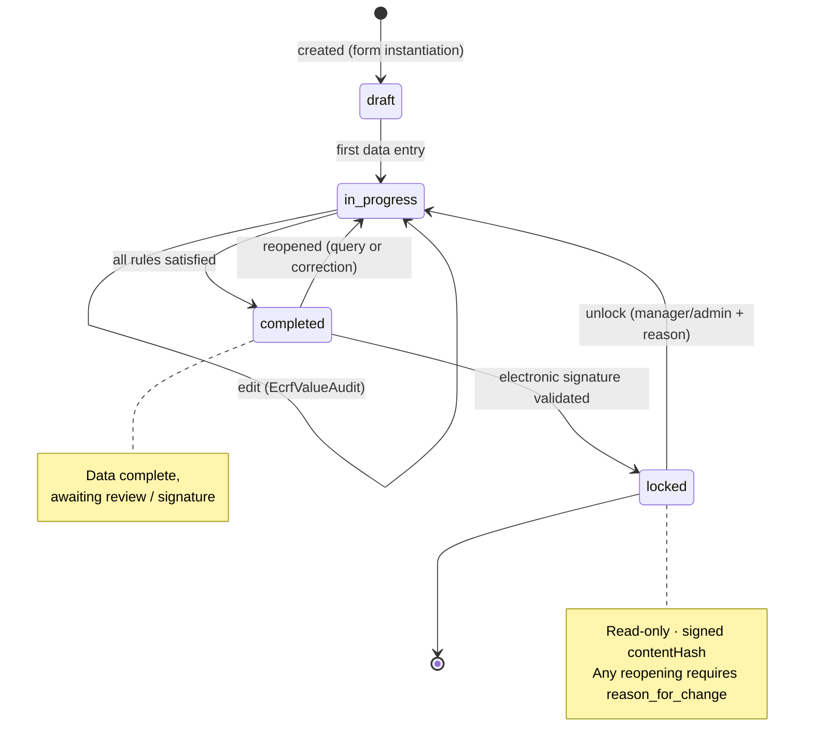
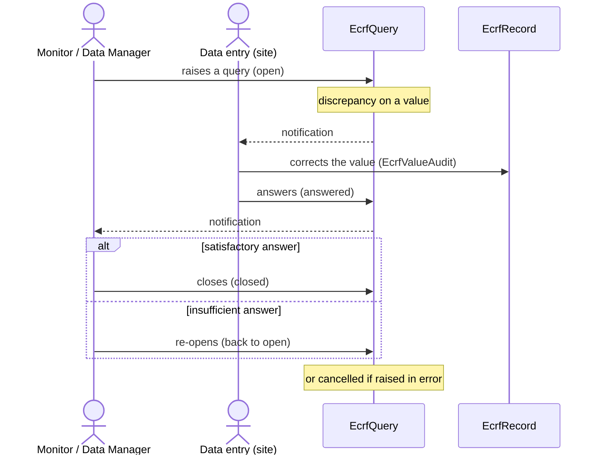

> 🌐 English version · [Version française](/architecture/overview/)

Reference document on the platform architecture. For code details, see the
[Backend code structure](/en/backend/symfony-structure/); for data, the
[Data model](/en/database/data-model/); for security, the [dedicated section](/en/security/readme/).

---

## Table of contents

1. [Technical stack](#1-technical-stack)
2. [High-level view](#2-high-level-view)
3. [Application layer](#3-application-layer)
4. [FrankenPHP worker mode](#4-frankenphp-worker-mode)
5. [Multi-tenancy & isolation](#5-multi-tenancy--isolation)
6. [eCRF module](#6-ecrf-module)
7. [Request lifecycle](#7-request-lifecycle)
8. [Infrastructure & deployment](#8-infrastructure--deployment)
9. [Architecture decisions (ADR)](#9-architecture-decisions-adr)

---

## 1. Technical stack

| Layer | Technology | Version |
|-------|------------|---------|
| Language | PHP | 8.5 |
| Framework | Symfony | 8.1 |
| Application server | FrankenPHP (Caddy) | 1.x — **worker mode** |
| ORM | Doctrine ORM | 3.6 |
| Database | PostgreSQL | 16 |
| Real-time | Mercure | (Caddy hub) |
| Front-end | AssetMapper + importmap + Stimulus | — (no Node build) |
| Containerization | Docker multi-stage | — |
| 2FA | OTPHP (TOTP) | 11.x |
| Encryption | libsodium (`crypto_secretbox`) | native |

---

## 2. High-level view



A **monolithic** application: a single application container embeds the web server, the PHP worker, the real-time hub and Vulcain support. The database and backups are separate services.

---

## 3. Application layer

Layered Symfony architecture, root namespace `App\` (PSR-4, `src/`).

```
Controller ──▶ Service ──▶ Repository ──▶ Doctrine ──▶ PostgreSQL
    │              │
    │              └─▶ EventListener (transparent encryption)
    │
    └─▶ Voter (authorization) ─▶ AccessService (effective role)

EventSubscriber: cross-cutting (2FA, RLS, sessions, headers, login/logout)
```

| Layer | Responsibility | Details |
|-------|----------------|---------|
| Controller (~42) | HTTP entry point, orchestration | [backend structure](/en/backend/symfony-structure/#2-controllers) |
| Service (~32) | Business logic | eCRF, encryption, access, GDPR, audit |
| Voter (9) + AccessService | Fine-grained authorization + workspace isolation | [security](/security/permissions/) |
| Repository (~47) | Data access, **always workspace-filtered** | [data model](/en/database/data-model/) |
| EventSubscriber (12) / EventListener (4) | Cross-cutting | [backend structure](/en/backend/symfony-structure/#5-events) |

---

## 4. FrankenPHP worker mode

The PHP process **stays alive between requests** (no bootstrap on every call) → major performance gain. Direct consequence for the code:

> **Any service holding request-scoped state MUST implement `Symfony\Contracts\Service\ResetInterface`** and reset its state in `reset()`.

Patterns applied in the code:
- `ActiveWorkspaceContext`, `StudyAccessService`: request-scoped cache cleared via `ResetInterface`.
- `WorkspaceRlsSubscriber`: PostgreSQL session variable set at `kernel.request`, **cleared at `kernel.terminate`** (prevents leakage between requests).
- Twig globals injected via a subscriber (`kernel.controller`), not via static state.
- Cookies set on the response, not in a persistent variable.

In dev the worker runs with `--watch` (hot reload); in prod, `opcache.validate_timestamps=0` + preloading.

---

## 5. Multi-tenancy & isolation

The **Workspace** is the tenancy boundary. Isolation uses **defense in depth, two layers**:

1. **Application** — `ActiveWorkspaceContext` (active workspace in session, re-validated on every access); **Voters** re-check `resource.workspace === active workspace`.
2. **Database** — **PostgreSQL Row-Level Security** (`FORCE ROW LEVEL SECURITY`) on `study`, `patient`, `ecrf_record`; `WorkspaceRlsSubscriber` sets `app.workspace_id`.

Golden rule, no exceptions:

```php
// ❌ FORBIDDEN
$study = $repo->find($id);

// ✅ MANDATORY
$study = $repo->findOneBy(['id' => $id, 'workspace' => $activeWorkspace]);
// or via a Voter that checks study.workspace === activeWorkspace
```

Details: [data model](/en/database/data-model/) · [security](/en/security/readme/).

---

## 6. eCRF module

The core business domain (data capture) relies on a **template → instance** architecture:

```
EcrfTemplate ── EcrfTemplateSection ── EcrfTemplateField     (reusable models, per workspace)
      │  (instantiation + snapshot)
      ▼
EcrfForm ── EcrfSection ── EcrfField                          (live form, attached to a study)
      │
      ▼
EcrfRecord ── EcrfValue ── EcrfValueAudit                     (captured data + history)
      ├── EcrfSignature   (electronic signature, 21 CFR Part 11)
      ├── EcrfAttachment  (file, opaque token)
      └── EcrfQuery       (discrepancies / clarifications)
```

Associated server-side engines: `EcrfRuleEngine` (conditional rules), `EcrfFormulaEngine` (calculated fields), `EcrfAuditWriter` (chained audit), `EcrfSignatureService` (signatures).

### eCRF validation workflow

Lifecycle of an `EcrfRecord` (enum `EcrfRecordStatus`). A record is only editable in
the `draft` and `in_progress` states (`EcrfRecordStatus::isEditable()`); it is frozen
in `locked` after an electronic signature (21 CFR Part 11).



In parallel, **monitoring** raises discrepancies (`EcrfQuery`, enum `EcrfQueryStatus`);
the resolution loop involves data entry (site) and the monitor / data manager:



---

## 7. Request lifecycle

Subscriber order on an authenticated request (indicative priorities):

```
kernel.request
  ├─ (auth firewall, 2FA)         TwoFactorSubscriber
  ├─ ForcePasswordChangeSubscriber (-5)
  ├─ SessionInactivitySubscriber  (+5)
  └─ WorkspaceRlsSubscriber       (-128, after auth → SET app.workspace_id)
kernel.controller
  └─ WorkspaceContextSubscriber   (workspace Twig globals)
[ Controller → Service → Repository (RLS active) → DB ]
kernel.response
  └─ SecurityHeadersSubscriber    (CSP nonce, HSTS, X-Frame-Options…)
kernel.terminate
  └─ WorkspaceRlsSubscriber       (RESET app.workspace_id)
```

---

## 8. Infrastructure & deployment

**Multi-stage** Dockerfile (`dunglas/frankenphp:1.13.1-php8.5.11`):

| Target | Base | Purpose |
|--------|------|---------|
| `frankenphp_base` | frankenphp | PHP extensions + Composer |
| `frankenphp_dev` | base + Xdebug | Hot-reload, non-root user |
| `frankenphp_prod_builder` | base | `composer install --no-dev`, compile assets, `dump-env prod` |
| `frankenphp_prod` | `debian:13.7-slim` | Final image (~150 MB), `www-data`, OPcache preload |

Layered Compose: `compose.yaml` (base) · `compose.override.yaml` (dev: Mailpit, watch, HTTP/3) · `compose.prod.yaml` (prod: Apache in front, `${VAR:?}` secrets, `backup` service).

Details: [deployment/](/deployment/readme/) · [production](/en/deployment/production/).

---

## 9. Architecture decisions (ADR)

Structural decisions are recorded as **Architecture Decision Records**:

- [ADR 0001 — Security foundations](/en/architecture/adr/0003-security-foundations/)
- [ADR 0001 — Use Symfony Security](/en/architecture/adr/0001-use-symfony-security/)
- [ADR 0002 — Session timeout server-side](/en/architecture/adr/0002-session-timeout-server-side/)

> Any new structural decision (technology, cross-cutting pattern, security trade-off) must be recorded in a new ADR — see [adr/README.md](/en/architecture/adr/readme/).
