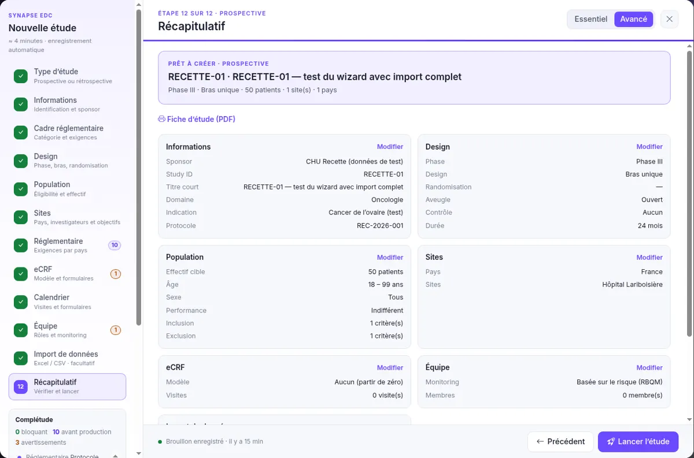

## 12. Summary

Review each block; "Edit" takes you back to the relevant step. The **study sheet (PDF)** summarizes everything.

**What you should see**

- The Completeness panel shows 0 blockers.
- "Launch the study" opens the study on its Configuration page.

## After launch

The study starts with the **Configuration** status. Check:

- **Patients**: the imported patients are present and linked to their site (a few seconds of processing).
- **Members**: the coordinating investigator and the site investigators are members of the study.
- **eCRF**: the forms created open in the designer.
- **Activity**: the creation and the import are logged.

:::note[Moving to production]
The Configuration checklist guides the final steps: country requirements, user acceptance testing (UAT), then dual signature by the Data Manager and the sponsor.
:::
