> 🌐 [Version française](/qa/recette-ophtalmologie/) · English version

This page guides an ophthalmologist tester, with no technical background, through the creation of a prospective ophthalmology study (anti-VEGF treatment of neovascular AMD), then through the entry of measures eye by eye. Each step gives the exact values to enter, what each field means and what you must see: if you do not see it, that is a failure to report.

Duration: **1 h 30 to 2 h**. Data: **fictional only**. Environment: the one the test team gives you (development or UAT, see the [Release process](/en/deployment/release-process/)).

The application screens, including the screenshots of this page, are in French: the labels are quoted as they appear on screen, with a short English gloss where it helps.

Contents: [Before you start](#before-you-start) · [Test file](#test-file) · [Why this path](#why-this-path) · [Step by step](#step-by-step) · [After the launch](#after-the-launch) · [Known issues](#known-issues) · [Reporting a problem](#reporting-a-problem)

:::caution[Fictional data only]
The acceptance environment is not a certified health data host (HDS). Never enter or import real patients: use the values of this page, the test file below and invented names, dates and identifiers.
:::

## Before you start

### Account

Each tester receives an administrator account. At the first login: set up two-factor authentication (an authenticator app such as Google Authenticator), keep the backup codes, then change the password. **Keep that password at hand**: it is used to **sign** the import (step 11), a form (step 23) and, in principle, the go-live signatures.

For step 24 (rights of a monitor), a second account with the site role "ARC moniteur" is needed: ask the test team for it before you start.

### How the wizard saves

- **Autosave**: each modified field is saved in the draft a few seconds after typing ("Brouillon enregistré" at the bottom of the window).
- **Continuer** (Continue) validates the step on the server. A refused step stays displayed, with the message under the field concerned.
- **Complétude** (left column): **bloquant** = prevents launching the study; **avant production** = to be cleared before real inclusions open, does not prevent the launch; **avertissement** = information only. The dots in the left column follow the legend shown under the list of steps.
- Closing the window loses nothing: the **Nouvelle étude** button then offers to resume the draft.
- The **Avancé** mode (button at the top of the window) shows the 12 steps; the Essentiel mode groups several of them and defers the regulatory, schedule and team steps. This test is done **in Avancé mode**.

### Vocabulary

| Term | Meaning |
|------|---------|
| eCRF | Electronic case report form: the data entry forms of the study |
| Query ("discordance") | A question put to the site about a doubtful value; it is open, answered, then closed |
| Principal investigator (PI) | Physician responsible for the study at a site (or for the whole study for the coordinator) |
| ARC (CRA, clinical research associate) | Checks the data for the sponsor, without entering them |
| Sponsor | Organisation responsible for the study (fictional here) |
| Test patient | Patient created during the configuration: marked "TEST", absent from the study exports, deleted at go-live |
| Electronic signature | A signature that requires typing your password again (21 CFR Part 11, a US rule adopted by good clinical practice) |

## Test file

Step 11 imports a small per-eye file. Create it in a text editor (Notepad, for example), save it as `import-recette-ophtalmologie.csv` in **UTF-8**, **semicolon** separated, then drop it at step 11. The first line is the header, one line = one patient.

```text
Identifiant patient;Date de visite;Site;study_eyes;bcva_etdrs_od (Ophtalmologie : visite de suivi);bcva_etdrs_os (Ophtalmologie : visite de suivi);pio_od (Ophtalmologie : visite de suivi);pio_os (Ophtalmologie : visite de suivi)
IMP-001;13/03/2026;LARIB-01;OD;62;70;16;15
IMP-002;14/03/2026;PITIE-01;OG;55;58;14;17
IMP-003;16/03/2026;ZZZ-99;OD;60;66;15;16
IMP-004;17/03/2026;LARIB-01;OD;58;64;900;17
IMP-005;18/03/2026;PITIE-01;OG;61;abc;16;14
IMP-006;2027-13-40;LARIB-01;OD;66;70;15;16
IMP-007;19/03/2026;PITIE-01;XX;64;68;14;15
```

At step 11, the "Télécharger le modèle CSV" button produces the official template of the study: compare its header with the file above. If it differs (column names, form title in brackets), **keep the template's header** and copy the data lines under it. If your sites do not have the codes `LARIB-01` and `PITIE-01` (step 6), replace them in the `Site` column.

### What the file tests

- **Per-eye columns**: `_od` is the right eye, `_os` the left eye (OG is recognised as OS). BCVA in ETDRS letters, IOP in mmHg.
- **`study_eyes`**: the study eye of each patient (OD, OG or OU). The study of this path follows one eye per patient.
- **One anomaly of each kind**, which the "Contrôles" (checks) step must flag:

| Patient | Anomaly | What the checks must display |
|---------|---------|------------------------------|
| IMP-001, IMP-002 | none | nothing |
| IMP-003 | site `ZZZ-99` that does not exist in the study | "Valeur non reconnue" (error) |
| IMP-004 | right eye IOP of 900 mmHg | "Hors plage" (warning: the limit is 80) |
| IMP-005 | left eye BCVA `abc` | "Valeur non reconnue" (error) |
| IMP-006 | visit date `2027-13-40` | "Date invalide" (error), and also "Champ obligatoire vide" for the visit date |
| IMP-007 | study eye `XX` | "Valeur non reconnue" (error) |

- **Days above 12** in the dates (13/03, 14/03…): they remove any day/month ambiguity.
- The identifier of the file becomes the **patient code** (the study keeps no identifying data): the file therefore contains no name and no date of birth.

## Why this path

- **Prospective study, Avancé mode**: only the Avancé mode shows the Réglementaire, Calendrier and Import steps.
- **Drug, non-minimal intervention, new data, sponsor in the EU**: the study falls under the **RIPH 1** category in France (interventional research with a non-minimal risk, Jardé law) and under the European regulation on clinical trials of medicines (**CTR**). These categories set the list of documents to provide at the Réglementaire step.
- **Therapeutic area Ophtalmologie**: shows the "Latéralité (ophtalmologie)" block at the Design step, the choice of the study eye at inclusion and the eCRF fields entered eye by eye.
- **Randomised, double blind**: this study keeps a randomised design only to exercise the screens (randomisation settings, unblinding). The first real studies will not be randomised. No arm is assigned to patients: the "Randomisée" status draws none. The path **stops before go-live**, see "[Known issues](#known-issues)".
- **No consent form deposited**: without a consent document, the study keeps no identifying data. Patients are therefore entered with a **patient code** and a year of birth, never a name.

## Step by step

### Step 1 · Type d'étude (study type)

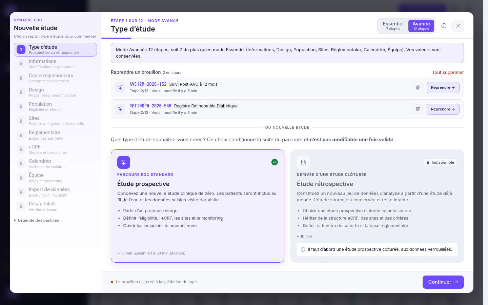

Menu **Études** → **Nouvelle étude** button. In the window header, choose the **Avancé** mode.

| Field | To choose | Explanation |
|-------|-----------|-------------|
| Mode | Avancé | Shows the 12 steps ("12 étapes" on the button). |
| Type | Étude prospective | Patients will be included as they come. The type is **final** after "Continuer". |
| Reprendre un brouillon | do not touch | If an old draft is listed, do not delete it: "Reprendre →" reopens it, the bin deletes it. |

**What you must see**

- [ ] "Continuer" stays grey until a type is chosen.
- [ ] After "Continuer", step 1 is ticked and the card reads "Choix définitif" (the screen says "Étude prospective. Le type est définitif…").

### Step 2 · Informations

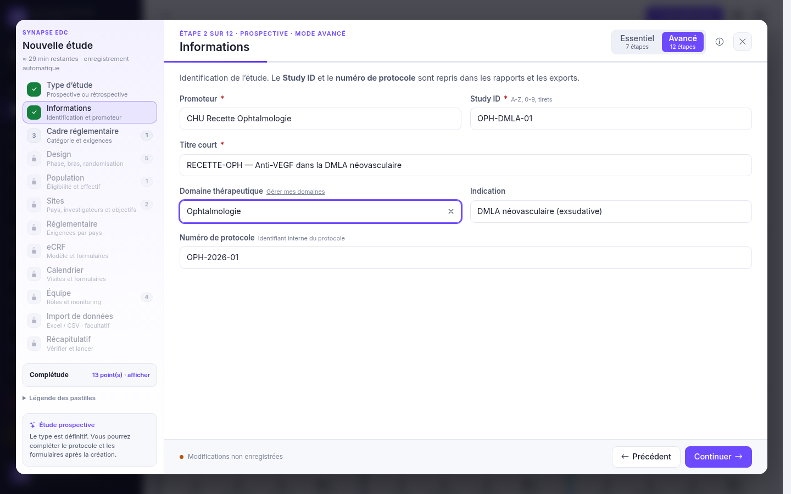

Identification of the study, reused in reports and exports.

| Field | To enter | Explanation |
|-------|----------|-------------|
| Promoteur | `CHU Recette Ophtalmologie` | The organisation responsible for the study. Required. |
| Study ID | `OPH-DMLA-01` | Short, unique code of the study: letters, digits, hyphens. Lower case becomes upper case. Required. |
| Titre court | `RECETTE-OPH — Anti-VEGF dans la DMLA néovasculaire` | The readable name of the study in lists. Required. |
| Domaine thérapeutique | Ophtalmologie | Enables the ophthalmology settings further on. |
| Indication | `DMLA néovasculaire (exsudative)` | The disease studied. |
| Numéro de protocole | `OPH-2026-01` | The sponsor's internal protocol reference, distinct from the Study ID. |

The grey texts in empty fields are **examples**: they disappear when you type.

**What you must see**

- [ ] The Study ID is displayed in capitals.
- [ ] A few seconds after typing, "Brouillon enregistré" appears at the bottom.
- [ ] After "Continuer", the blocking points of the step disappear from the completeness panel.

### Step 3 · Cadre réglementaire (regulatory framework)

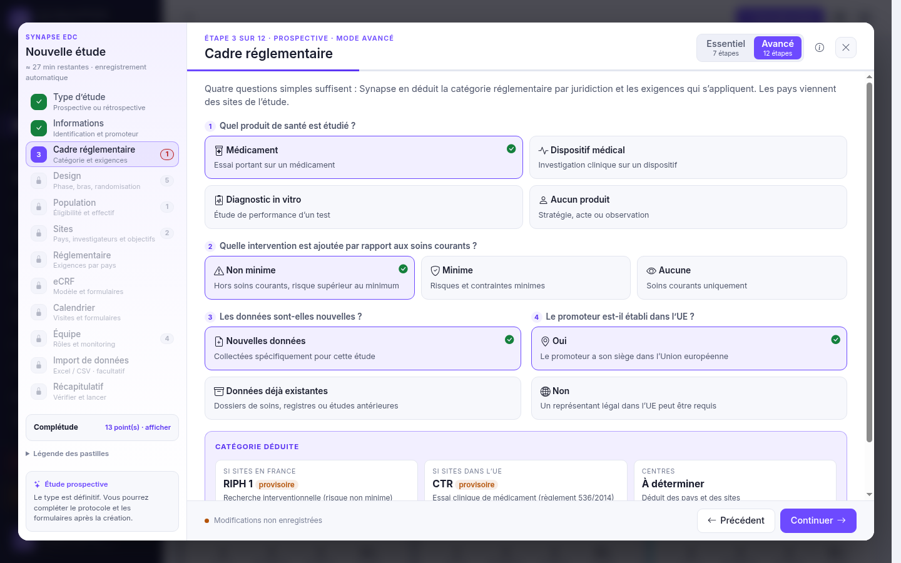

Four questions from which Synapse derives the regulatory category per country.

| Question | To choose | Explanation |
|----------|-----------|-------------|
| 1 Quel produit de santé est étudié ? | Médicament | A trial on a medicine falls under the European CTR regulation. |
| 2 Quelle intervention est ajoutée par rapport aux soins courants ? | Non minime | "Hors soins courants, risque supérieur au minimum": RIPH 1 category in France. |
| 3 Les données sont-elles nouvelles ? | Nouvelles données | Collected specifically for this study. |
| 4 Le promoteur est-il établi dans l'UE ? | Oui | A sponsor outside the EU must appoint a legal representative in the EU. |

The "Continuer" button waits for the four answers ("4/4 réponses").

**What you must see**

- [ ] In the "Catégorie déduite" box: France **RIPH 1** and European Union **CTR**, each marked "provisoire" ("Si sites en France", "Si sites dans l'UE"), and a third card "Centres : À déterminer" (deduced from the countries and sites).
- [ ] The message "La catégorie sera confirmée quand vous aurez choisi les pays (étape Sites)" is displayed: this is normal, countries are chosen at step 6.

### Step 4 · Design

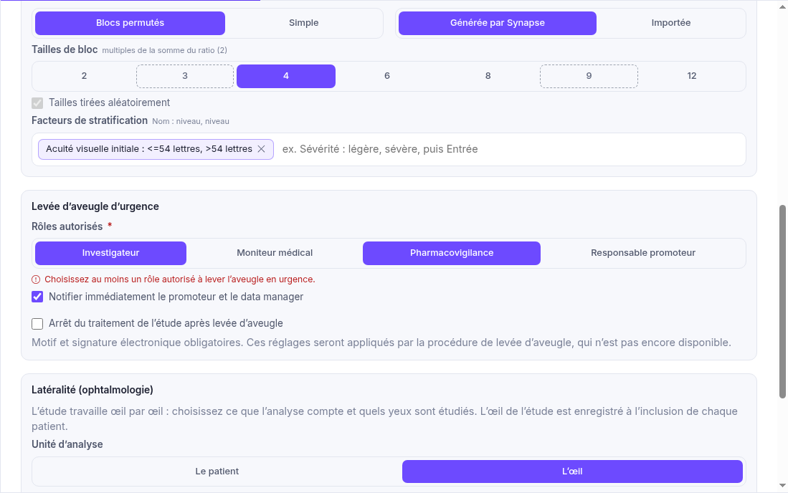

Structure of the trial. The ophthalmology fields are in the "Latéralité (ophtalmologie)" block.

| Field | To enter | Explanation |
|-------|----------|-------------|
| Phase | Phase III | Development stage of the medicine. |
| Design de l'essai | Randomisé 2 bras | Two randomly assigned groups. |
| Randomisation | `1:1` | Allocation ratio between arms (proposed automatically when the field is empty). |
| Aveugle | Double aveugle | Neither the patient nor the investigator knows the arm. |
| Type de contrôle | Comparateur actif | The reference group receives an active treatment. |
| Noms des bras | `Aflibercept`, `Ranibizumab` | Type a name then Enter. |
| Randomisation détaillée · Méthode | Blocs permutés | The allocation is rebalanced at regular intervals (the block size). |
| Randomisation détaillée · Liste de randomisation | Générée par Synapse | A design setting, simply recorded: no arm is drawn at this stage. |
| Tailles de bloc | `4` | Must be a multiple of the sum of the ratio (here 2). |
| Facteurs de stratification | `Acuité visuelle initiale : <=54 lettres, >54 lettres` then Enter | A factor whose levels are balanced between arms. Format "Name: level, level". |
| Levée d'aveugle d'urgence · Rôles autorisés | Investigateur and Pharmacovigilance | Roles that will be able to unblind in an emergency (at least one is required). See "Known issues". |
| Latéralité · Unité d'analyse | L'œil | The analysis counts eyes, not patients. |
| Latéralité · Yeux étudiés | Un œil (œil de l'étude choisi à l'inclusion) | Each patient is followed for a single eye. |
| Latéralité · Règle si les deux yeux sont éligibles | Œil le plus atteint | Rule applied when both eyes meet the criteria. |
| Inclusion / Suivi | `12` and `12` months | Length of recruitment then of the follow-up of each patient. |
| Durée totale | `24` (computed) | Inclusion + follow-up, editable. Required. |

**What you must see**

- [ ] The "Randomisation détaillée", "Levée d'aveugle d'urgence" and "Latéralité (ophtalmologie)" blocks appear.
- [ ] The total duration fills itself with 24.
- [ ] Block sizes that are not a multiple of the sum of the ratio (2), such as `3`, are disabled: only valid sizes can be ticked.
- [ ] With no role allowed to unblind, "Continuer" is refused with "Choisissez au moins un rôle autorisé à lever l'aveugle en urgence."

### Step 5 · Population

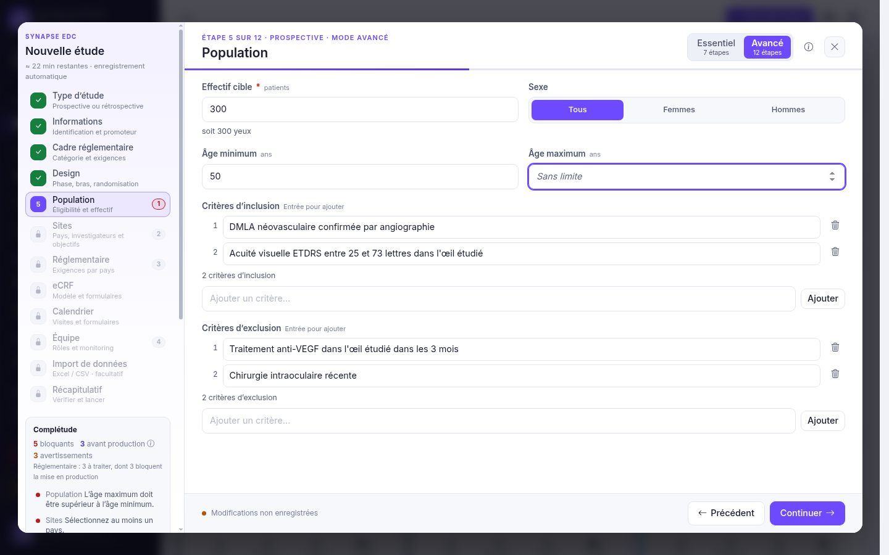

Who can be included, and how many.

| Field | To enter | Explanation |
|-------|----------|-------------|
| Effectif cible | `300` | Number of patients to include. It is the reference for the targets per site (step 6). A multiple of 2 for a 1:1 ratio. |
| Sexe | Tous | |
| Âge minimum | `50` | |
| Âge maximum | leave empty | "Sans limite". |
| Critères d'inclusion | `DMLA néovasculaire confirmée par angiographie`, then Enter; `Acuité visuelle ETDRS entre 25 et 73 lettres dans l'œil étudié`, then Enter | One numbered, editable line per criterion; the bin button removes it. |
| Critères d'exclusion | `Traitement anti-VEGF dans l'œil étudié dans les 3 mois`, then Enter; `Chirurgie intraoculaire récente`, then Enter | Same. |

The performance status (ECOG, KPS) is not offered: it is an oncology scale.

**What you must see**

- [ ] The two inclusion criteria and the two exclusion criteria are listed as numbered editable lines, each with its bin button.
- [ ] A target of 301 adds, in the "Complétude" block of the left column ("afficher"), the warning "L'effectif cible (301) n'est pas un multiple de la somme du ratio de randomisation (2)."; put `300` back.

### Step 6 · Sites

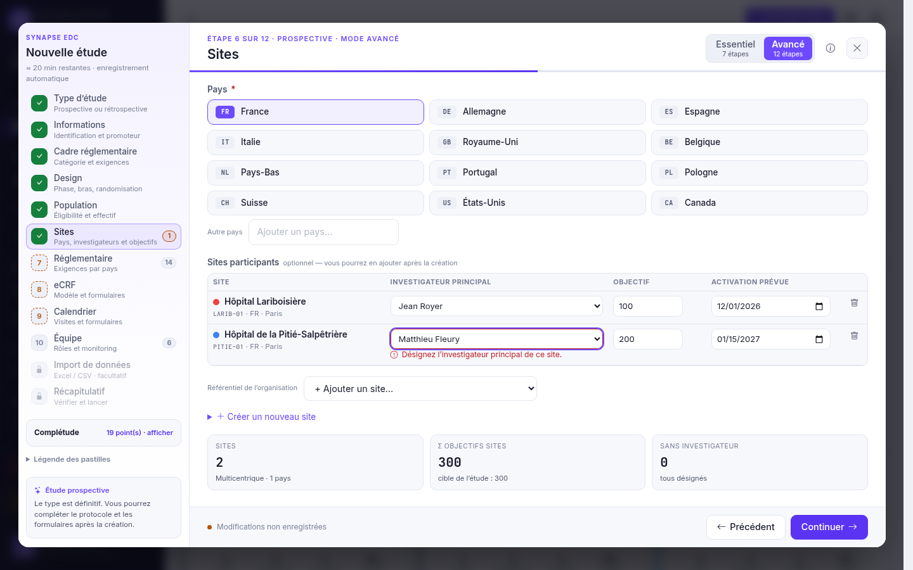

Countries of the study, then participating sites.

| Field | To enter | Explanation |
|-------|----------|-------------|
| Pays | France | Determines the regulatory rules applied. This choice confirms the RIPH 1 and CTR categories. Required. |
| Référentiel du workspace | `LARIB-01` then `PITIE-01` ("+ Ajouter un site…") | The demonstration sites of the workspace. If these sites do not exist, open "Créer un nouveau site" and enter a fictional Nom, Code, Pays (France) and Ville with these same codes. |
| Investigateur principal | a proposed user, for each site | The physician responsible for the study at this site. He or she becomes a member of the study at launch, limited to the patients of the site. A site left "À désigner" blocks the step. |
| Objectif | `100` for `LARIB-01`, `200` for `PITIE-01` | Number of patients expected at the site. |
| Activation prévue | `01/12/2026` for `LARIB-01`, `15/01/2027` for `PITIE-01` | Date the site opens to inclusions. A past date shows "Date d'activation passée". |

**What you must see**

- [ ] The statistics strip shows 2 sites and "Σ objectifs sites" at 300, equal to the target.
- [ ] A site without a principal investigator blocks "Continuer".

### Step 7 · Réglementaire

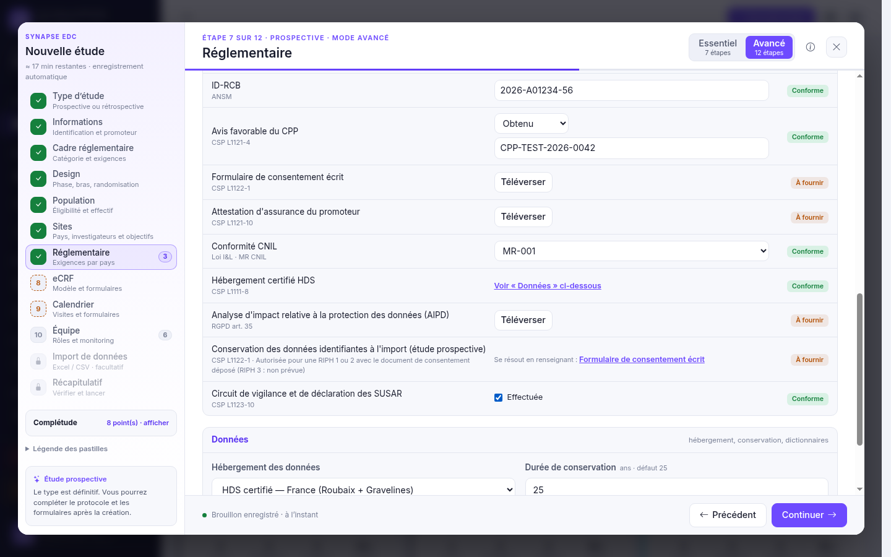

List of the requirements derived from the RIPH 1 and CTR framework, per rule set ("Socle international", "Union européenne", "France"). A missing point does not prevent the launch: it will have to be cleared before go-live.

| Requirement | To do | Explanation |
|-------------|-------|-------------|
| Protocole signé | **Téléverser** a fictional one-page PDF saying "TEST" | The signed protocol of the study. |
| Version du protocole | `1.0` | |
| Date du protocole | `15/10/2026` | |
| EU CT number | `2026-500123-45-00` | Trial number assigned by CTIS, the European clinical trials portal. Format `YYYY-5NNNNN-NN-NN`; a wrong format is flagged. |
| ID-RCB | `2026-A01234-56` | Registration number of the research with the ANSM (French medicines agency). Format `YYYY-ANNNNN-NN`. |
| Avis favorable du CPP | "Obtenu", reference `CPP-TEST-2026-0042` | Opinion of the ethics committee (comité de protection des personnes). A status "Obtenu" without a reference shows "Référence requise". |
| Conformité CNIL | `MR-001` | The CNIL reference methodology (French data protection authority) for research with consent. |
| Circuit de vigilance et de déclaration des SUSAR | tick | Procedure for reporting suspected unexpected serious adverse reactions. |
| Données · Hébergement des données | "HDS certifié — France (Roubaix + Gravelines)" | HDS: hosting certified for health data, mandatory for French patients. |
| Données · Durée de conservation | `25` years | The CTR regulation requires 25 years for the trial master file. |
| Données · Versions des dictionnaires | MedDRA `27.1` | MedDRA: the international dictionary of adverse events; its version is frozen for the length of the study. |

**What remains to be provided after this step** (do not enter it, these are "avant production" points): the CTIS authorisation (parts I and II), the written consent form, the sponsor's insurance certificate, the data protection impact assessment (AIPD, a simple warning) and "Conservation des données identifiantes à l'import", which is only resolved by uploading the consent form (see step 14).

**What you must see**

- [ ] The header reads "Exigences déduites du cadre RIPH 1 · CTR".
- [ ] The country matrix shows France and the count of requirements met out of the total.
- [ ] A wrongly formatted ID-RCB (for example `2026-A1234`) shows "Format attendu : AAAA-ANNNNN-NN"; the status updates a few seconds later, and with the value in the row above it becomes "Conforme".
- [ ] The uploaded protocol appears with its version and deposit date, and in the summary (step 12) under "Documents déposés"; the EU CT number and the CPP opinion become "Conforme".

### Step 8 · eCRF

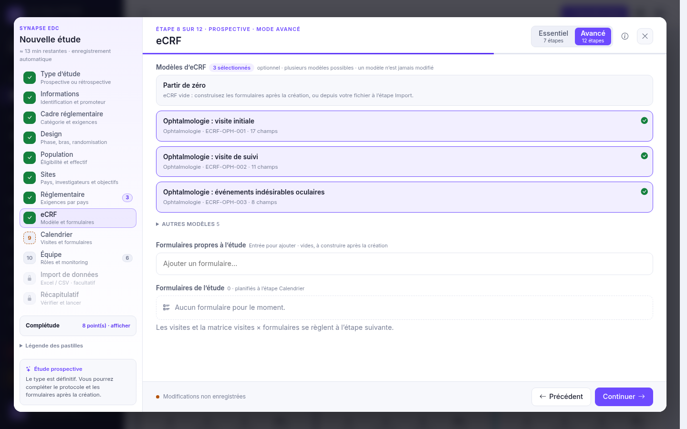

The data entry forms of the study.

| Field | To tick | Explanation |
|-------|---------|-------------|
| Modèles d'eCRF | `Ophtalmologie : visite initiale`, `Ophtalmologie : visite de suivi`, `Ophtalmologie : événements indésirables oculaires` | Three templates offered at the top of the list (Ophtalmologie area). Several templates can be ticked. |
| Formulaires propres à l'étude | leave empty | To create empty forms to build later. |

**What you must see**

- [ ] "Partir de zéro" unticks as soon as a template is ticked.
- [ ] The counter shows "3 sélectionnés".
- [ ] Under "Formulaires de l'étude", the three forms are listed.

### Step 9 · Calendrier (schedule)

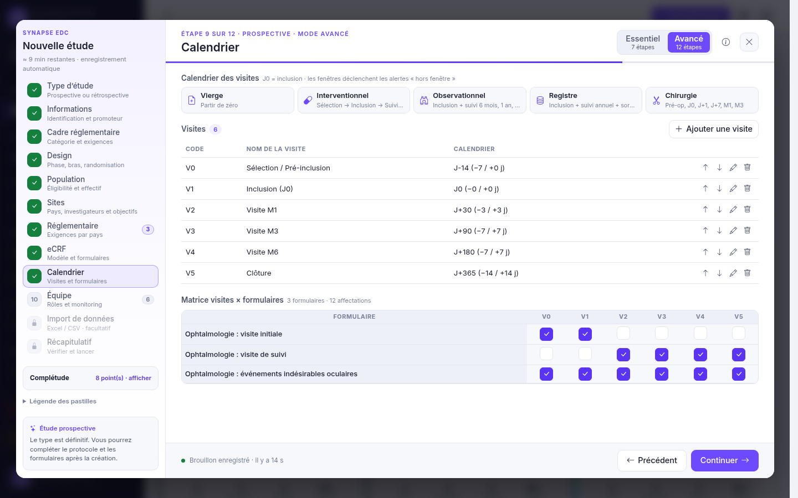

The visits of the study and the forms completed at each one. **D0 is the inclusion day.**

The schedule **is already proposed**: a randomised trial gets the "Interventionnel" model (Sélection → Inclusion → Suivi → Clôture) and each form is placed at its visit according to its template. The presets of the "Interventionnel" button are only for starting from scratch.

Expected visits (code, name, day): `V0` Sélection / Pré-inclusion (D-14), `V1` Inclusion (D0), `V2` Visite M1 (D30), `V3` Visite M3 (D90), `V4` Visite M6 (D180), `V5` Clôture (D365).

Expected "visits × forms" matrix (a tick = form planned at the visit):

| Form | V0 | V1 | V2 | V3 | V4 | V5 |
|------|----|----|----|----|----|----|
| Ophtalmologie : visite initiale | yes | yes | | | | |
| Ophtalmologie : visite de suivi | | | yes | yes | yes | yes |
| Ophtalmologie : événements indésirables oculaires | yes | yes | yes | yes | yes | yes |

The adverse events form is planned at every visit but is **optional**: it is filled only when an event occurs. This nuance shows in the patient's visit book (step 17), not in the matrix.

**What you must see**

- [ ] Six visits, and the matrix above. The counter reads "3 formulaires · 12 affectations".
- [ ] No "Formulaires non planifiés" warning.
- [ ] A click on a matrix cell ticks or unticks it (put it back as above).

### Step 10 · Équipe (team)

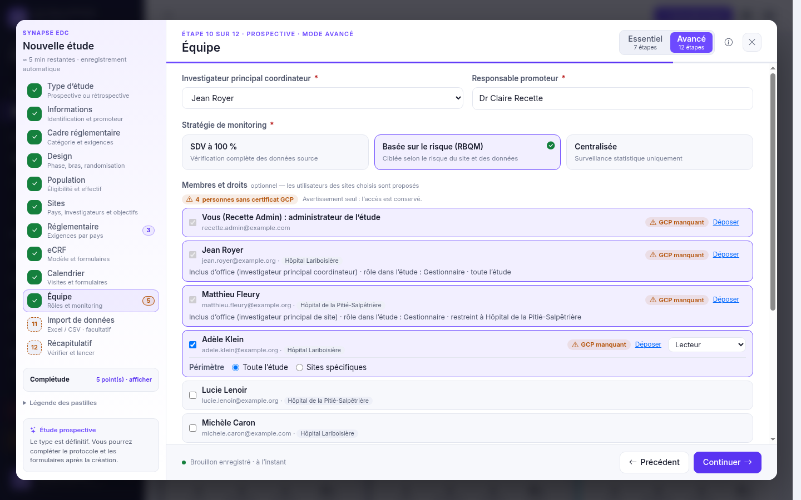

Leads, monitoring, members and invitations.

| Field | To enter | Explanation |
|-------|----------|-------------|
| Investigateur principal coordinateur | a proposed user | The physician who coordinates the study across all sites. Required. |
| Responsable promoteur | `Dr Claire Recette` | Contact at the sponsor; free text, not necessarily a user. Required. |
| Stratégie de monitoring | Basée sur le risque (RBQM) | How the data are checked by the ARCs: check everything ("SDV à 100 %"), target by risk, or monitor remotely with statistics ("Centralisée"). Required. |
| Membres et droits | tick **one** user, role "Lecteur" | The principal investigators are already included. "GCP manquant" flags a missing good clinical practice certificate: a warning only. |
| Invitations · E-mail | `arc.recette@example.com` | Click "Inviter par e-mail". E-mails are only sent at launch. |
| Invitations · Rôle sur les sites | "ARC moniteur"; this field only appears once a site is ticked (site chips) | With no site ticked, the invitee can access all sites ("Accès à tous les sites"). |
| Invitations · Rôle dans l'étude | keep the proposed value | For an "ARC moniteur", the application proposes **Lecteur**. Ticking a site first preselects "Investigateur" and the Gestionnaire study role, until "ARC moniteur" is chosen. |

Invalid address trial: in a second invitation, type `pas-une-adresse`.

**What you must see**

- [ ] Ticking a site preselects "Investigateur" and the Gestionnaire study role; the study role switches to "Lecteur" as soon as "ARC moniteur" is chosen as the site role.
- [ ] With `pas-une-adresse`: the message "Adresse e-mail invalide : cette invitation ne sera pas enregistrée." appears under the field, and "Continuer" is refused as long as the address is invalid or duplicated. Remove this invitation with the bin ("Invitation retirée").
- [ ] If the bin button of a refused invitation stays inactive (known issue, #381), click "Précédent" then "Continuer": the invitation goes away.

### Step 11 · Import de données

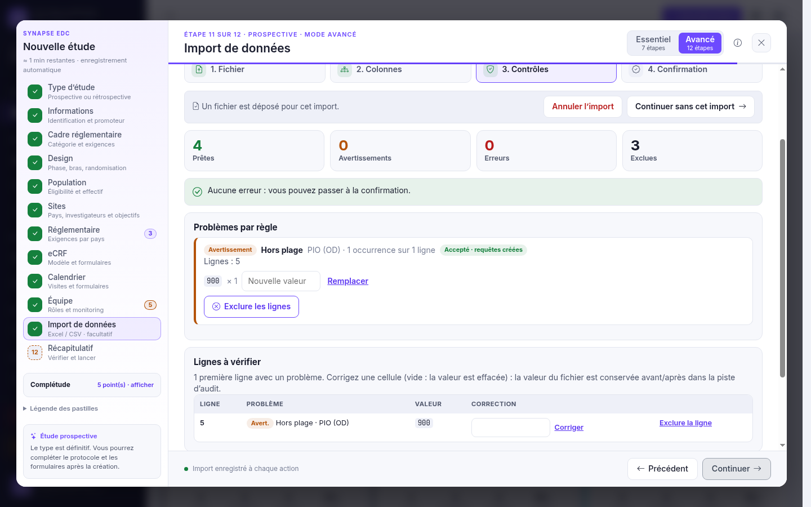
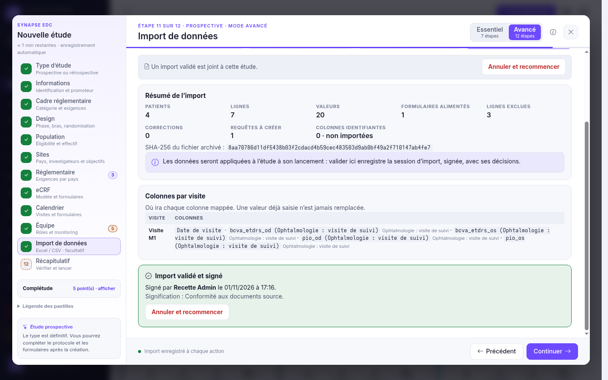

Drop the test file (see [Test file](#test-file)). The import has four sub-steps: Fichier, Colonnes, Contrôles, Confirmation. It is **optional**: "Passer cette étape" (or "Continuer sans cet import" once a file is deposited) skips it (in that case, do the import from Patients › Importer after launch).

**11.1 Fichier.** Drag the file or "parcourez vos dossiers".

| Item | To check | Explanation |
|------|----------|-------------|
| Empreinte SHA-256 | displayed | Fingerprint of the file, kept for traceability: it later proves which file was imported. |
| Lignes de données / Colonnes | 7 rows, 8 columns | |
| Lecture du fichier | semicolon separator, header on line 1 | Unfold it if needed. |
| Données identifiantes | "Aucune colonne identifiante détectée"; policy "Ne pas importer" left as it is | The file holds no name or date of birth. A notice "Base réglementaire manquante : Formulaire de consentement écrit" is displayed: this is normal, do not upload the consent form (see step 14). |

Next button: **Continuer vers les colonnes**.

**11.2 Colonnes.** Each column is matched to a field of the study, and to a visit: the "Visite" column offers "Selon le formulaire" (keep it).

| Column | Expected field | Explanation |
|--------|----------------|-------------|
| `Identifiant patient` | Identifiant patient | With the warning "Identifiant du fichier = code patient": it must contain no identifying data. |
| `Date de visite` | Date de visite | The mention "Alimente aussi : …" says that the same column also fills the "Date de la visite" field of the follow-up form. |
| `Site` | Site | Code or name of a site of the study. |
| `study_eyes` | Œil de l'étude | The study eye of the patient. |
| `bcva_etdrs_od`, `bcva_etdrs_os`, `pio_od`, `pio_os` | BCVA (OD), BCVA (OS), PIO (OD), PIO (OS) | One target per eye. Under each one, "→ Visite M1" tells the visit where the value goes (that of the follow-up form). |

Next button: **Continuer vers les contrôles**.

**11.3 Contrôles.** The values of the file are checked against the fields: errors (blocking) and warnings. See the anomaly table on the "Test file" part. Actions:

1. For IMP-007 (`XX`): in the "Valeur non reconnue" group of the "Œil de l'étude" field (`study_eyes` column), type `OD` in "Nouvelle valeur" then click **Remplacer**.
2. Click **Exclure toutes les lignes en erreur** and confirm: IMP-003 (site), IMP-005 (unrecognised value) and IMP-006 (date) leave the import.
3. For IMP-004 (IOP 900, "Hors plage" warning): **Accepter et créer une requête par ligne**. A query will be created on this value once the import is applied.

Next button: **Continuer vers la confirmation** (grey as long as an error remains).

**11.4 Confirmation et signature.**

| Field | To enter | Explanation |
|-------|----------|-------------|
| Résumé de l'import | expected: 4 patients (IMP-001, IMP-002, IMP-004, IMP-007), 7 rows, 20 values, 1 form fed, 3 excluded rows, 1 query to create | Patients, values, forms fed, excluded rows, corrections, queries to create. |
| Colonnes par visite | read the table: "Visite M1" receives the date and the four measure columns | Announces where each column goes; a value already entered is never replaced. |
| Site d'inclusion | `LARIB-01` | Site of the rows with no value in the Site column. The "Site" column of the file wins, row by row. |
| Certification | tick | You attest that the data and the matching are correct. |
| Signification de la signature | keep "Conformité aux documents source" | The legal meaning of the signature, stored with it (21 CFR Part 11). |
| Mot de passe (ré-authentification) | first a wrong password, then yours | An electronic signature requires typing the password again. |

Button: **Valider et signer l'import**.

**What you must see**

- [ ] 11.1: 7 data rows and 8 columns.
- [ ] 11.2: the 8 columns are matched with no "En attente" or "Œil à préciser" column.
- [ ] 11.3: exactly the anomalies of the table, with the labels given. "Aucune erreur : vous pouvez passer à la confirmation" after the exclusion.
- [ ] 11.4: the wrong password is refused with a message; the right one validates: "Import validé et signé". Then go on to the summary with "Continuer".
- [ ] An "Annuler l'import" bar is visible as soon as the file is deposited.

:::note[Imported patients are real patients]
Imported patients are not marked "TEST": they are not deleted at go-live and they appear in the normal exports. On the acceptance environment this has no consequence since the data are fictional.
:::

### Step 12 · Récapitulatif et lancement (summary and launch)

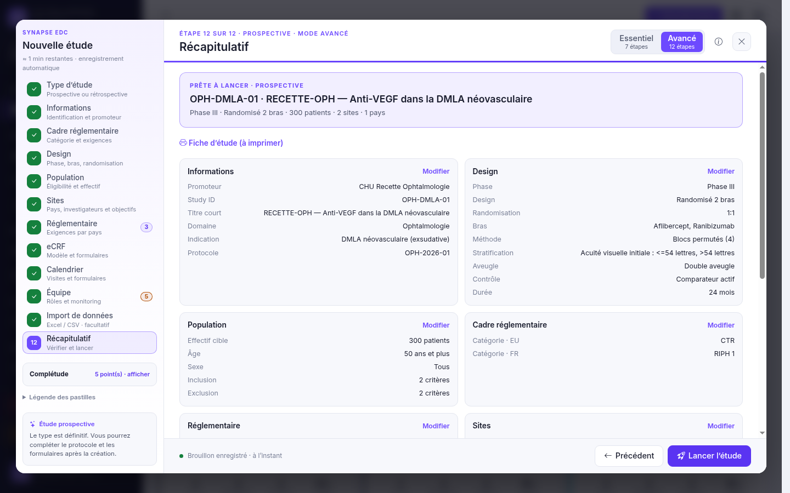

Review, open the "Fiche d'étude (à imprimer)", then **Lancer l'étude**.

**What you must see**

- [ ] The header reads "Prête à lancer · prospective", the Study ID in capitals and the summary "Phase III · Randomisé 2 bras · 300 patients · 2 sites · 1 pays".
- [ ] The Informations, Design, Population, Cadre réglementaire, Réglementaire, Sites, eCRF (three templates), Calendrier ("6, de J-14 à J+365"), Équipe (members, the invitation with its study role, site role and sites) and Import ("Signé" with your name) blocks match what you entered.
- [ ] "Lancer l'étude" opens a confirmation window saying that the study is created in Configuration status (settings, import and test patients open, real inclusions closed until go-live) and how many points remain to be handled ("5 à traiter, dont 3 bloquent la mise en production").
- [ ] After confirmation, the study opens on its **Configuration** page.

## After the launch

### Step 13 · First look at the Configuration page

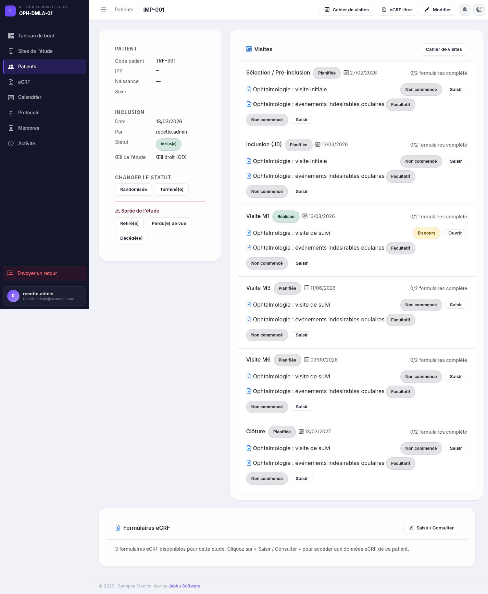

The Configuration page is the go-live checklist, in **four foldable gates** (one open at a time): **1 Exigences réglementaires**, **2 Paramètres à confirmer**, **3 Recette (UAT)**, **4 Signatures et mise en production**. The application calls them "étapes" (steps); they are called gates here so as not to confuse them with the steps of this test.

**What you must see**

- [ ] The pills "Configuration" and "Patients de test uniquement" (the latter disappears once the import is applied), then "RIPH 1 · CTR · Multicentrique".
- [ ] A "Prochaine action" banner (for example "Renseigner : …" with the "Voir les exigences" button).
- [ ] The progress bar: Réglementaire, Paramètres, Recette, Mise en production.
- [ ] In **Patients**, the imported patients IMP-001, IMP-002, IMP-004 and IMP-007 are present after a few seconds (the import is applied in the background), with their patient code and study eye. On the IMP-001 sheet, the values of the file are in the "Ophtalmologie : visite de suivi" form of the **Visite M1** visit ("En cours"), not in an "Hors plan" visit.
- [ ] The study's Members page lists the creator ("Propriétaire"), the coordinating PI, the site PIs and the member ticked at step 10.

### Step 14 · Gate 1: regulatory requirements

Unfold "Exigences réglementaires". It repeats the requirements of step 7: "À traiter (n)" first, then the compliant ones folded.

| Item | To do | Explanation |
|------|-------|-------------|
| Autorisation CTIS (parties I et II) | status "Obtenu", reference `CTIS-TEST-2026-01`, "Enregistrer les exigences" | Authorisation of the trial through the European portal. |
| Ajouter un document | expected document "Attestation d'assurance du promoteur", a fictional PDF, version `1.0`, "Téléverser" | Uploads a missing document (also possible on its row). **Do not upload the written consent form**: the study could then keep identifying data, and the inclusion form of steps 16 and 21 would ask for a name and a date of birth instead of the year of birth. |

**What you must see**

- [ ] The "n à traiter" counter goes down after each save.
- [ ] The requirements entered at step 7 are folded in "n exigences conformes ou facultatives".
- [ ] Gate 1 becomes "Terminé" when all requirements are handled (you may leave some: that is one more point to clear before go-live).

### Step 15 · Gate 2: settings to confirm

**What you must see**

- [ ] The message "Aucun paramètre à confirmer : l'étude a été configurée en mode avancé." and the gate at "Terminé" (0 / 0).

### Step 16 · First test patient, right eye

In gate 3 "Recette (UAT)", **Données de test** block, click **Créer un patient de test**. Choose a site if asked.

| Field | To enter | Explanation |
|-------|----------|-------------|
| Année de naissance | `1950` | The study sets a minimum age: the year is required. No name is asked. |
| Sexe | any | |
| Œil de l'étude | Œil droit (OD) | The study follows a single eye per patient. Required. |

Click **Inclure dans l'étude**.

**What you must see**

- [ ] A banner "L'étude est en configuration : ce patient sera un patient de test" at the top of the form.
- [ ] A note says the study keeps no identifying data (patient code generated at inclusion, no name nor full date of birth).
- [ ] The patient sheet shows a **Code patient**, the year of birth, "Patient de test" and "Œil de l'étude: Œil droit (OD)".
- [ ] With no eye chosen, the inclusion is refused.

### Step 17 · Visit book

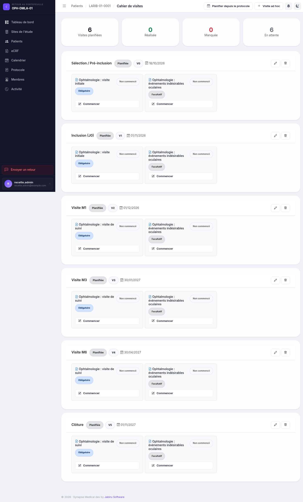

Visits are scheduled as soon as the patient is included: on the sheet, scroll down to the **Cahier de visites** (no need to click "Planifier depuis le protocole" in the "Visites" page).

**What you must see**

- [ ] Six visits, each with the forms of the step 9 matrix: "visite initiale" at Sélection and Inclusion, "visite de suivi" from M1 to Clôture, "événements indésirables oculaires" at every visit.
- [ ] The adverse events form carries the **Facultatif** label; the others are **Obligatoire** (in the "Visites" page) and "Non commencé".
- [ ] No "Hors plan" form for this hand-entered patient.

### Step 18 · Entry eye by eye

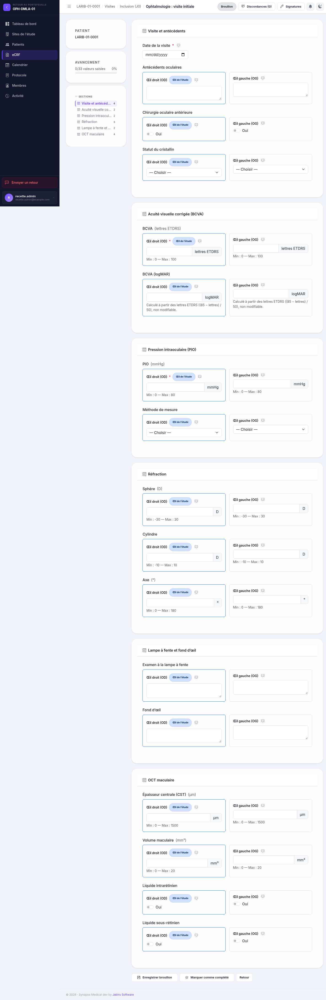

Open the **Inclusion (D0)** visit (the patient's "Visites" page), form **Ophtalmologie : visite initiale**, with **Commencer**. Each measure is displayed **side by side** for the right eye (OD) and the left eye (OG); the study eye is outlined and carries the "Œil de l'étude" badge.

| Section | Field | Œil droit (OD) | Œil gauche (OG) |
|---------|-------|----------------|-----------------|
| Visite et antécédents | Date de la visite | a past date | |
| Acuité visuelle corrigée (BCVA) | BCVA (ETDRS letters) | `62` | `70` |
| Pression intraoculaire (PIO) | PIO (mmHg) | `16` | `15` |
| Pression intraoculaire (PIO) | Méthode de mesure | Goldmann | Goldmann |

The "BCVA (logMAR)" field is **computed** from the ETDRS letters and cannot be edited; under the BCVA, the equivalent in logMAR, decimal and Snellen is displayed.

Click **Enregistrer brouillon**. The values are also saved automatically after a few seconds ("Enregistré à …").

Limits trial: enter `90` in the right eye IOP then save.

**What you must see**

- [ ] BCVA and IOP are required (asterisk) **for the study eye only**; the other eye stays optional.
- [ ] The value `90` is refused with the message "Valeur trop élevée : le maximum autorisé est 80."; it is not saved. Put `16` back and save.
- [ ] After saving the draft, the form stays displayed, the values are kept with their eye and the "valeurs saisies" progress goes up (it also counts the "Oui / Non" switches left on "Non": known issue, #378).

### Step 19 · Modify with a reason, then complete

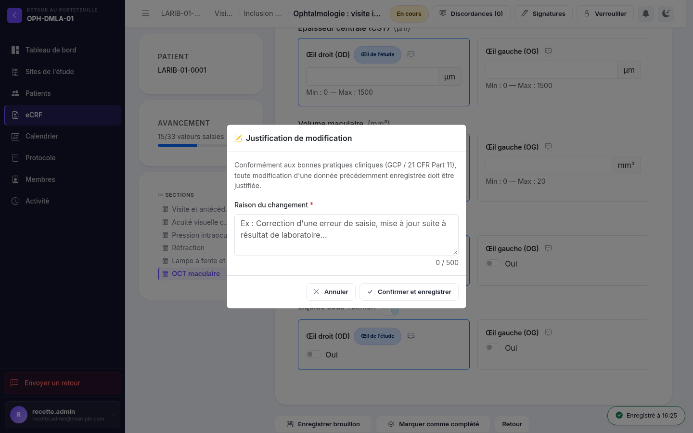
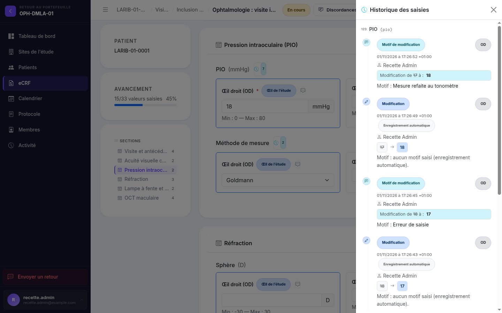

Before completing, change the right eye IOP from `16` to `18` and click **Enregistrer brouillon**. Then click **Marquer comme complété**.

**What you must see**

- [ ] Modifying a value already saved opens the "Justification de modification" window: "Raison du changement" is required (500 characters maximum). Enter `Mesure refaite au tonomètre`.
- [ ] The history icon (clock) of the field lists the old value, the new one, the author and the time; for the IOP modification it also gives the reason ("Motif : Mesure refaite au tonomètre").
- [ ] "Marquer comme complété" is refused as long as a required value of the study eye is missing; once the values are entered, the application goes back to the visit book, the form becomes "Complété", read-only, and its progress does not fall to 0.
- [ ] Expected: the Inclusion visit counts as done as soon as its required forms are completed, without waiting for the optional adverse events form.

### Step 20 · Follow-up visit

Open the **Visite M1** visit (V2), form **Ophtalmologie : visite de suivi**, and enter: right eye BCVA `40`, left eye BCVA `70`, right eye IOP `15`, left eye IOP `15`, visit date: enter today's date (a date after the inclusion one is impossible on the day of inclusion, because future dates are refused). Save.

**What you must see**

- [ ] A warning flags the right eye BCVA change: "BCVA (OD) : -22 par rapport à la première valeur du même œil (62), au-delà de 15." It is a warning: saving is not blocked.
- [ ] The left eye BCVA (70, same as at inclusion) triggers no warning.
- [ ] The adverse events form, left empty, does not prevent the visit from counting as done once the follow-up is completed.
- [ ] Optional: in "Ophtalmologie : événements indésirables oculaires", create an event (term `Hémorragie sous-conjonctivale`, eye OD, start date, severity Légère). The section is repeatable ("Instance").

### Step 21 · Second test patient, left eye

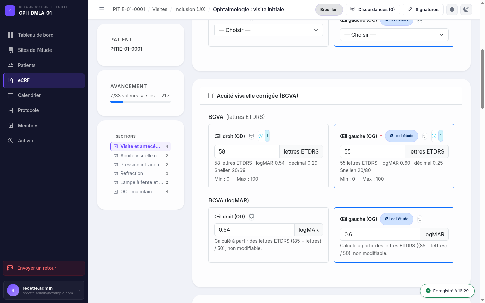

Redo steps 16 and 17 with another patient: year of birth `1948`, **Œil gauche (OG)** as the study eye. In the visit book, open "Ophtalmologie : visite initiale" at Inclusion and enter BCVA OD `58`, BCVA OG `55`, IOP OD `14`, IOP OG `17`.

**What you must see**

- [ ] This time the left eye is outlined, carries the "Œil de l'étude" badge and its fields are required.
- [ ] The test patient list shows both patients with their study eye (OD for one, OG for the other).

### Step 22 · Query on the left eye BCVA

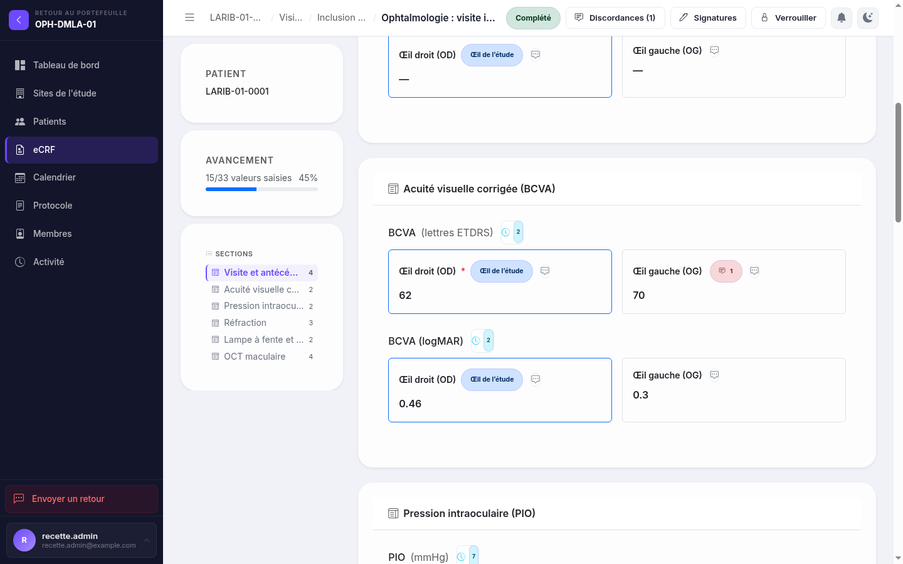

A query ("discordance") is a question put to the site about a value. In the "visite initiale" form of the first patient, next to **Œil gauche (OG)** of the BCVA field, click the "Lever une discordance" icon.

| Field | To enter | Explanation |
|-------|----------|-------------|
| Champ concerné | "BCVA OG" (prefilled, with the eye) | "Changer ou retirer le champ" lets you pick another one. The value entered (`70`) is recalled. |
| Type de discordance | Illisible / ambigu | "Valeur manquante" is proposed by default: change it. Other choices: Date incohérente, Valeur hors intervalle, Déviation protocole, Autre. |
| Description | `Acuité de l'œil gauche à confirmer sur la feuille d'examen.` | |

Click **Enregistrer**. Then, in the query list: type an answer (`Valeur confirmée : 70 lettres.`) then **Répondre**, then **Clôturer**.

**What you must see**

- [ ] After saving, a red open-query badge appears next to the field, **on the left eye only**.
- [ ] The query is "Ouverte", then "Répondue" after the answer, then "Clôturée"; the author and date of each action are displayed.
- [ ] The study's Discordances page lists the open queries: this one while it is open, and the one created by the import for IMP-004, shown as "Alerte d'import" ("Import n°1, ligne 5 : hors plage (valeur du fichier « 900 »)").
- [ ] The form offers "Discordances (n)", n being the number of open queries.

### Step 23 · Electronic signature of a form

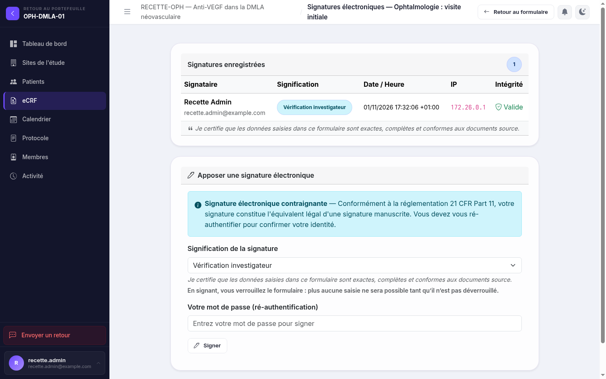

In the completed "visite initiale" form, click **Signatures**: the page directly shows the **Apposer une signature électronique** block.

| Field | To enter | Explanation |
|-------|----------|-------------|
| Signification de la signature | Vérification investigateur | The meaning of the signature, stored with it. |
| Votre mot de passe (ré-authentification) | first a wrong password, then yours | An electronic signature requires typing the password again. |

Click **Signer**.

**What you must see**

- [ ] A wrong password is refused.
- [ ] With the right one: the signature appears in the list (signatory, meaning, date and time) with integrity "Valide".
- [ ] The form stays read-only: the signature locks it ("Déverrouiller" button in place of "Verrouiller").

### Step 24 · Rights of a monitor (ARC)

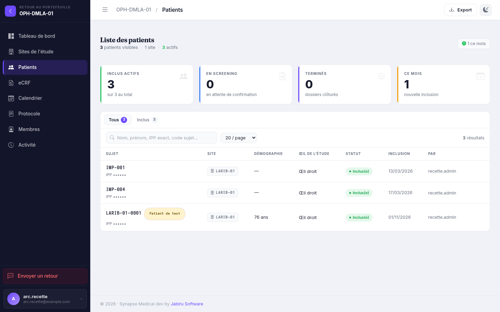

Sign out, then open the invitation of step 10 (address `arc.recette@example.com`) to create the ARC account, and log in (private browser window) with it: site role "ARC moniteur" on a site of the study, study role Lecteur. Open the form of a patient of that site.

**What you must see**

- [ ] The form is **read-only**: neither "Enregistrer brouillon" nor "Marquer comme complété".
- [ ] The "Lever une discordance" button is present, per field and per eye: the ARC can raise a query (`Valeur à vérifier sur le dossier source.`), close it, and cancel those raised by the ARC. The ARC cannot answer (reserved to data entry).
- [ ] The ARC sees only the patients and queries of the ARC's site.
- [ ] For the signature, only the meaning "Vérification sponsor / ARC" is offered.

### Step 25 · Export the test data

Go back to the Configuration page, gate 3, **Données de test** block: section "Exporter les données de test (fichiers marqués « TEST »)".

| Button | To do | Explanation |
|--------|-------|-------------|
| Patients CSV | download and open | The list of test patients. |
| eCRF CSV | download, open the ZIP archive | The eCRF data: one CSV file per form, one row per patient, **one column per eye**. |
| eCRF CSV (une ligne par œil) | download, open the ZIP archive | The same data, **one row per eye**. |

**What you must see**

- [ ] The name of each file contains `TEST` and the last column, "Donnée de test", is `TEST` on every row (in each CSV of the archive).
- [ ] The files contain only your two test patients (not the imported patients).
- [ ] Column export: the archive holds `01_…visite_initiale.csv`, `02_…visite_de_suivi.csv` and `03_…evenements_indesirables_oculaires.csv`. In the first two, columns `bcva_etdrs_od`, `bcva_etdrs_os`, `pio_od`, `pio_os` **suffixed with the visit**, for example `bcva_etdrs_od_v1` (Inclusion) and `bcva_etdrs_od_v2` (Visite M1). The `study_eyes` column shows OD for one patient and OS for the other.
- [ ] One-row-per-eye export: same files, with the columns `eye` (OD or OS) and `study_eye` (`Y` for the study eye, `N` for the other).
- [ ] The values match what you entered: BCVA 62 / 70 and IOP 18 / 15 for the first patient.

### Step 26 · Normal exports and the log

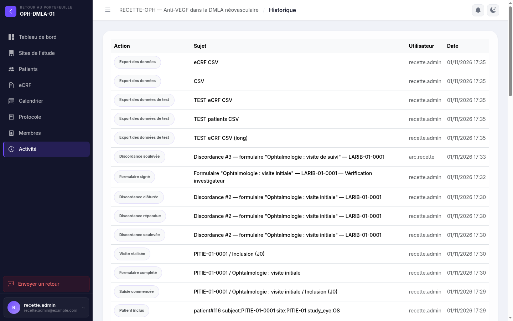

On the study page, ⋮ menu → **Exporter CSV**, then **Données eCRF CSV, ZIP (une colonne par œil)**. Then ⋮ menu → **Historique complet**.

**What you must see**

- [ ] The normal exports contain **no test patient** (they contain the imported patients).
- [ ] The full history lists, with author and time, notably: the launch of the study, the applied import, the entries ("Saisie commencée", "Saisie enregistrée", "Formulaire complété"), the query (creation, answer, closure), the signature, the test data export. The reason of the IOP modification is read in the history of the field (step 19), not in this log.

### Step 27 · Gate 3: acceptance test (UAT)

The acceptance scenarios of the Configuration page are run on your test patients. A non-randomised study has 4 scenarios; this randomised double-blind study has 6, 2 of them greyed out:

1. "Saisie d'un patient test sur chaque formulaire du calendrier"
2. "Contrôles de cohérence et discordances automatiques déclenchés"
3. "Randomisation test : allocation et équilibre des bras"
4. "Levée d'aveugle d'urgence (rôle autorisé, signature)"
5. "Export des données de test (CSV/Excel)"
6. "Droits par rôle et par site vérifiés"

For each scenario, click **Réussi** (passed) or **Échoué** (failed); a comment is required if failed.

- Scenarios 1 and 6: **Réussi** after steps 16 to 24.
- Scenario 2: **Réussi** after the BCVA change warning (step 20) and the IOP limits (step 18).
- Scenario 3 (randomisation): its "Réussi" button is greyed out, like the unblinding one (scenario 4), with the note "Attribution des bras pas encore disponible".

**What you must see**

- [ ] "Réussi" or "Échoué" saves the result with date, time and your name; "Remettre à exécuter" puts it back on hold.
- [ ] The **Levée d'aveugle d'urgence** scenario shows "Procédure pas encore disponible" and its "Réussi" button is **greyed out** (known issue, see below).
- [ ] The **Export des données de test** scenario: its "Réussi" button is usable (no longer greyed out).

### Step 28 · Gate 4: signatures and go-live

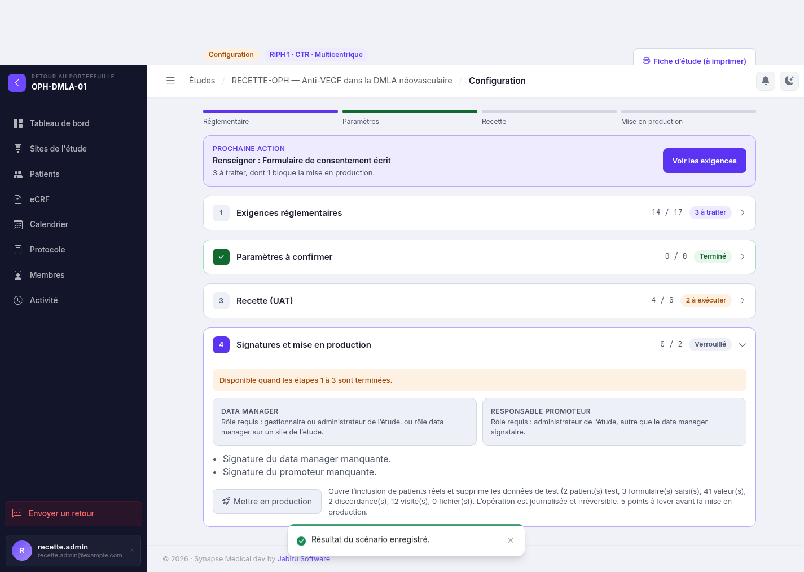

**What you must see**

- [ ] Gate 3 cannot finish for a blinded study (the unblinding and randomisation scenarios cannot be declared "Réussi"), so gate 4 stays locked.
- [ ] Gate 4 is "Verrouillé" as long as gates 1 to 3 are not finished: "Disponible quand les étapes 1 à 3 sont terminées."
- [ ] The **Mettre en production** button is greyed out and gives the number of points to clear before go-live.
- [ ] **Do not try to go further**: for a blinded study, go-live is impossible as long as emergency unblinding does not exist. The test stops here.

## Known issues

| Where | What you will see | Tracking |
|-------|-------------------|----------|
| Emergency unblinding | The procedure does not exist yet. The settings entered at step 4 (allowed roles, notification, treatment stop) are stored but not applied. The matching acceptance scenario cannot be declared "Réussi" ("Procédure pas encore disponible"). | #314 |
| Go-live | A blinded study cannot go live as long as emergency unblinding does not exist: the test stops before gate 4. | #314 |
| SDTM export | The CDISC (SDTM) export does not exist; it is replaced by the test data export (CSV and Excel). The CDISC ODM export does not exist either. | #337 |
| Randomisation | The settings (ratio, blocks, strata) are recorded but no code assigns an arm to a patient; the "Randomisée" status draws none. The "Randomisation test" scenario is greyed out ("Attribution des bras pas encore disponible"). | #348 |
| Import | A file without intraocular pressure is refused by the ophthalmology forms; the file of this page holds one for every patient. | #356 |
| Sites | The principal investigator of the second site was sometimes refused at step 6 with no established cause: if it happens, report it with the time. | #373 |
| Reason for change | The justification of a modification can be bypassed by cancelling the window. | #377 |
| Checkboxes | The "valeurs saisies" progress counts the "Oui / Non" switches left on "Non". | #378 |
| Visits | After a follow-up is entered, the visit shows its planned date as the done date. | #379 |
| Import | The inclusion date is deduced at import. | #380 |
| Invitations | The bin button of a refused invitation can stay inactive; way out: "Précédent" then "Continuer". | #381 |
| Dates | The date format follows the browser: use a French browser. | #375 |
| Import | Only the wide format (one row per patient, `_od` and `_os` columns) is read; the "one row per eye" export cannot be re-imported. Imported patients are not test patients. | — |

A point marked "—" has no ticket at the time of writing: describe it if it differs from this table.

## Reporting a problem

For each anomaly, send this information with a screenshot:

```text
Plan step: (number and title)
Page address: https://…/…
What I did: (values entered)
What I expected:
What happened: (exact message, screenshot)
Browser and time:
```

The ticks are not saved by the application: note your results (passed or failed) step by step in your report.
