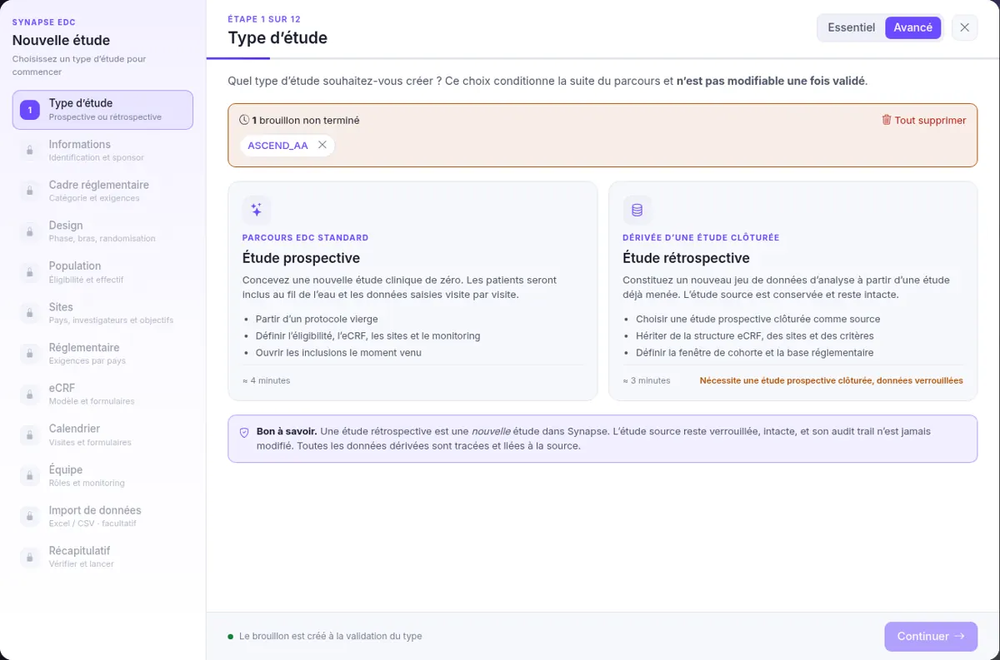
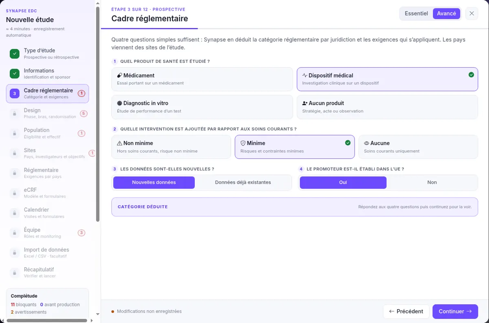

Ouvrez **Études** → **Nouvelle étude**. Ce guide suit le mode **Avancé** ; en mode Essentiel, les mêmes champs sont regroupés en moins d'étapes.

## 1. Type d'étude

Choisissez le parcours. Ce choix conditionne la suite et **n'est plus modifiable** une fois validé.

| Champ | Exemple | À quoi ça sert |
|-------|---------|----------------|
| **Type** \* | `Étude prospective` | Les patients sont inclus au fil de l'eau et les données saisies visite par visite. « Rétrospective » crée un jeu de données d'analyse à partir d'une étude prospective clôturée. |
| **Brouillon non terminé** | — | Si un ancien brouillon est listé, cliquez sur son nom pour le reprendre ; la croix le supprime. |

**Ce que vous devez voir** : après « Continuer », l'étape 1 est cochée en vert.

## 2. Informations

L'identification de l'étude, reprise dans les rapports et les exports.

| Champ | Exemple | À quoi ça sert |
|-------|---------|----------------|
| **Sponsor** \* | `CHU de Bordeaux` | Le promoteur : l'organisme responsable de l'étude. |
| **Study ID** \* | `MELA-2026` | Code court et unique : lettres, chiffres, tirets. Converti en majuscules ; il préfixe les identifiants. |
| **Titre court** \* | `Suivi du mélanome opéré` | Le nom lisible de l'étude dans les listes. |
| **Domaine thérapeutique** | `Oncologie` | Sert au classement des études. |
| **Indication** | `Mélanome` | La maladie étudiée. |
| **Numéro de protocole** | `BDX-2026-014` | La référence interne du protocole chez le promoteur, distincte du Study ID. |

:::note[Textes grisés]
Les valeurs grisées dans les champs vides sont des exemples : elles disparaissent dès la saisie.
:::

## 3. Cadre réglementaire

Quatre questions suffisent : Synapse en déduit la catégorie réglementaire par pays et les exigences qui s'appliquent.

| Champ | Exemple | À quoi ça sert |
|-------|---------|----------------|
| **Produit de santé étudié** \* | `Dispositif médical` | Médicament, dispositif, diagnostic in vitro ou aucun produit. Chacun relève d'un règlement différent (CTR, MDR, IVDR). |
| **Intervention ajoutée aux soins** \* | `Minime` | « Non minime » → RIPH 1 ; « Minime » → RIPH 2 ; « Aucune » → RIPH 3. |
| **Données nouvelles ?** \* | `Nouvelles données` | « Données déjà existantes » mène vers une recherche sur données (hors loi Jardé). |
| **Promoteur établi dans l'UE ?** \* | `Oui` | Un promoteur hors UE doit désigner un représentant légal dans l'UE. |

:::caution[La catégorie dépend des pays]
Les pays sont choisis à l'étape Sites. Tant qu'aucun pays n'est choisi, la catégorie s'affiche « Non concerné ».
:::

---

Précédent : [Premiers pas](../premiers-pas/) · Suivant : [Design, population et sites](../design-population-sites/)
