> 🌐 Version française · [English version](/en/qa/ophthalmology-acceptance-test/)

Cette page guide un testeur ophtalmologue, sans connaissance technique, dans la création d'une étude prospective d'ophtalmologie (traitement anti-VEGF de la DMLA néovasculaire), puis dans la saisie des mesures œil par œil. Chaque étape donne les valeurs exactes à saisir, ce que veut dire chaque champ et ce que vous devez voir : si ce n'est pas le cas, c'est un échec à signaler.

Durée : **1 h 30 à 2 h**. Données : **fictives uniquement**. Environnement : celui que l'équipe de recette vous indique (développement ou UAT, voir [Processus de release](/deployment/release-process/)).

Sommaire : [Avant de commencer](#avant-de-commencer) · [Fichier de test](#fichier-de-test) · [Pourquoi ce chemin](#pourquoi-ce-chemin-précis) · [Pas à pas](#pas-à-pas) · [Après le lancement](#après-le-lancement) · [Problèmes connus](#problèmes-connus) · [Signaler un problème](#signaler-un-problème)

:::caution[Données fictives uniquement]
L'environnement de recette n'est pas un hébergement de santé certifié (HDS). Ne saisissez et n'importez jamais de vrais patients : utilisez les valeurs de cette page, le fichier de test ci-dessous et des noms, dates et identifiants inventés.
:::

## Avant de commencer

### Compte

Chaque testeur reçoit un compte administrateur. À la première connexion : configuration de la double authentification (application de type Google Authenticator), conservation des codes de secours, puis changement du mot de passe. **Gardez ce mot de passe sous la main** : il sert à **signer** l'import (étape 11), un formulaire (étape 23) et, en principe, les signatures de la mise en production.

Pour l'étape 24 (droits d'un ARC), il faut un second compte avec le rôle de site « ARC moniteur » : demandez-le à l'équipe de recette avant de commencer.

### Comment le wizard enregistre

- **Enregistrement automatique** : chaque champ modifié est enregistré dans le brouillon quelques secondes après la saisie (« Brouillon enregistré » en bas de la fenêtre).
- **Continuer** valide l'étape côté serveur. Une étape refusée reste affichée, avec le message sous le champ en cause.
- **Complétude** (colonne de gauche) : **bloquant** = empêche de lancer l'étude ; **avant production** = à lever avant l'ouverture des inclusions réelles, n'empêche pas le lancement ; **avertissement** = simple information. Les pastilles de la colonne de gauche suivent la légende affichée sous la liste des étapes.
- Fermer la fenêtre ne perd rien : le bouton **Nouvelle étude** propose ensuite de reprendre le brouillon.
- Le mode **Avancé** (bouton en haut de la fenêtre) affiche les 12 étapes ; le mode Essentiel en regroupe plusieurs et reporte le réglementaire, le calendrier et l'équipe. Cette recette se fait **en mode Avancé**.

### Vocabulaire

| Terme | Sens |
|-------|------|
| eCRF | Cahier d'observation électronique : les formulaires de saisie de l'étude |
| Discordance (query) | Question posée au centre sur une valeur douteuse ; elle est ouverte, répondue, puis clôturée |
| Investigateur principal (PI) | Médecin responsable de l'étude sur un centre (ou sur toute l'étude pour le coordinateur) |
| ARC | Attaché de recherche clinique : il vérifie les données pour le promoteur, sans les saisir |
| Promoteur | Organisme responsable de l'étude (ici fictif) |
| Patient de test | Patient créé pendant la configuration : marqué « TEST », absent des exports de l'étude, supprimé à la mise en production |
| Signature électronique | Signature qui exige de retaper votre mot de passe (21 CFR Part 11, norme américaine reprise par les bonnes pratiques) |

## Fichier de test

L'étape 11 importe un petit fichier par œil. Créez-le dans un éditeur de texte (Bloc-notes, par exemple), enregistrez-le sous le nom `import-recette-ophtalmologie.csv` en **UTF-8**, séparateur **point-virgule**, puis déposez-le à l'étape 11. La première ligne est l'en-tête, une ligne = un patient.

```text
Identifiant patient;Date de visite;Site;study_eyes;bcva_etdrs_od (Ophtalmologie : visite de suivi);bcva_etdrs_os (Ophtalmologie : visite de suivi);pio_od (Ophtalmologie : visite de suivi);pio_os (Ophtalmologie : visite de suivi)
IMP-001;13/03/2026;LARIB-01;OD;62;70;16;15
IMP-002;14/03/2026;PITIE-01;OG;55;58;14;17
IMP-003;16/03/2026;ZZZ-99;OD;60;66;15;16
IMP-004;17/03/2026;LARIB-01;OD;58;64;900;17
IMP-005;18/03/2026;PITIE-01;OG;61;abc;16;14
IMP-006;2027-13-40;LARIB-01;OD;66;70;15;16
IMP-007;19/03/2026;PITIE-01;XX;64;68;14;15
```

À l'étape 11, le bouton « Télécharger le modèle CSV » produit le modèle officiel de l'étude : comparez son en-tête au fichier ci-dessus. S'il diffère (noms de colonnes, titre de formulaire entre parenthèses), **gardez l'en-tête du modèle** et recopiez les lignes de données dessous. Si vos sites n'ont pas les codes `LARIB-01` et `PITIE-01` (étape 6), remplacez-les dans la colonne `Site`.

### Ce que le fichier teste

- **Les colonnes par œil** : `_od` est l'œil droit, `_os` l'œil gauche (OG est reconnu comme OS). BCVA en lettres ETDRS, PIO en mmHg.
- **`study_eyes`** : l'œil de l'étude de chaque patient (OD, OG ou OU). L'étude de ce parcours suit un seul œil par patient.
- **Une anomalie de chaque sorte**, que l'étape « Contrôles » doit signaler :

| Patient | Anomalie | Ce que les contrôles doivent afficher |
|---------|----------|----------------------------------------|
| IMP-001, IMP-002 | aucune | rien |
| IMP-003 | site `ZZZ-99` qui n'existe pas dans l'étude | « Valeur non reconnue » (erreur) |
| IMP-004 | PIO de l'œil droit à 900 mmHg | « Hors plage » (avertissement : la borne est 80) |
| IMP-005 | BCVA de l'œil gauche `abc` | « Valeur non reconnue » (erreur) |
| IMP-006 | date de visite `2027-13-40` | « Date invalide » (erreur), et aussi « Champ obligatoire vide » pour la date de la visite |
| IMP-007 | œil de l'étude `XX` | « Valeur non reconnue » (erreur) |

- **Des jours supérieurs à 12** dans les dates (13/03, 14/03…) : ils évitent toute ambiguïté jour/mois.
- L'identifiant du fichier devient le **code patient** (l'étude ne conserve aucune donnée identifiante) : le fichier ne contient donc ni nom ni date de naissance.

## Pourquoi ce chemin précis

- **Étude prospective, mode Avancé** : seul le mode Avancé affiche les étapes Réglementaire, Calendrier et Import.
- **Médicament, intervention non minime, nouvelles données, promoteur dans l'UE** : l'étude relève de la catégorie **RIPH 1** en France (recherche interventionnelle à risque non minime, loi Jardé) et du règlement européen sur les essais cliniques de médicaments (**CTR**). Ces catégories fixent la liste des documents à fournir à l'étape Réglementaire.
- **Domaine thérapeutique Ophtalmologie** : fait apparaître le bloc « Latéralité (ophtalmologie) » à l'étape Design, le choix de l'œil de l'étude à l'inclusion et les champs eCRF saisis œil par œil.
- **Randomisé, double aveugle** : cette étude garde un plan randomisé uniquement pour exercer les écrans (réglages de randomisation, levée d'aveugle). Les premières études réelles ne seront pas randomisées. Aucun bras n'est attribué aux patients : le statut « Randomisée » n'en tire aucun. Le parcours **s'arrête avant la mise en production**, voir « [Problèmes connus](#problèmes-connus) ».
- **Aucun consentement déposé** : sans document de consentement, l'étude ne conserve pas de données identifiantes. Les patients sont donc saisis avec un **code patient** et une année de naissance, jamais un nom.

## Pas à pas

### Étape 1 · Type d'étude

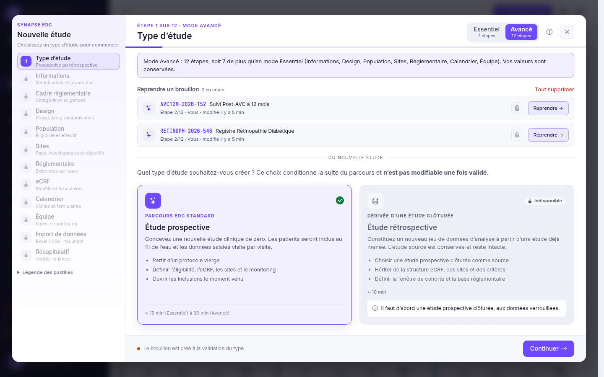

Menu **Études** → bouton **Nouvelle étude**. Dans l'en-tête de la fenêtre, choisissez le mode **Avancé**.

| Champ | À choisir | Explication |
|-------|-----------|-------------|
| Mode | Avancé | Affiche les 12 étapes (« 12 étapes » sur le bouton). |
| Type | Étude prospective | Les patients seront inclus au fil de l'eau. Le type est **définitif** après « Continuer ». |
| Reprendre un brouillon | ne pas toucher | Si un ancien brouillon est listé, ne le supprimez pas : « Reprendre → » le rouvre, la corbeille le supprime. |

**Ce que vous devez voir**

- [ ] « Continuer » reste grisé tant qu'aucun type n'est choisi.
- [ ] Après « Continuer », l'étape 1 est cochée et la carte indique « Choix définitif » (l'écran dit : « Étude prospective. Le type est définitif… »).

### Étape 2 · Informations

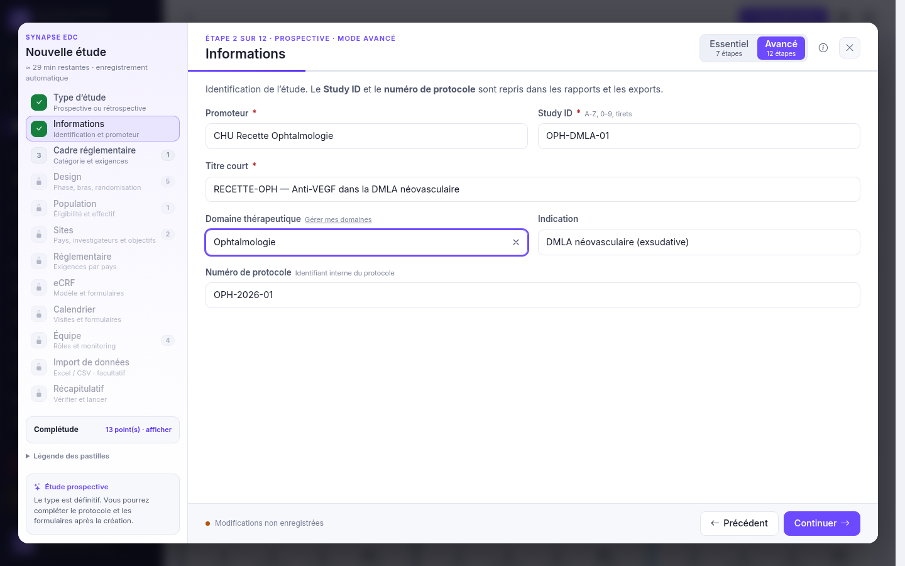

Identification de l'étude, reprise dans les rapports et les exports.

| Champ | À saisir | Explication |
|-------|----------|-------------|
| Promoteur | `CHU Recette Ophtalmologie` | L'organisme responsable de l'étude. Obligatoire. |
| Study ID | `OPH-DMLA-01` | Code court et unique de l'étude : lettres, chiffres, tirets. Les minuscules deviennent des majuscules. Obligatoire. |
| Titre court | `RECETTE-OPH — Anti-VEGF dans la DMLA néovasculaire` | Le nom lisible de l'étude dans les listes. Obligatoire. |
| Domaine thérapeutique | Ophtalmologie | Active les réglages propres à l'ophtalmologie plus loin. |
| Indication | `DMLA néovasculaire (exsudative)` | La maladie étudiée. |
| Numéro de protocole | `OPH-2026-01` | Référence interne du protocole chez le promoteur, distincte du Study ID. |

Les textes gris dans les champs vides sont des **exemples** : ils disparaissent à la saisie.

**Ce que vous devez voir**

- [ ] Le Study ID s'affiche en majuscules.
- [ ] Quelques secondes après la saisie, « Brouillon enregistré » apparaît en bas.
- [ ] Après « Continuer », les points bloquants de l'étape disparaissent de la complétude.

### Étape 3 · Cadre réglementaire

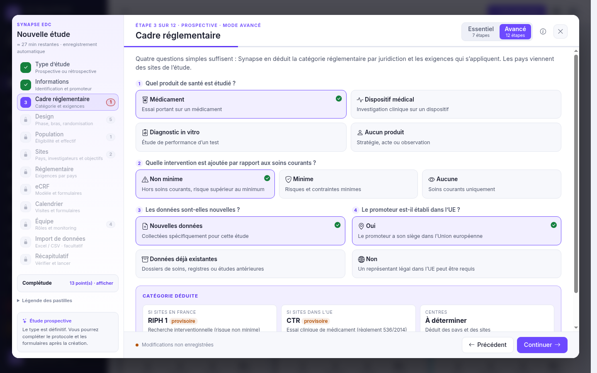

Quatre questions dont Synapse déduit la catégorie réglementaire par pays.

| Question | À choisir | Explication |
|----------|-----------|-------------|
| 1 Quel produit de santé est étudié ? | Médicament | Un essai portant sur un médicament relève du règlement européen CTR. |
| 2 Quelle intervention est ajoutée par rapport aux soins courants ? | Non minime | « Hors soins courants, risque supérieur au minimum » : catégorie RIPH 1 en France. |
| 3 Les données sont-elles nouvelles ? | Nouvelles données | Collectées spécifiquement pour cette étude. |
| 4 Le promoteur est-il établi dans l'UE ? | Oui | Un promoteur hors UE doit désigner un représentant légal dans l'UE. |

Le bouton « Continuer » attend les quatre réponses (« 4/4 réponses »).

**Ce que vous devez voir**

- [ ] Dans l'encadré « Catégorie déduite » : France **RIPH 1** et Union européenne **CTR**, chacune marquée « provisoire » (« Si sites en France », « Si sites dans l'UE »), et une troisième carte « Centres : À déterminer » (déduit des pays et des sites).
- [ ] Le message « La catégorie sera confirmée quand vous aurez choisi les pays (étape Sites) » est affiché : c'est normal, les pays se choisissent à l'étape 6.

### Étape 4 · Design

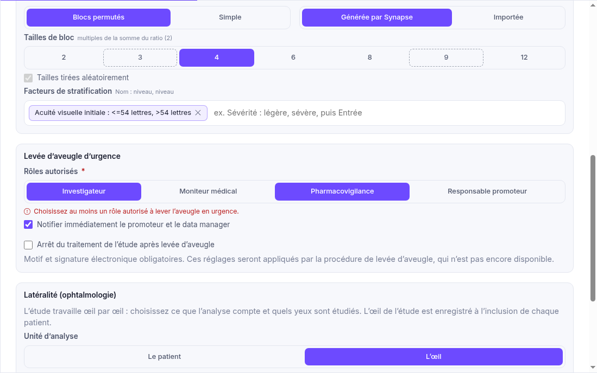

Structure de l'essai. Les champs d'ophtalmologie sont dans le bloc « Latéralité (ophtalmologie) ».

| Champ | À saisir | Explication |
|-------|----------|-------------|
| Phase | Phase III | Stade de développement du médicament. |
| Design de l'essai | Randomisé 2 bras | Deux groupes tirés au sort. |
| Randomisation | `1:1` | Rapport d'attribution entre les bras (proposé automatiquement si le champ est vide). |
| Aveugle | Double aveugle | Ni le patient ni l'investigateur ne connaissent le bras. |
| Type de contrôle | Comparateur actif | Le groupe de référence reçoit un traitement actif. |
| Noms des bras | `Aflibercept`, `Ranibizumab` | Tapez un nom puis Entrée. |
| Randomisation détaillée · Méthode | Blocs permutés | L'attribution est rééquilibrée à intervalles réguliers (la taille du bloc). |
| Randomisation détaillée · Liste de randomisation | Générée par Synapse | Réglage de conception, simplement enregistré : aucun bras n'est tiré au sort à ce stade. |
| Tailles de bloc | `4` | Doit être un multiple de la somme du ratio (ici 2). |
| Facteurs de stratification | `Acuité visuelle initiale : <=54 lettres, >54 lettres` puis Entrée | Facteur dont les niveaux sont équilibrés entre les bras. Format « Nom : niveau, niveau ». |
| Levée d'aveugle d'urgence · Rôles autorisés | Investigateur et Pharmacovigilance | Rôles qui pourront lever l'aveugle en urgence (au moins un est exigé). Voir « Problèmes connus ». |
| Latéralité · Unité d'analyse | L'œil | L'analyse compte les yeux et non les patients. |
| Latéralité · Yeux étudiés | Un œil (œil de l'étude choisi à l'inclusion) | Chaque patient est suivi pour un seul œil. |
| Latéralité · Règle si les deux yeux sont éligibles | Œil le plus atteint | Règle appliquée quand les deux yeux répondent aux critères. |
| Inclusion / Suivi | `12` et `12` mois | Durée du recrutement puis du suivi de chaque patient. |
| Durée totale | `24` (calculée) | Somme inclusion + suivi, modifiable. Obligatoire. |

**Ce que vous devez voir**

- [ ] Les blocs « Randomisation détaillée », « Levée d'aveugle d'urgence » et « Latéralité (ophtalmologie) » apparaissent.
- [ ] La durée totale se remplit seule avec 24.
- [ ] Les tailles de bloc qui ne sont pas un multiple de la somme du ratio (2), comme `3`, sont désactivées : seules les tailles valides se cochent.
- [ ] Sans aucun rôle autorisé pour la levée d'aveugle, « Continuer » est refusé avec « Choisissez au moins un rôle autorisé à lever l'aveugle en urgence. »

### Étape 5 · Population

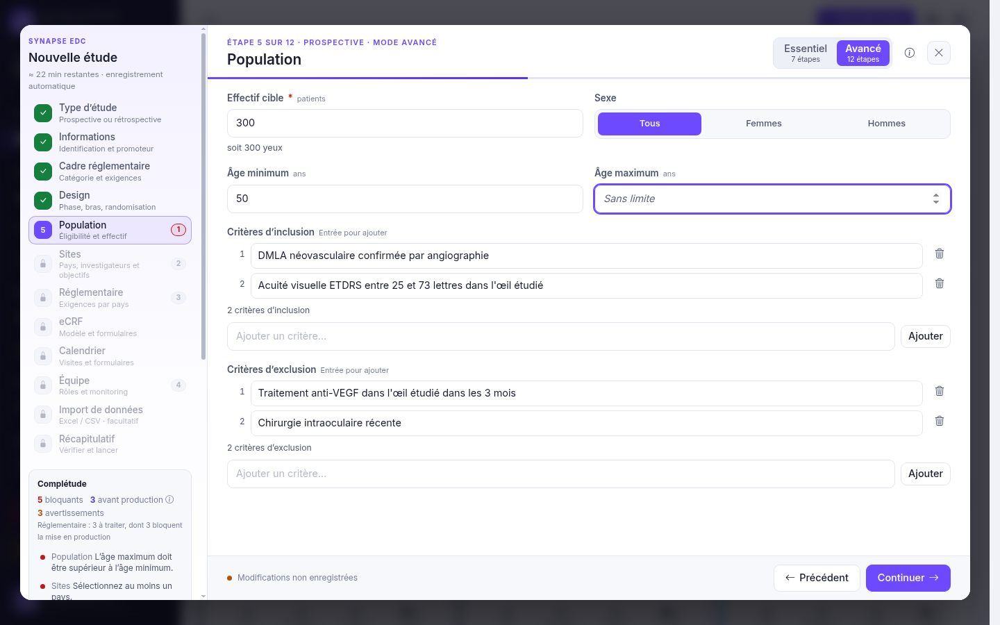

Qui peut être inclus, et combien.

| Champ | À saisir | Explication |
|-------|----------|-------------|
| Effectif cible | `300` | Nombre de patients à inclure. Il sert de référence aux objectifs par site (étape 6). Multiple de 2 pour un ratio 1:1. |
| Sexe | Tous | |
| Âge minimum | `50` | |
| Âge maximum | laisser vide | « Sans limite ». |
| Critères d'inclusion | `DMLA néovasculaire confirmée par angiographie`, puis Entrée ; `Acuité visuelle ETDRS entre 25 et 73 lettres dans l'œil étudié`, puis Entrée | Une ligne numérotée et modifiable par critère ; le bouton corbeille la supprime. |
| Critères d'exclusion | `Traitement anti-VEGF dans l'œil étudié dans les 3 mois`, puis Entrée ; `Chirurgie intraoculaire récente`, puis Entrée | Idem. |

Le statut de performance (ECOG, KPS) n'est pas proposé : c'est une échelle d'oncologie.

**Ce que vous devez voir**

- [ ] Les deux critères d'inclusion et les deux critères d'exclusion sont listés en lignes numérotées modifiables, chacune avec son bouton corbeille.
- [ ] Un effectif de 301 ajoute, dans le bloc « Complétude » de la colonne de gauche (« afficher »), l'avertissement « L'effectif cible (301) n'est pas un multiple de la somme du ratio de randomisation (2). » ; remettre `300`.

### Étape 6 · Sites

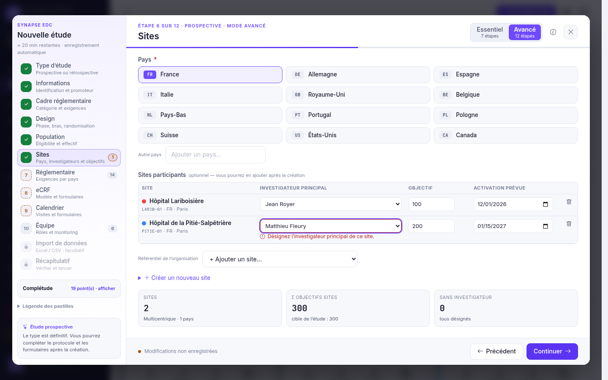

Pays de l'étude, puis établissements participants.

| Champ | À saisir | Explication |
|-------|----------|-------------|
| Pays | France | Détermine les règles réglementaires appliquées. C'est ce choix qui confirme les catégories RIPH 1 et CTR. Obligatoire. |
| Référentiel du workspace | `LARIB-01` puis `PITIE-01` (« + Ajouter un site… ») | Les sites de démonstration du workspace. Si ces sites n'existent pas, ouvrez « Créer un nouveau site » et saisissez Nom, Code, Pays (France) et Ville fictifs avec ces mêmes codes. |
| Investigateur principal | un utilisateur proposé, pour chaque site | Le médecin responsable de l'étude sur ce site. Il devient membre de l'étude au lancement, limité aux patients de son site. Un site « À désigner » bloque l'étape. |
| Objectif | `100` pour `LARIB-01`, `200` pour `PITIE-01` | Nombre de patients attendus sur le site. |
| Activation prévue | `01/12/2026` pour `LARIB-01`, `15/01/2027` pour `PITIE-01` | Date d'ouverture du site aux inclusions. Une date passée fait afficher « Date d'activation passée ». |

**Ce que vous devez voir**

- [ ] Le bandeau de statistiques indique 2 sites et « Σ objectifs sites » à 300, soit l'effectif cible.
- [ ] Un site sans investigateur principal bloque « Continuer ».

### Étape 7 · Réglementaire

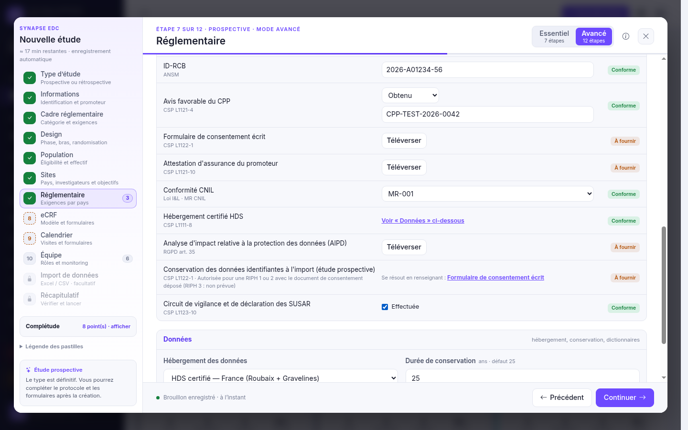

Liste des exigences déduites du cadre RIPH 1 et CTR, par ensemble de règles (« Socle international », « Union européenne », « France »). Un point manquant n'empêche pas le lancement : il devra être levé avant la mise en production.

| Exigence | À faire | Explication |
|----------|---------|-------------|
| Protocole signé | **Téléverser** un PDF fictif d'une page portant « TEST » | Le protocole signé de l'étude. |
| Version du protocole | `1.0` | |
| Date du protocole | `15/10/2026` | |
| EU CT number | `2026-500123-45-00` | Numéro d'essai attribué par CTIS, le portail européen des essais cliniques. Format `AAAA-5NNNNN-NN-NN` ; un format faux est signalé. |
| ID-RCB | `2026-A01234-56` | Numéro d'enregistrement de la recherche auprès de l'ANSM. Format `AAAA-ANNNNN-NN`. |
| Avis favorable du CPP | « Obtenu », référence `CPP-TEST-2026-0042` | Avis du comité de protection des personnes. Un statut « Obtenu » sans référence affiche « Référence requise ». |
| Conformité CNIL | `MR-001` | Méthodologie de référence de la CNIL applicable aux recherches avec consentement. |
| Circuit de vigilance et de déclaration des SUSAR | cocher | Procédure de déclaration des effets indésirables graves inattendus. |
| Données · Hébergement des données | « HDS certifié — France (Roubaix + Gravelines) » | HDS : hébergement certifié pour les données de santé, obligatoire pour des patients français. |
| Données · Durée de conservation | `25` ans | Le règlement CTR exige 25 ans pour le dossier permanent de l'essai. |
| Données · Versions des dictionnaires | MedDRA `27.1` | MedDRA : dictionnaire international des événements indésirables ; sa version est figée pour la durée de l'étude. |

**Ce qui reste à fournir après cette étape** (ne le saisissez pas, ce sont des points « avant production ») : l'autorisation CTIS (parties I et II), le formulaire de consentement écrit, l'attestation d'assurance du promoteur, l'analyse d'impact relative à la protection des données (AIPD, simple avertissement) et la « Conservation des données identifiantes à l'import ».
Cette dernière ne se résout que par le dépôt du consentement : ne le déposez pas (voir l'étape 14).

**Ce que vous devez voir**

- [ ] L'en-tête indique « Exigences déduites du cadre RIPH 1 · CTR ».
- [ ] La matrice par pays affiche la France et le compteur d'exigences remplies sur le total.
- [ ] Un ID-RCB au mauvais format (par exemple `2026-A1234`) affiche « Format attendu : AAAA-ANNNNN-NN » ; le statut se met à jour quelques secondes plus tard, et avec la valeur de la ligne ci-dessus il passe « Conforme ».
- [ ] Le protocole téléversé apparaît avec sa version et sa date de dépôt, et au récapitulatif (étape 12) sous « Documents déposés » ; l'EU CT number et l'avis du CPP passent « Conforme ».

### Étape 8 · eCRF

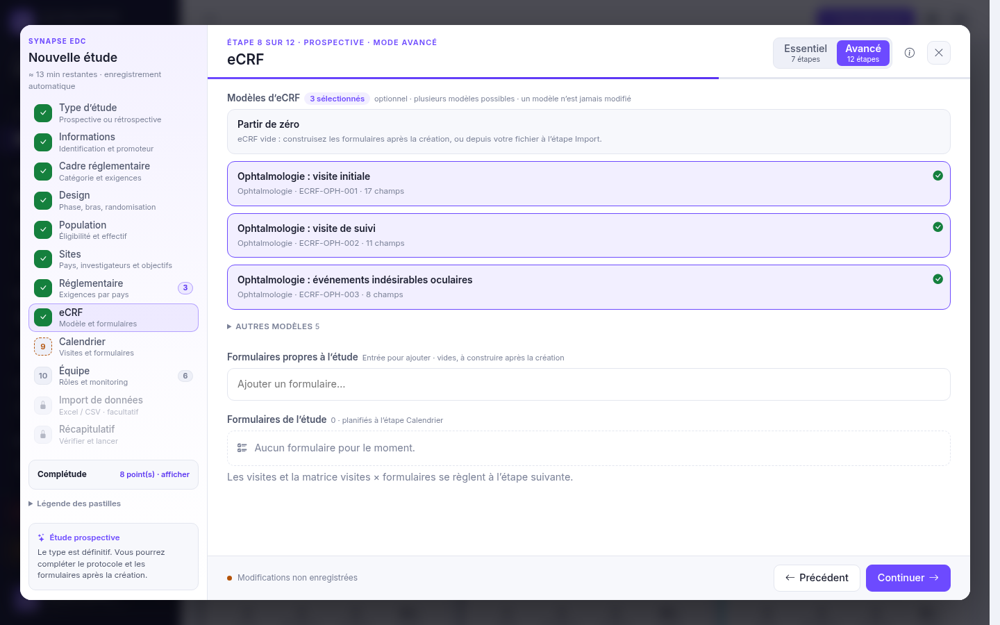

Les formulaires de saisie de l'étude.

| Champ | À cocher | Explication |
|-------|----------|-------------|
| Modèles d'eCRF | `Ophtalmologie : visite initiale`, `Ophtalmologie : visite de suivi`, `Ophtalmologie : événements indésirables oculaires` | Trois modèles proposés en tête de liste (domaine Ophtalmologie). Plusieurs modèles peuvent être cochés. |
| Formulaires propres à l'étude | laisser vide | Pour créer des formulaires vides à construire plus tard. |

**Ce que vous devez voir**

- [ ] « Partir de zéro » se décoche dès qu'un modèle est coché.
- [ ] Le compteur affiche « 3 sélectionnés ».
- [ ] Sous « Formulaires de l'étude », les trois formulaires sont listés.

### Étape 9 · Calendrier

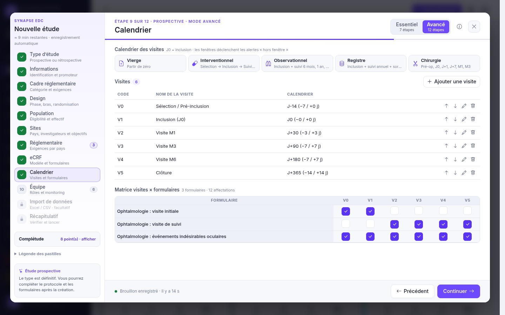

Les visites de l'étude et les formulaires remplis à chacune. **J0 est le jour de l'inclusion.**

Le calendrier **est déjà proposé** : un essai randomisé reçoit le modèle « Interventionnel » (Sélection → Inclusion → Suivi → Clôture) et chaque formulaire est placé à sa visite d'après son modèle. Les préréglages du bouton « Interventionnel » ne servent qu'à repartir de zéro.

Visites attendues (code, nom, jour) : `V0` Sélection / Pré-inclusion (J-14), `V1` Inclusion (J0), `V2` Visite M1 (J30), `V3` Visite M3 (J90), `V4` Visite M6 (J180), `V5` Clôture (J365).

Matrice « visites × formulaires » attendue (une coche = formulaire prévu à la visite) :

| Formulaire | V0 | V1 | V2 | V3 | V4 | V5 |
|------------|----|----|----|----|----|----|
| Ophtalmologie : visite initiale | oui | oui | | | | |
| Ophtalmologie : visite de suivi | | | oui | oui | oui | oui |
| Ophtalmologie : événements indésirables oculaires | oui | oui | oui | oui | oui | oui |

Le formulaire d'événements indésirables est prévu à chaque visite mais **facultatif** : on le remplit seulement quand un événement survient. Cette nuance se voit dans le cahier de visites du patient (étape 17), pas dans la matrice.

**Ce que vous devez voir**

- [ ] Six visites, et la matrice ci-dessus. Le compteur indique « 3 formulaires · 12 affectations ».
- [ ] Aucun avertissement « Formulaires non planifiés ».
- [ ] Un clic sur une case de la matrice la coche ou la décoche (remettez-la comme ci-dessus).

### Étape 10 · Équipe

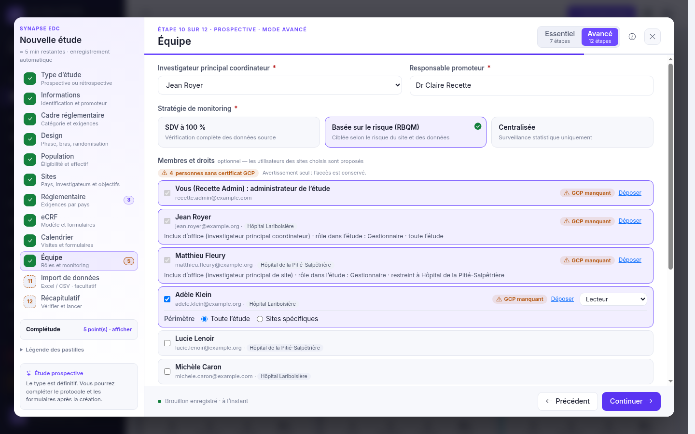

Responsables, monitoring, membres et invitations.

| Champ | À saisir | Explication |
|-------|----------|-------------|
| Investigateur principal coordinateur | un utilisateur proposé | Le médecin qui coordonne l'étude sur tous les sites. Obligatoire. |
| Responsable promoteur | `Dr Claire Recette` | Contact chez le promoteur ; texte libre, pas forcément un utilisateur. Obligatoire. |
| Stratégie de monitoring | Basée sur le risque (RBQM) | Comment les données sont vérifiées par les ARC : tout vérifier (« SDV à 100 % »), cibler selon le risque, ou surveiller à distance par statistiques (« Centralisée »). Obligatoire. |
| Membres et droits | cocher **un** utilisateur, rôle « Lecteur » | Les investigateurs principaux sont déjà inclus d'office. « GCP manquant » signale l'absence de certificat de bonnes pratiques cliniques : simple avertissement. |
| Invitations · E-mail | `arc.recette@example.com` | Cliquez sur « Inviter par e-mail ». Les e-mails ne partent qu'au lancement. |
| Invitations · Rôle sur les sites | « ARC moniteur » ; ce champ n'apparaît qu'une fois un site coché (puces des sites) | Sans site coché, l'invité a accès à tous les sites (« Accès à tous les sites »). |
| Invitations · Rôle dans l'étude | laisser la valeur proposée | Pour un « ARC moniteur », l'application propose **Lecteur**. Cocher un site présélectionne d'abord « Investigateur » et le rôle d'étude Gestionnaire, jusqu'à ce que « ARC moniteur » soit choisi. |

Essai d'une adresse invalide : dans une seconde invitation, saisissez `pas-une-adresse`.

**Ce que vous devez voir**

- [ ] Cocher un site présélectionne « Investigateur » et le rôle d'étude Gestionnaire ; le rôle d'étude passe à « Lecteur » dès que « ARC moniteur » est choisi comme rôle sur les sites.
- [ ] Avec `pas-une-adresse` : le message « Adresse e-mail invalide : cette invitation ne sera pas enregistrée. » apparaît sous le champ, et « Continuer » est refusé tant que l'adresse reste invalide ou en double. Retirez cette invitation avec la corbeille (« Invitation retirée »).
- [ ] Si le bouton corbeille d'une invitation refusée reste inactif (problème connu, #381), cliquez sur « Précédent » puis « Continuer » : l'invitation disparaît.

### Étape 11 · Import de données

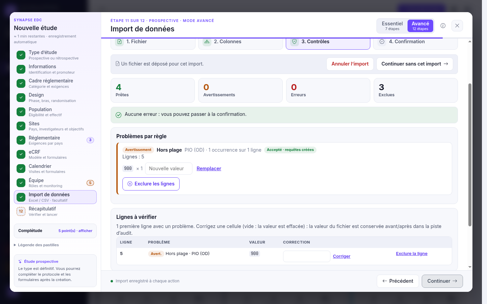
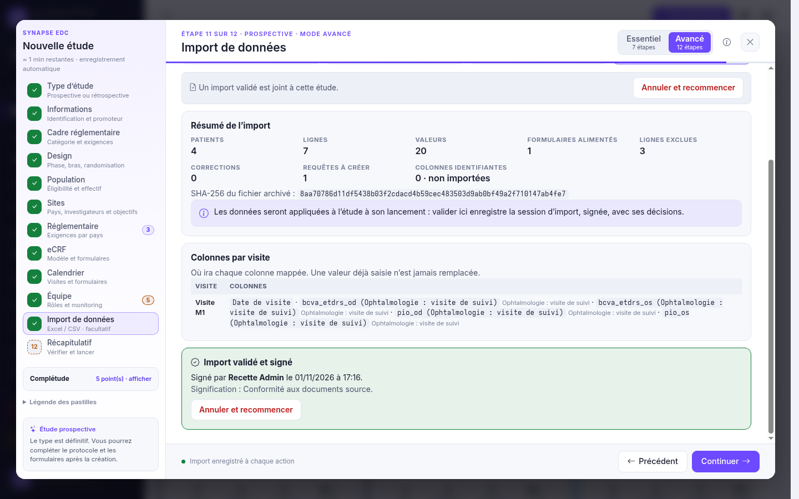

Déposer le fichier de test (voir [Fichier de test](#fichier-de-test)). L'import comporte quatre sous-étapes : Fichier, Colonnes, Contrôles, Confirmation. Il est **facultatif** : « Passer cette étape » (ou « Continuer sans cet import » une fois un fichier déposé) le saute (à faire dans ce cas, puis reprendre l'import depuis Patients › Importer après le lancement).

**11.1 Fichier.** Glissez le fichier ou « parcourez vos dossiers ».

| Élément | À vérifier | Explication |
|---------|------------|-------------|
| Empreinte SHA-256 | affichée | Empreinte du fichier, conservée pour la traçabilité : elle prouve plus tard quel fichier a été importé. |
| Lignes de données / Colonnes | 7 lignes, 8 colonnes | |
| Lecture du fichier | séparateur point-virgule, en-tête ligne 1 | Dépliez-la si besoin. |
| Données identifiantes | « Aucune colonne identifiante détectée » ; politique « Ne pas importer » laissée telle quelle | Le fichier ne contient ni nom ni date de naissance. Un avis « Base réglementaire manquante : Formulaire de consentement écrit » est affiché : c'est normal, ne déposez pas le consentement (voir l'étape 14). |

Bouton suivant : **Continuer vers les colonnes**.

**11.2 Colonnes.** Chaque colonne est rapprochée d'un champ de l'étude, et d'une visite : la colonne « Visite » propose « Selon le formulaire » (laissez ce choix).

| Colonne | Champ attendu | Explication |
|---------|---------------|-------------|
| `Identifiant patient` | Identifiant patient | Avec l'avertissement « Identifiant du fichier = code patient » : il ne doit contenir aucune donnée identifiante. |
| `Date de visite` | Date de visite | La mention « Alimente aussi : … » signale que la même colonne renseigne le champ « Date de la visite » du formulaire de suivi. |
| `Site` | Site | Code ou nom d'un site de l'étude. |
| `study_eyes` | Œil de l'étude | L'œil de l'étude du patient. |
| `bcva_etdrs_od`, `bcva_etdrs_os`, `pio_od`, `pio_os` | BCVA (OD), BCVA (OS), PIO (OD), PIO (OS) | Une cible par œil. Sous chacune, « → Visite M1 » indique la visite où ira la valeur (celle du formulaire de suivi). |

Bouton suivant : **Continuer vers les contrôles**.

**11.3 Contrôles.** Les valeurs du fichier sont confrontées aux champs : erreurs (bloquantes) et avertissements. Voir le tableau d'anomalies de la page « Fichier de test ». Actions :

1. Pour IMP-007 (`XX`) : dans le groupe « Valeur non reconnue » du champ « Œil de l'étude » (colonne `study_eyes`), saisissez `OD` dans « Nouvelle valeur » puis cliquez sur **Remplacer**.
2. Cliquez sur **Exclure toutes les lignes en erreur** et confirmez : IMP-003 (site), IMP-005 (valeur non reconnue) et IMP-006 (date) sortent de l'import.
3. Pour IMP-004 (PIO 900, avertissement « Hors plage ») : **Accepter et créer une requête par ligne**. Une discordance sera créée sur cette valeur après l'application de l'import.

Bouton suivant : **Continuer vers la confirmation** (grisé tant qu'il reste une erreur).

**11.4 Confirmation et signature.**

| Champ | À saisir | Explication |
|-------|----------|-------------|
| Résumé de l'import | attendu : 4 patients (IMP-001, IMP-002, IMP-004, IMP-007), 7 lignes, 20 valeurs, 1 formulaire alimenté, 3 lignes exclues, 1 requête à créer | Patients, valeurs, formulaires alimentés, lignes exclues, corrections, requêtes à créer. |
| Colonnes par visite | lire le tableau : « Visite M1 » reçoit la date et les quatre colonnes de mesure | Annonce où ira chaque colonne ; une valeur déjà saisie n'est jamais remplacée. |
| Site d'inclusion | `LARIB-01` | Site des lignes sans valeur dans la colonne Site. La colonne « Site » du fichier l'emporte, ligne par ligne. |
| Certification | cocher | Vous attestez que les données et le rapprochement sont justes. |
| Signification de la signature | garder « Conformité aux documents source » | Le sens juridique de la signature, enregistré avec elle (21 CFR Part 11). |
| Mot de passe (ré-authentification) | d'abord un mauvais mot de passe, puis le vôtre | Une signature électronique exige de retaper le mot de passe. |

Bouton : **Valider et signer l'import**.

**Ce que vous devez voir**

- [ ] 11.1 : 7 lignes de données et 8 colonnes.
- [ ] 11.2 : les 8 colonnes sont rapprochées sans colonne « En attente » ni « Œil à préciser ».
- [ ] 11.3 : exactement les anomalies du tableau, avec les libellés indiqués. « Aucune erreur : vous pouvez passer à la confirmation » après l'exclusion.
- [ ] 11.4 : le mauvais mot de passe est refusé avec un message ; le bon valide : « Import validé et signé ». Passez ensuite au Récapitulatif avec « Continuer ».
- [ ] Une barre « Annuler l'import » est visible dès que le fichier est déposé.

:::note[Les patients importés sont des patients réels]
Les patients importés ne sont pas marqués « TEST » : ils ne sont pas supprimés à la mise en production et apparaissent dans les exports normaux. Sur l'environnement de recette, cela n'a pas de conséquence puisque les données sont fictives.
:::

### Étape 12 · Récapitulatif et lancement

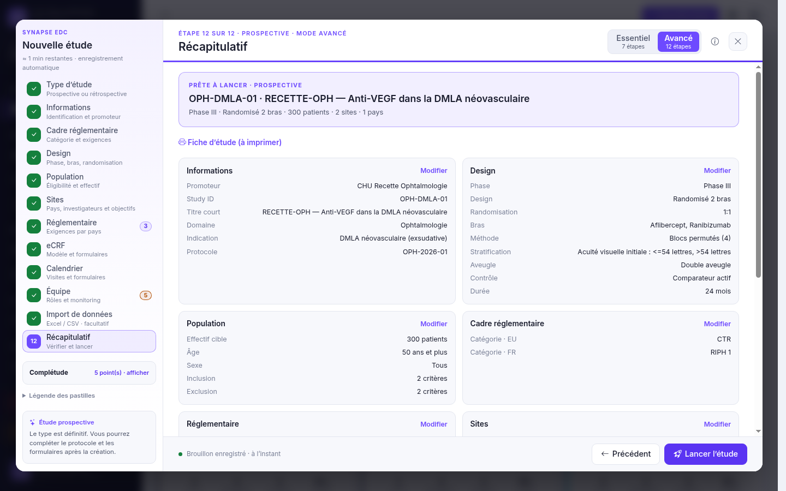

Relire, ouvrir la « Fiche d'étude (à imprimer) », puis **Lancer l'étude**.

**Ce que vous devez voir**

- [ ] L'en-tête indique « Prête à lancer · prospective », le Study ID en majuscules et le résumé « Phase III · Randomisé 2 bras · 300 patients · 2 sites · 1 pays ».
- [ ] Les blocs Informations, Design, Population, Cadre réglementaire, Réglementaire, Sites, eCRF (trois modèles), Calendrier (« 6, de J-14 à J+365 »), Équipe (membres, invitation avec son rôle d'étude, son rôle sur les sites et ses sites) et Import (« Signé » avec votre nom) correspondent à ce que vous avez saisi.
- [ ] « Lancer l'étude » ouvre une fenêtre de confirmation qui dit que l'étude est créée en statut Configuration (réglages, import et patients de test ouverts, inclusions réelles fermées jusqu'à la mise en production) et combien de points restent à traiter (« 5 à traiter, dont 3 bloquent la mise en production »).
- [ ] Après confirmation, l'étude s'ouvre sur sa page **Configuration**.

## Après le lancement

### Étape 13 · Première lecture de la page Configuration

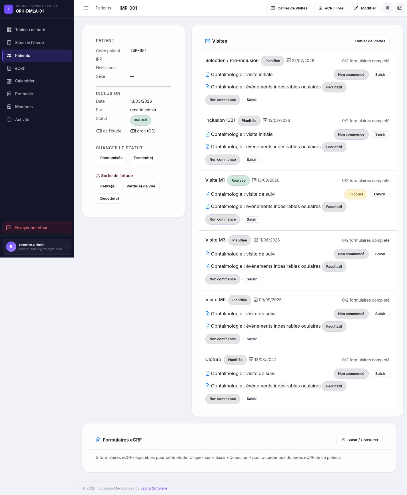

La page Configuration est la liste de contrôle de la mise en production, en **quatre volets dépliables** (un seul ouvert à la fois) : **1 Exigences réglementaires**, **2 Paramètres à confirmer**, **3 Recette (UAT)**, **4 Signatures et mise en production**. L'application les numérote « étapes » ; ils sont appelés « volets » ici pour ne pas les confondre avec les étapes de cette recette.

**Ce que vous devez voir**

- [ ] Les pastilles « Configuration » et « Patients de test uniquement » (cette dernière disparaît une fois l'import appliqué), puis « RIPH 1 · CTR · Multicentrique ».
- [ ] Un bandeau « Prochaine action » (par exemple « Renseigner : … » avec le bouton « Voir les exigences »).
- [ ] La barre d'avancement : Réglementaire, Paramètres, Recette, Mise en production.
- [ ] Dans **Patients**, les patients importés IMP-001, IMP-002, IMP-004 et IMP-007 sont présents après quelques secondes (l'import s'applique en arrière-plan), avec leur code patient et leur œil de l'étude. Sur la fiche de IMP-001, les valeurs du fichier sont dans le formulaire « Ophtalmologie : visite de suivi » de la visite **Visite M1** (« En cours »), et non dans une visite « Hors plan ».
- [ ] La page Membres de l'étude liste le créateur (« Propriétaire »), le PI coordinateur, les PI des sites et le membre coché à l'étape 10.

### Étape 14 · Volet 1 : exigences réglementaires

Dépliez « Exigences réglementaires ». Elle reprend les exigences de l'étape 7 : « À traiter (n) » en premier, puis les exigences conformes repliées.

| Élément | À faire | Explication |
|---------|---------|-------------|
| Autorisation CTIS (parties I et II) | statut « Obtenu », référence `CTIS-TEST-2026-01`, « Enregistrer les exigences » | Autorisation de l'essai par le portail européen. |
| Ajouter un document | document attendu « Attestation d'assurance du promoteur », un PDF fictif, version `1.0`, « Téléverser » | Dépose un document manquant (possible aussi sur sa ligne). **Ne déposez pas le consentement écrit** : le formulaire d'inclusion (étapes 16 et 21) demanderait alors un nom et une date de naissance. |

**Ce que vous devez voir**

- [ ] Le compteur « n à traiter » diminue après chaque enregistrement.
- [ ] Les exigences saisies à l'étape 7 sont repliées dans « n exigences conformes ou facultatives ».
- [ ] Le volet 1 passe à « Terminé » quand toutes les exigences sont traitées (vous pouvez en laisser, c'est un point de plus à lever avant la production).

### Étape 15 · Volet 2 : paramètres à confirmer

**Ce que vous devez voir**

- [ ] Le message « Aucun paramètre à confirmer : l'étude a été configurée en mode avancé. » et le volet à « Terminé » (0 / 0).

### Étape 16 · Premier patient de test, œil droit

Dans le volet 3 « Recette (UAT) », bloc **Données de test**, cliquez sur **Créer un patient de test**. Choisissez un site si on vous le demande.

| Champ | À saisir | Explication |
|-------|----------|-------------|
| Année de naissance | `1950` | L'étude fixe un âge minimum : l'année est obligatoire. Aucun nom n'est demandé. |
| Sexe | au choix | |
| Œil de l'étude | Œil droit (OD) | L'étude suit un seul œil par patient. Obligatoire. |

Cliquez sur **Inclure dans l'étude**.

**Ce que vous devez voir**

- [ ] Un bandeau « L'étude est en configuration : ce patient sera un patient de test » en haut du formulaire.
- [ ] Une note indique que l'étude ne conserve pas de données identifiantes (code patient généré à l'inclusion, ni nom ni date de naissance complète).
- [ ] La fiche du patient affiche un **Code patient**, l'année de naissance, « Patient de test » et « Œil de l'étude : Œil droit (OD) ».
- [ ] Sans choix de l'œil, l'inclusion est refusée.

### Étape 17 · Cahier de visites

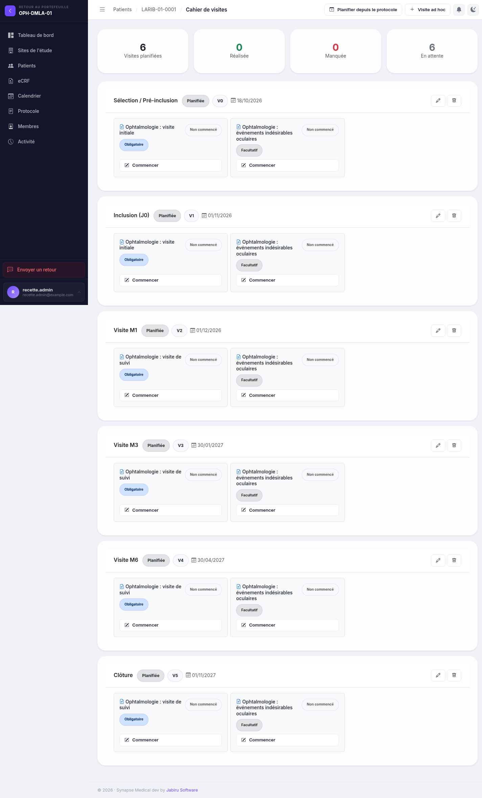

Les visites sont planifiées dès l'inclusion du patient : sur sa fiche, descendez jusqu'au **Cahier de visites** (inutile de cliquer sur « Planifier depuis le protocole » dans la page « Visites »).

**Ce que vous devez voir**

- [ ] Six visites, avec à chacune les formulaires de la matrice de l'étape 9 : « visite initiale » à Sélection et Inclusion, « visite de suivi » de M1 à Clôture, « événements indésirables oculaires » à toutes les visites.
- [ ] Le formulaire d'événements indésirables porte l'étiquette **Facultatif** ; les autres sont **Obligatoire** (page « Visites ») et « Non commencé ».
- [ ] Aucun formulaire « Hors plan » pour ce patient saisi à la main.

### Étape 18 · Saisie œil par œil

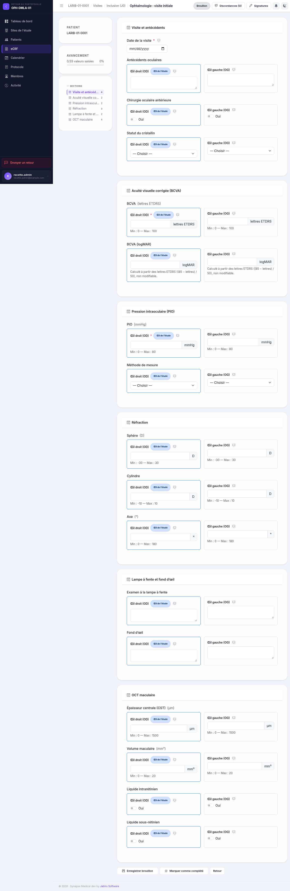

Ouvrez la visite **Inclusion (J0)** (page « Visites » du patient), formulaire **Ophtalmologie : visite initiale**, avec **Commencer**. Chaque mesure est affichée **côte à côte** pour l'œil droit (OD) et l'œil gauche (OG) ; l'œil de l'étude est entouré et porte le badge « Œil de l'étude ».

| Section | Champ | Œil droit (OD) | Œil gauche (OG) |
|---------|-------|----------------|-----------------|
| Visite et antécédents | Date de la visite | une date passée | |
| Acuité visuelle corrigée (BCVA) | BCVA (lettres ETDRS) | `62` | `70` |
| Pression intraoculaire (PIO) | PIO (mmHg) | `16` | `15` |
| Pression intraoculaire (PIO) | Méthode de mesure | Goldmann | Goldmann |

Le champ « BCVA (logMAR) » est **calculé** à partir des lettres ETDRS et non modifiable ; sous la BCVA, l'équivalent en logMAR, décimal et Snellen s'affiche.

Cliquez sur **Enregistrer brouillon**. Les valeurs sont aussi enregistrées automatiquement après quelques secondes (« Enregistré à … »).

Essai de bornes : saisissez `90` dans la PIO de l'œil droit puis enregistrez.

**Ce que vous devez voir**

- [ ] La BCVA et la PIO sont obligatoires (étoile) **pour l'œil de l'étude seulement** ; l'autre œil reste facultatif.
- [ ] La valeur `90` est refusée avec le message « Valeur trop élevée : le maximum autorisé est 80. » ; elle n'est pas enregistrée. Remettez `16` et enregistrez.
- [ ] Après enregistrement du brouillon, le formulaire reste affiché, les valeurs sont conservées avec leur œil et l'avancement « valeurs saisies » monte (il compte aussi les interrupteurs « Oui / Non » laissés sur « Non » : problème connu, #378).

### Étape 19 · Modifier avec un motif, puis compléter

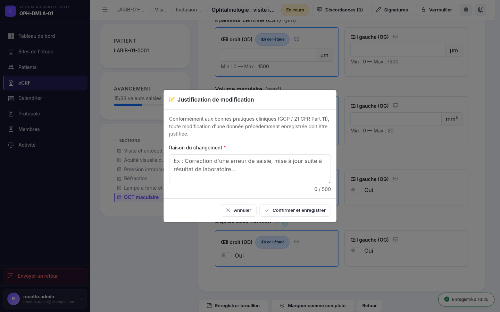
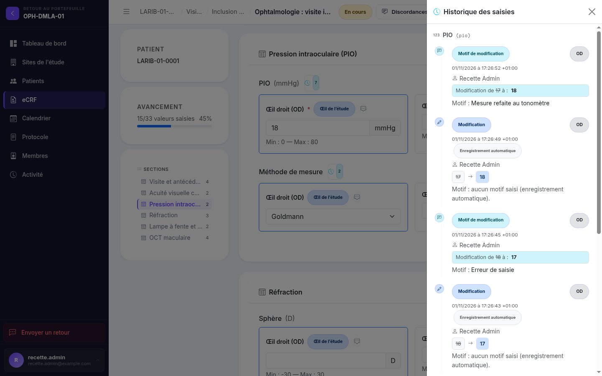

Avant de compléter, changez la PIO de l'œil droit de `16` à `18` et cliquez sur **Enregistrer brouillon**. Puis cliquez sur **Marquer comme complété**.

**Ce que vous devez voir**

- [ ] La modification d'une valeur déjà enregistrée ouvre la fenêtre « Justification de modification » : « Raison du changement » est obligatoire (500 caractères maximum). Saisissez `Mesure refaite au tonomètre`.
- [ ] L'icône d'historique (horloge) du champ liste l'ancienne valeur, la nouvelle, l'auteur et l'heure ; pour la modification de la PIO, elle indique aussi le motif (« Motif : Mesure refaite au tonomètre »).
- [ ] « Marquer comme complété » est refusé tant qu'une valeur obligatoire de l'œil de l'étude manque ; une fois les valeurs saisies, l'application revient au cahier de visites, le formulaire passe « Complété », devient lisible seulement et son avancement ne tombe pas à 0.
- [ ] Attendu : la visite Inclusion est considérée comme réalisée dès que ses formulaires obligatoires sont complétés, sans attendre le formulaire d'événements indésirables facultatif.

### Étape 20 · Visite de suivi

Ouvrez la visite **Visite M1** (V2), formulaire **Ophtalmologie : visite de suivi**, et saisissez : BCVA œil droit `40`, BCVA œil gauche `70`, PIO œil droit `15`, PIO œil gauche `15`, date de visite : saisissez la date du jour (une date postérieure à l'inclusion est impossible le jour même, car les dates futures sont refusées). Enregistrez.

**Ce que vous devez voir**

- [ ] Un avertissement signale la variation de la BCVA de l'œil droit : « BCVA (OD) : -22 par rapport à la première valeur du même œil (62), au-delà de 15. » C'est un avertissement : l'enregistrement n'est pas bloqué.
- [ ] La BCVA de l'œil gauche (70, identique à l'inclusion) ne déclenche aucun avertissement.
- [ ] Le formulaire d'événements indésirables, laissé vide, n'empêche pas la visite d'être comptée comme réalisée une fois le suivi complété.
- [ ] Facultatif : dans « Ophtalmologie : événements indésirables oculaires », créez un événement (terme `Hémorragie sous-conjonctivale`, œil concerné OD, date de début, gravité Légère). La section est répétable (« Instance »).

### Étape 21 · Second patient de test, œil gauche

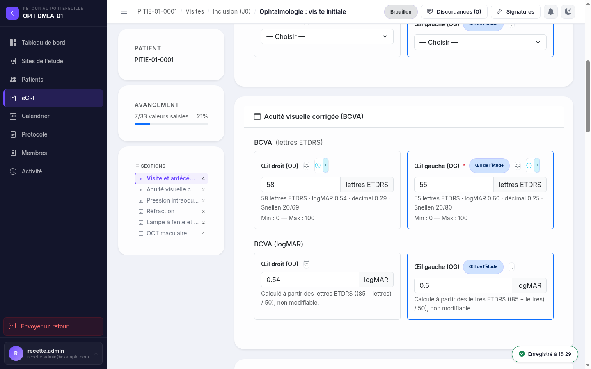

Recommencez les étapes 16 et 17 avec un autre patient : année de naissance `1948`, **Œil gauche (OG)** comme œil de l'étude. Au cahier de visites, ouvrez « Ophtalmologie : visite initiale » à l'Inclusion et saisissez BCVA OD `58`, BCVA OG `55`, PIO OD `14`, PIO OG `17`.

**Ce que vous devez voir**

- [ ] Cette fois, c'est l'œil gauche qui est entouré, porte le badge « Œil de l'étude » et dont les champs sont obligatoires.
- [ ] La liste des patients affiche vos deux patients, marqués « Patient de test », avec leur œil de l'étude (OD pour l'un, OG pour l'autre).

### Étape 22 · Discordance sur la BCVA de l'œil gauche

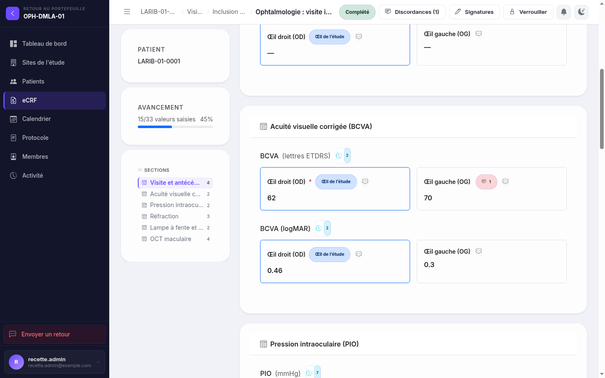

Une discordance (query) est une question posée au centre sur une valeur. Dans le formulaire « visite initiale » du premier patient, à côté de **Œil gauche (OG)** du champ BCVA, cliquez sur l'icône « Lever une discordance ».

| Champ | À saisir | Explication |
|-------|----------|-------------|
| Champ concerné | « BCVA OG » (prérempli, avec l'œil) | « Changer ou retirer le champ » permet d'en choisir un autre. La valeur saisie (`70`) est rappelée. |
| Type de discordance | Illisible / ambigu | « Valeur manquante » est proposé par défaut : changez-le. Autres choix : Date incohérente, Valeur hors intervalle, Déviation protocole, Autre. |
| Description | `Acuité de l'œil gauche à confirmer sur la feuille d'examen.` | |

Cliquez sur **Enregistrer**. Ensuite, dans la liste des discordances : saisissez une réponse (`Valeur confirmée : 70 lettres.`) puis **Répondre**, puis **Clôturer**.

**Ce que vous devez voir**

- [ ] Après l'enregistrement, une pastille rouge de discordance ouverte apparaît à côté du champ, **uniquement sur l'œil gauche**.
- [ ] La discordance est « Ouverte », puis « Répondue » après la réponse, puis « Clôturée » ; l'auteur et la date de chaque action sont affichés.
- [ ] La page Discordances de l'étude liste les discordances ouvertes : celle-ci tant qu'elle est ouverte, et celle créée par l'import pour IMP-004, présentée comme « Alerte d'import » (« Import n°1, ligne 5 : hors plage (valeur du fichier « 900 ») »).
- [ ] Le formulaire propose « Discordances (n) », n étant le nombre de discordances ouvertes.

### Étape 23 · Signature électronique d'un formulaire

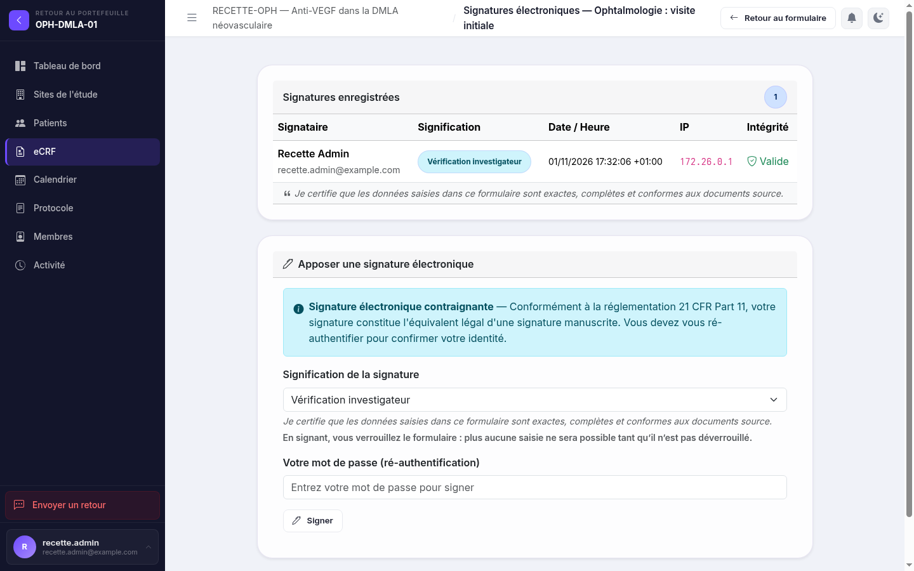

Dans le formulaire « visite initiale » complété, cliquez sur **Signatures** : la page affiche directement le bloc **Apposer une signature électronique**.

| Champ | À saisir | Explication |
|-------|----------|-------------|
| Signification de la signature | Vérification investigateur | Le sens de la signature, enregistré avec elle. |
| Votre mot de passe (ré-authentification) | d'abord un mauvais mot de passe, puis le vôtre | Une signature électronique exige de retaper le mot de passe. |

Cliquez sur **Signer**.

**Ce que vous devez voir**

- [ ] Un mauvais mot de passe est refusé.
- [ ] Avec le bon : la signature apparaît dans la liste (signataire, signification, date et heure) avec l'intégrité « Valide ».
- [ ] Le formulaire reste en lecture seule : la signature le verrouille (bouton « Déverrouiller » à la place de « Verrouiller »).

### Étape 24 · Droits d'un ARC

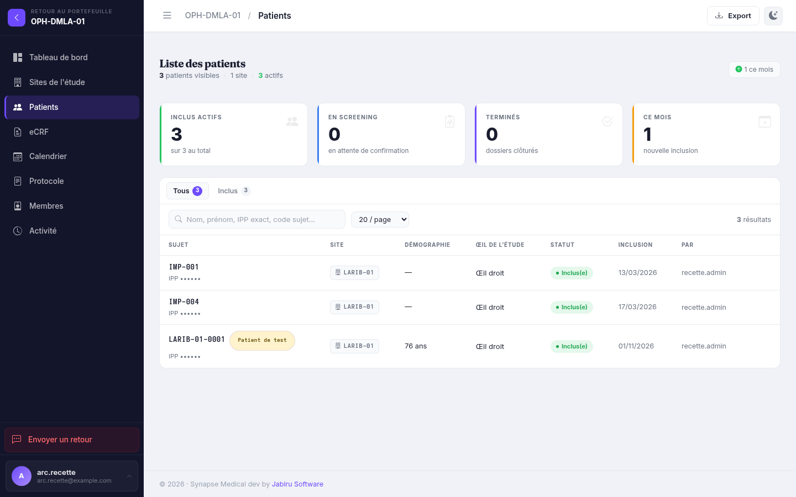

Déconnectez-vous, puis ouvrez l'invitation de l'étape 10 (adresse `arc.recette@example.com`) pour créer le compte ARC, et connectez-vous (fenêtre privée du navigateur) avec lui : rôle de site « ARC moniteur » sur un site de l'étude, rôle d'étude Lecteur. Ouvrez le formulaire d'un patient de ce site.

**Ce que vous devez voir**

- [ ] Le formulaire est en **lecture seule** : ni « Enregistrer brouillon » ni « Marquer comme complété ».
- [ ] Le bouton « Lever une discordance » est présent, par champ et par œil : l'ARC peut lever une discordance (`Valeur à vérifier sur le dossier source.`), la clôturer, et annuler celles qu'il a levées. Il ne peut pas répondre (réservé à la saisie).
- [ ] Il ne voit que les patients et les discordances de son site.
- [ ] Pour la signature, seule la signification « Vérification sponsor / ARC » lui est proposée.

### Étape 25 · Exporter les données de test

Revenez à la page Configuration, volet 3, bloc **Données de test** : section « Exporter les données de test (fichiers marqués « TEST ») ».

| Bouton | À faire | Explication |
|--------|---------|-------------|
| Patients CSV | télécharger et ouvrir | La liste des patients de test. |
| eCRF CSV | télécharger, ouvrir l'archive ZIP | Les données eCRF : un fichier CSV par formulaire, une ligne par patient, **une colonne par œil**. |
| eCRF CSV (une ligne par œil) | télécharger, ouvrir l'archive ZIP | Les mêmes données, **une ligne par œil**. |

**Ce que vous devez voir**

- [ ] Le nom de chaque fichier contient `TEST` et la dernière colonne, « Donnée de test », vaut `TEST` sur chaque ligne (dans chacun des CSV de l'archive).
- [ ] Les fichiers ne contiennent que vos deux patients de test (pas les patients importés).
- [ ] Export par colonne : l'archive contient `01_…visite_initiale.csv`, `02_…visite_de_suivi.csv` et `03_…evenements_indesirables_oculaires.csv`. Dans les deux premiers, des colonnes `bcva_etdrs_od`, `bcva_etdrs_os`, `pio_od`, `pio_os` **suffixées par la visite**, par exemple `bcva_etdrs_od_v1` (Inclusion) et `bcva_etdrs_od_v2` (Visite M1).
  La colonne `study_eyes` indique OD pour l'un et OS pour l'autre.
- [ ] Export une ligne par œil : mêmes fichiers, avec les colonnes `eye` (OD ou OS) et `study_eye` (`Y` pour l'œil de l'étude, `N` pour l'autre).
- [ ] Les valeurs correspondent à celles saisies : BCVA 62 / 70 et PIO 18 / 15 pour le premier patient.

### Étape 26 · Les exports normaux et le journal

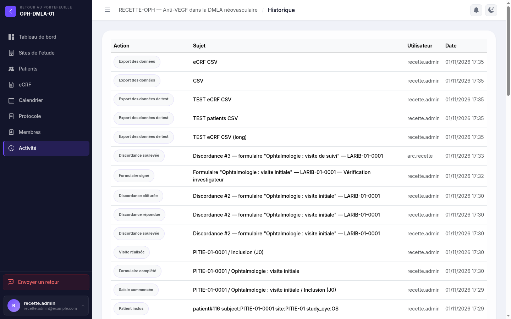

Sur la page de l'étude, menu ⋮ → **Exporter CSV**, puis **Données eCRF CSV, ZIP (une colonne par œil)**. Puis menu ⋮ → **Historique complet**.

**Ce que vous devez voir**

- [ ] Les exports normaux ne contiennent **aucun patient de test** (ils contiennent les patients importés).
- [ ] L'historique complet liste, avec l'auteur et l'heure, notamment : le lancement de l'étude, l'import appliqué, les saisies (« Saisie commencée », « Saisie enregistrée », « Formulaire complété »), la discordance (création, réponse, clôture), la signature, l'export des données de test. Le motif de la modification de la PIO se lit dans l'historique du champ (étape 19), pas dans ce journal.

### Étape 27 · Volet 3 : recette (UAT)

Les scénarios de recette du volet 3 de la page Configuration se font sur vos patients de test. Une étude non randomisée a 4 scénarios ; cette étude randomisée en double aveugle en a 6, dont 2 grisés :

1. « Saisie d'un patient test sur chaque formulaire du calendrier »
2. « Contrôles de cohérence et discordances automatiques déclenchés »
3. « Randomisation test : allocation et équilibre des bras »
4. « Levée d'aveugle d'urgence (rôle autorisé, signature) »
5. « Export des données de test (CSV/Excel) »
6. « Droits par rôle et par site vérifiés »

Pour chaque scénario, cliquez sur **Réussi** ou **Échoué** (un commentaire est obligatoire si échoué).

- Scénarios 1 et 6 : **Réussi** après les étapes 16 à 24.
- Scénario 2 : **Réussi** après l'avertissement de variation de la BCVA (étape 20) et les bornes de la PIO (étape 18).
- Scénario 3 (randomisation) : son bouton « Réussi » est grisé, comme celui de la levée d'aveugle (scénario 4), avec la mention « Attribution des bras pas encore disponible ».

**Ce que vous devez voir**

- [ ] « Réussi » ou « Échoué » enregistre le résultat avec la date, l'heure et votre nom ; « Remettre à exécuter » le remet en attente.
- [ ] Le scénario **Levée d'aveugle d'urgence** affiche « Procédure pas encore disponible » et son bouton « Réussi » est **grisé** (anomalie connue, voir plus bas).
- [ ] Le scénario **Export des données de test** : son bouton « Réussi » est utilisable (il n'est plus grisé).

### Étape 28 · Volet 4 : signatures et mise en production

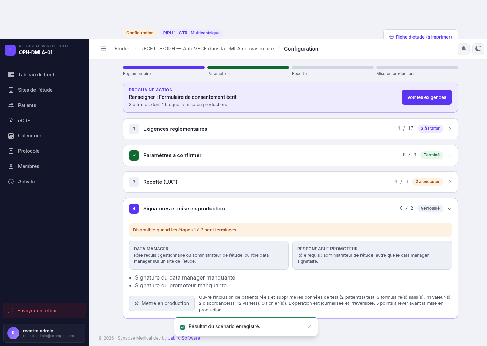

**Ce que vous devez voir**

- [ ] Le volet 3 ne peut pas se terminer pour une étude en aveugle (les scénarios de levée d'aveugle et de randomisation ne peuvent pas être déclarés « Réussi »), donc le volet 4 reste verrouillé.
- [ ] Le volet 4 est « Verrouillé » tant que les volets 1 à 3 ne sont pas terminés : « Disponible quand les étapes 1 à 3 sont terminées. »
- [ ] Le bouton **Mettre en production** est grisé et indique le nombre de points à lever avant la mise en production.
- [ ] **Ne cherchez pas à aller plus loin** : pour une étude en aveugle, la mise en production est impossible tant que la levée d'aveugle d'urgence n'existe pas. La recette s'arrête ici.

## Problèmes connus

| Où | Ce que vous verrez | Suivi |
|----|--------------------|-------|
| Levée d'aveugle d'urgence | La procédure n'existe pas encore. Les réglages saisis à l'étape 4 (rôles autorisés, notification, arrêt du traitement) sont enregistrés mais pas appliqués. Le scénario de recette correspondant ne peut pas être déclaré « Réussi » (« Procédure pas encore disponible »). | #314 |
| Mise en production | Une étude en aveugle ne peut pas être mise en production tant que la levée d'aveugle n'existe pas : la recette s'arrête avant le volet 4. | #314 |
| Export SDTM | L'export CDISC (SDTM) n'existe pas ; il est remplacé par l'export des données de test (CSV et Excel). L'export CDISC ODM n'existe pas non plus. | #337 |
| Randomisation | Les réglages (ratio, blocs, strates) sont enregistrés mais aucun code n'attribue de bras à un patient ; le statut « Randomisée » ne tire aucun bras. Le scénario « Randomisation test » est grisé (« Attribution des bras pas encore disponible »). | #348 |
| Import | Un fichier sans pression intraoculaire est refusé par les formulaires d'ophtalmologie ; le fichier de cette page en contient une pour chaque patient. | #356 |
| Sites | Il est arrivé que le médecin responsable du second site soit refusé à l'étape 6 sans cause établie : si c'est le cas, signalez-le avec l'heure. | #373 |
| Raison du changement | La justification d'une modification peut être contournée en annulant la fenêtre. | #377 |
| Cases à cocher | L'avancement « valeurs saisies » compte les interrupteurs « Oui / Non » laissés sur « Non ». | #378 |
| Visites | Après la saisie d'un suivi, la visite affiche sa date prévue comme date de réalisation. | #379 |
| Import | La date d'inclusion est déduite à l'import. | #380 |
| Invitations | Le bouton corbeille d'une invitation refusée peut rester inactif ; sortie : « Précédent » puis « Continuer ». | #381 |
| Dates | Le format des dates suit celui du navigateur : utilisez un navigateur en français. | #375 |
| Import | Seul le format large (une ligne par patient, colonnes `_od` et `_os`) est lu ; l'export « une ligne par œil » ne se réimporte pas. Les patients importés ne sont pas des patients de test. | — |

Un point marqué « — » n'a pas de ticket au moment de l'écriture : décrivez-le s'il diffère de ce tableau.

## Signaler un problème

Pour chaque anomalie, envoyez ces informations avec une capture d'écran :

```text
Étape du plan : (numéro et titre)
Adresse de la page : https://…/…
Ce que j'ai fait : (valeurs saisies)
Ce que j'attendais :
Ce qui s'est passé : (message exact, capture)
Navigateur et heure :
```

Les cases cochées ne sont pas enregistrées par l'application : notez vos résultats (réussi ou échec) étape par étape dans votre compte rendu.
